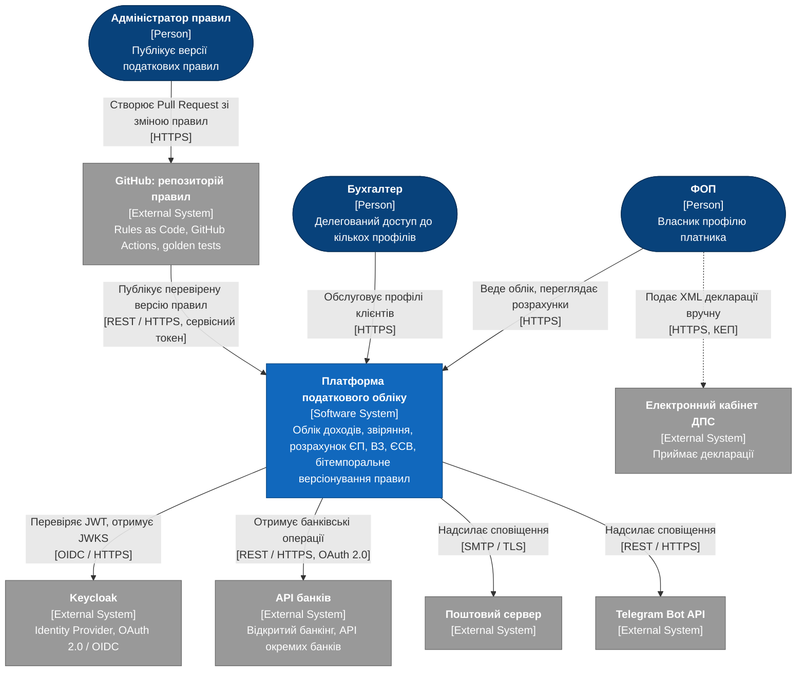
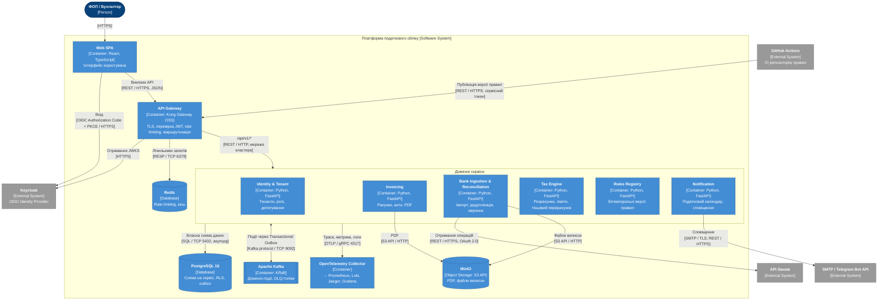
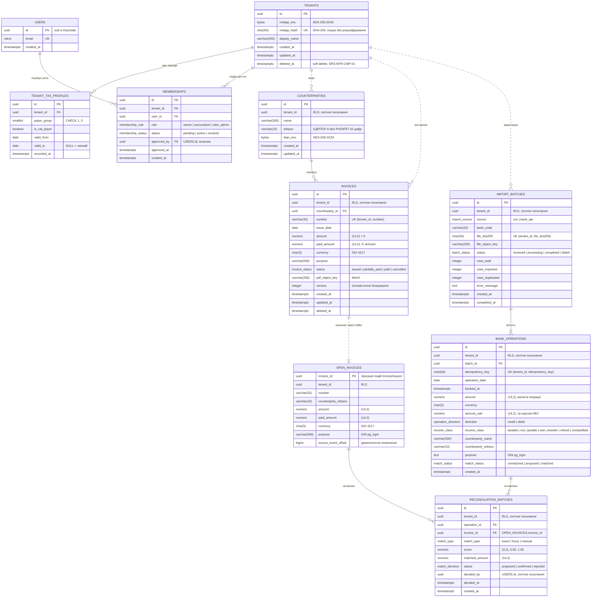
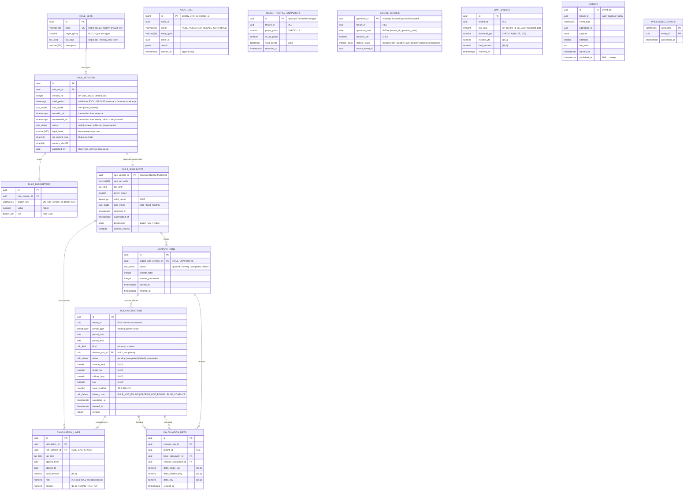
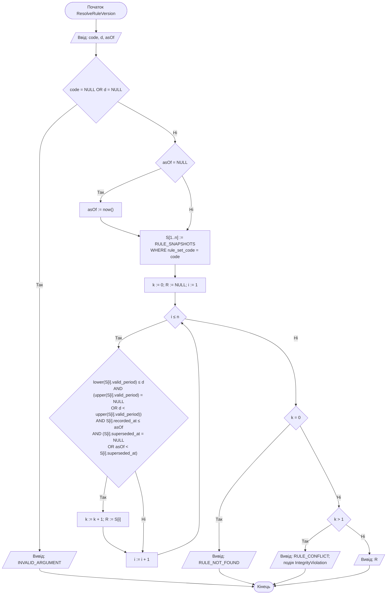
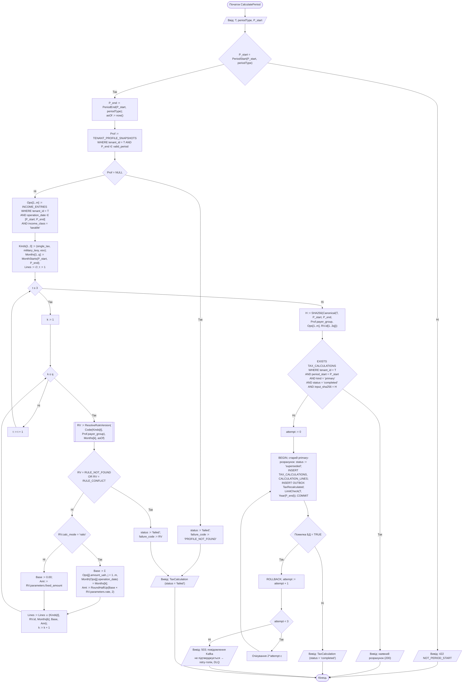
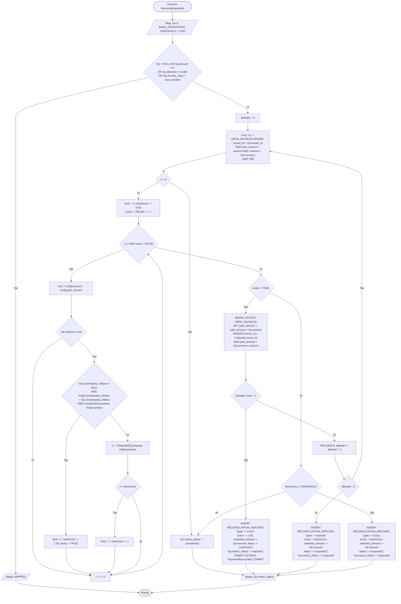

# РОЗДІЛ 2. ПРОЄКТУВАННЯ АРХІТЕКТУРИ СИСТЕМИ

Архітектуру описано за моделлю C4 (рівні Context, Container, Component) у форматі Diagrams-as-Code (Mermaid.js). Діаграми використовують нотацію C4 (стереотипи Person, Software System, Container, Component, External System; протокол на кожному зв'язку) і побудовані синтаксисом `flowchart`, оскільки експериментальний синтаксис C4 у Mermaid не забезпечує читабельного компонування для 15+ елементів. Підрозділи 2.4–2.7 деталізують шар даних (ERD), міжсервісні контракти ([api/openapi.yaml](api/openapi.yaml)), алгоритми критичних вузлів та інтеграційний аудит. Вимоги, на які посилаються описи, наведено в [srs.md](srs.md), архітектурні рішення — у каталозі [adr/](adr/).

## 2.1. Контекстне та контейнерне моделювання системи (C4 Model)

### 2.1.1. C4 Level 1: System Context

**Опис елементів і зв'язків.**

| Елемент | Тип | Роль |
|---|---|---|
| ФОП | Person | Веде облік доходів і переглядає розрахунки ([SRS-FUN-05](srs.md#srs-fun-05), [SRS-FUN-14](srs.md#srs-fun-14)) |
| Бухгалтер | Person | Обслуговує делеговані профілі ([SRS-FUN-03](srs.md#srs-fun-03)) |
| Адміністратор правил | Person | Вносить зміни правил через Pull Request у репозиторій правил ([SRS-FUN-19](srs.md#srs-fun-19)) |
| Платформа податкового обліку | Software System | Система, що проєктується |
| Keycloak | External System | Видає й підписує JWT за OAuth 2.0 / OIDC ([SRS-NFR-SEC-01](srs.md#srs-nfr-sec-01)) |
| API банків | External System | Джерело банківських операцій ([SRS-FUN-09](srs.md#srs-fun-09)) |
| GitHub: репозиторій правил | External System | Зберігає правила як код, виконує golden tests і публікує версію ([SRS-NFR-COR-01](srs.md#srs-nfr-cor-01)) |
| Поштовий сервер, Telegram Bot API | External System | Канали доставки сповіщень ([SRS-FUN-24](srs.md#srs-fun-24)) |
| Електронний кабінет ДПС | External System | Приймає XML декларації, який користувач подає самостійно ([SRS-FUN-17](srs.md#srs-fun-17)); пряма інтеграція поза межами системи |

Протоколи: користувачі звертаються до платформи через HTTPS; публікація правил із CI — REST / HTTPS із сервісним токеном; перевірка токенів — OIDC / HTTPS (JWKS); отримання банківських даних — REST / HTTPS з авторизацією OAuth 2.0; сповіщення — SMTP / TLS і REST / HTTPS.

### 2.1.2. C4 Level 2: Container Diagram

**Опис контейнерів.**

| Контейнер | Технологія | Відповідальність і трасування |
|---|---|---|
| Web SPA | React, TypeScript | Інтерфейс користувача; вхід за OIDC Authorization Code + PKCE |
| API Gateway | Kong Gateway OSS | Термінація TLS 1.3, перевірка підпису JWT за JWKS, обмеження 100 запитів/хв на користувача з лічильниками в Redis, маршрутизація `/api/v1/*` ([SRS-NFR-SEC-04](srs.md#srs-nfr-sec-04), [SRS-NFR-SEC-05](srs.md#srs-nfr-sec-05), [SRS-NFR-MNT-02](srs.md#srs-nfr-mnt-02)) |
| Identity & Tenant | Python, FastAPI | Тенанти, ролі, делегування ([SRS-FUN-01](srs.md#srs-fun-01) – [SRS-FUN-04](srs.md#srs-fun-04)) |
| Invoicing | Python, FastAPI | Рахунки, акти, PDF у MinIO, статус оплати за подією `PaymentReconciled` ([SRS-FUN-05](srs.md#srs-fun-05) – [SRS-FUN-07](srs.md#srs-fun-07)) |
| Bank Ingestion & Reconciliation | Python, FastAPI | Імпорт CSV і API банків, ключ ідемпотентності, Circuit Breaker, звіряння ([SRS-FUN-08](srs.md#srs-fun-08) – [SRS-FUN-13](srs.md#srs-fun-13), [SRS-NFR-REL-05](srs.md#srs-nfr-rel-05)) |
| Tax Engine | Python, FastAPI | Розрахунок ЄП, ВЗ, ЄСВ, відтворюваність, ліміти, тіньовий перерахунок і diff-звіти ([SRS-FUN-14](srs.md#srs-fun-14) – [SRS-FUN-18](srs.md#srs-fun-18), [SRS-FUN-21](srs.md#srs-fun-21), [SRS-FUN-22](srs.md#srs-fun-22)); деталізацію наведено на [C4 Component](#diagram-level3) |
| Rules Registry | Python, FastAPI | Бітемпоральні версії правил, заборона змін опублікованих версій, журнал аудиту ([SRS-FUN-19](srs.md#srs-fun-19), [SRS-FUN-20](srs.md#srs-fun-20), [SRS-FUN-25](srs.md#srs-fun-25)) |
| Notification | Python, FastAPI | Податковий календар, email і Telegram ([SRS-FUN-23](srs.md#srs-fun-23), [SRS-FUN-24](srs.md#srs-fun-24)) |
| Apache Kafka | KRaft | Транспорт доменних подій, retry- і DLQ-топіки, ≥ 6 партицій із ключем `tenant_id` ([SRS-NFR-SCAL-02](srs.md#srs-nfr-scal-02), [SRS-NFR-REL-03](srs.md#srs-nfr-rel-03)); вибір обґрунтовано в [ADR-001](adr/0001-choice-of-technology.md) |
| PostgreSQL 16 | Database | Окрема схема та роль на сервіс, RLS, таблиці outbox і processed_events, PITR ([SRS-NFR-SEC-03](srs.md#srs-nfr-sec-03), [SRS-NFR-REL-04](srs.md#srs-nfr-rel-04)) |
| Redis | Database | Лічильники rate limiting, кеш моделей читання |
| MinIO | S3 API | PDF документів і вихідні файли виписок |
| OpenTelemetry Collector | OTel | Приймає траси, метрики й логи та передає їх до Prometheus, Loki, Jaeger, Grafana ([SRS-NFR-OBS-01](srs.md#srs-nfr-obs-01), [SRS-NFR-OBS-02](srs.md#srs-nfr-obs-02)) |

**Потоки подій.** Identity & Tenant публікує `TaxProfileChanged`, який споживає Tax Engine; Invoicing публікує `InvoiceIssued`, який споживає Bank Ingestion для проєкції відкритих рахунків; Bank Ingestion публікує `StatementImported`, `IncomeOperationRecorded` і `PaymentReconciled`; Tax Engine споживає `IncomeOperationRecorded`, Invoicing — `PaymentReconciled`; Rules Registry публікує `RuleSetPublished`, який споживає Tax Engine; Tax Engine публікує `TaxRecalculated` і `LimitThresholdReached`, які споживає Notification. Кожен сервіс записує події до власної таблиці outbox у транзакції зміни даних, а фоновий процес OutboxRelay публікує їх до Kafka ([SRS-NFR-REL-02](srs.md#srs-nfr-rel-02)). Сервіси не звертаються до схем даних інших сервісів: потрібні дані зберігаються як локальні проєкції подій (підрозділ 2.4).

**Протоколи.** Зовнішні виклики — REST / HTTPS з JSON; внутрішня маршрутизація від шлюзу — REST / HTTP у мережі кластера, обмеженій політиками Kubernetes NetworkPolicy; доступ до PostgreSQL — SQL / TCP 5432 (asyncpg); Kafka — Kafka protocol / TCP 9092; Redis — RESP / TCP 6379; MinIO — S3 API / HTTP; телеметрія — OTLP / gRPC 4317.

## 2.2. Компонентне моделювання критичного сервісу системи

### 2.2.1. C4 Level 3: Component Diagram — Tax Engine Service

Для декомпозиції обрано Tax Engine Service, оскільки він містить основне обчислювальне навантаження і реалізує ключові вимоги темпоральної коректності та відтворюваності.

```mermaid
flowchart TB
  gw["<b>API Gateway</b><br/>[Container: Kong]"]
  kin[["<b>Apache Kafka</b><br/>[Container]<br/>IncomeOperationRecorded, TaxProfileChanged, RuleSetPublished"]]
  subgraph te["Tax Engine Service [Container: Python 3.12, FastAPI]"]
    subgraph inbound["Inbound: адаптери входу"]
      mw["<b>Middleware Pipeline</b><br/>[Component: ASGI middleware]<br/>Correlation ID, OpenTelemetry, Global Error Handler (RFC 9457)"]
      auth["<b>AuthGuard</b><br/>[Component: FastAPI Depends]<br/>Перевірка JWT RS256, RBAC"]
      tctx["<b>TenantContext</b><br/>[Component: FastAPI Depends]<br/>SET app.tenant_id для RLS"]
      api["<b>TaxController</b><br/>[Component: FastAPI Router]<br/>/api/v1/tax-calculations, /api/v1/shadow-runs, DTO Pydantic v2"]
      cons["<b>EventConsumer</b><br/>[Component: aiokafka]<br/>Десеріалізація та валідація подій"]
      idem["<b>IdempotencyGuard</b><br/>[Component]<br/>Таблиця processed_events"]
    end
    subgraph core["Core: прикладний і доменний шар"]
      uc["<b>CalculationUseCase</b><br/>[Component: Application Service]<br/>Оркестрація розрахунку періоду"]
      shadow["<b>ShadowRecalculationUseCase</b><br/>[Component: Application Service]<br/>Тіньовий перерахунок, diff-звіт"]
      resolver["<b>RuleResolver</b><br/>[Component: Domain Service]<br/>Вибір версії правил за датою операції"]
      calc["<b>TaxCalculators</b><br/>[Component: Strategy]<br/>SingleTax, MilitaryLevy, SocialContribution; Decimal"]
      limit["<b>LimitMonitor</b><br/>[Component: Domain Service]<br/>Пороги 80/95/100 %"]
      hasher["<b>InputHasher</b><br/>[Component]<br/>SHA-256 канонічного входу"]
      ports{{"<b>Ports</b><br/>[Interfaces: typing.Protocol]<br/>RuleSnapshotPort, CalculationRepoPort, UnitOfWork, EventPublisherPort"}}
    end
    subgraph outbound["Outbound: адаптери виходу"]
      rulerepo["<b>RuleSnapshotRepository</b><br/>[Component: SQLAlchemy 2.0]<br/>Локальна проєкція версій правил"]
      calcrepo["<b>CalculationRepository</b><br/>[Component: SQLAlchemy 2.0]<br/>Результати, diff-звіти"]
      uow["<b>SqlAlchemyUnitOfWork</b><br/>[Component]<br/>Одна транзакція: результат + outbox"]
      outbox["<b>OutboxRelay</b><br/>[Component: фоновий worker]<br/>Публікація з outbox, retry, DLQ"]
    end
  end
  pg[("<b>PostgreSQL 16</b><br/>[Database]<br/>схема tax_engine, RLS")]
  kout[["<b>Apache Kafka</b><br/>[Container]<br/>TaxRecalculated, LimitThresholdReached, DLQ"]]
  gw -->|"[REST / HTTP]"| mw
  mw -->|"ASGI call chain"| api
  api -->|"Depends()"| auth
  api -->|"Depends()"| tctx
  api -->|"Виклик use case через DI"| uc
  api -->|"Виклик use case через DI"| shadow
  kin -->|"[Kafka protocol / TCP 9092]"| cons
  cons -->|"Перевірка event_id"| idem
  cons -->|"Виклик use case через DI"| uc
  cons -->|"RuleSetPublished"| shadow
  uc --> resolver
  uc --> calc
  uc --> limit
  uc --> hasher
  shadow --> resolver
  shadow --> calc
  resolver -->|"через RuleSnapshotPort"| ports
  uc -->|"через UnitOfWork, CalculationRepoPort"| ports
  shadow -->|"через RuleSnapshotPort, CalculationRepoPort"| ports
  rulerepo -.->|"реалізує"| ports
  calcrepo -.->|"реалізує"| ports
  uow -.->|"реалізує"| ports
  idem -->|"через UnitOfWork"| ports
  rulerepo -->|"[SQL / TCP 5432]"| pg
  calcrepo -->|"[SQL / TCP 5432]"| pg
  uow -->|"[SQL / TCP 5432]"| pg
  outbox -->|"Читає outbox [SQL / TCP 5432]"| pg
  outbox -->|"[Kafka protocol / TCP 9092]"| kout
  classDef container fill:#438dd5,stroke:#2e6295,color:#ffffff
  classDef comp fill:#85bbf0,stroke:#5d82a8,color:#000000
  classDef port fill:#ffffff,stroke:#5d82a8,color:#000000
  classDef db fill:#438dd5,stroke:#2e6295,color:#ffffff
  class gw,kin,kout container
  class mw,auth,tctx,api,cons,idem,uc,shadow,resolver,calc,limit,hasher,rulerepo,calcrepo,uow,outbox comp
  class ports port
  class pg db
```

**Опис компонентів.**

| Шар | Компонент | Роль і взаємодія |
|---|---|---|
| Inbound | Middleware Pipeline | ASGI-middleware: correlation ID, інструментування OpenTelemetry, глобальний обробник помилок із відповіддю у форматі RFC 9457 (Problem Details) ([SRS-NFR-OBS-01](srs.md#srs-nfr-obs-01)) |
| Inbound | AuthGuard | Залежність FastAPI `Depends()`: перевірка JWT RS256 і ролей за політикою deny-by-default ([SRS-NFR-SEC-01](srs.md#srs-nfr-sec-01), [SRS-NFR-SEC-02](srs.md#srs-nfr-sec-02)) |
| Inbound | TenantContext | Встановлює `app.tenant_id` у сесії PostgreSQL для політик RLS ([SRS-FUN-04](srs.md#srs-fun-04)) |
| Inbound | TaxController | Маршрути `/api/v1/tax-calculations` і `/api/v1/shadow-runs` ([openapi.yaml](api/openapi.yaml)), валідація DTO Pydantic v2; викликає лише use case, без доступу до репозиторіїв |
| Inbound | EventConsumer | Споживач aiokafka для `IncomeOperationRecorded`, `TaxProfileChanged` і `RuleSetPublished`; валідація схем подій |
| Inbound | IdempotencyGuard | Перевіряє `event_id` у таблиці `processed_events` у транзакції обробки ([SRS-NFR-REL-02](srs.md#srs-nfr-rel-02)) |
| Core | CalculationUseCase | Оркеструє розрахунок періоду ([SRS-FUN-14](srs.md#srs-fun-14)) |
| Core | ShadowRecalculationUseCase | Оновлює проєкцію правил, виконує тіньовий перерахунок і формує diff-звіт ([SRS-FUN-21](srs.md#srs-fun-21), [SRS-FUN-22](srs.md#srs-fun-22)) |
| Core | RuleResolver | Вибирає версію правил, чинну на дату операції, з урахуванням transaction time ([SRS-FUN-14](srs.md#srs-fun-14)) |
| Core | TaxCalculators | Стратегії SingleTax, MilitaryLevy, SocialContribution на `Decimal` ([SRS-NFR-COR-02](srs.md#srs-nfr-cor-02)) |
| Core | LimitMonitor | Пороги 80/95/100 % ліміту доходу ([SRS-FUN-18](srs.md#srs-fun-18)) |
| Core | InputHasher | SHA-256 канонічного подання вхідних даних ([SRS-FUN-15](srs.md#srs-fun-15), [SRS-FUN-16](srs.md#srs-fun-16)) |
| Core | Ports | Інтерфейси `typing.Protocol`: RuleSnapshotPort, CalculationRepoPort, UnitOfWork, EventPublisherPort; ядро залежить лише від них (Dependency Inversion) |
| Outbound | RuleSnapshotRepository | Локальна проєкція версій правил, оновлювана з подій `RuleSetPublished`; усуває синхронну залежність від Rules Registry під час розрахунку |
| Outbound | CalculationRepository | Збереження результатів з ідентифікатором версії правил і хешем, diff-звітів |
| Outbound | SqlAlchemyUnitOfWork | Одна транзакція для результату розрахунку та запису до outbox (реалізує EventPublisherPort) |
| Outbound | OutboxRelay | Фоновий процес: публікація з outbox, повторні спроби з експоненційною затримкою, DLQ ([SRS-NFR-REL-03](srs.md#srs-nfr-rel-03)) |

**Взаємодія всередині процесу.** Залежності впроваджуються через механізм `Depends()` FastAPI та композиційний корінь застосунку; ядро не імпортує SQLAlchemy, aiokafka чи FastAPI. Зв'язки між шарами спрямовані лише всередину: Inbound → Core → Ports ← Outbound.

## 2.3. Документування архітектурних рішень (Architecture Decision Records)

| ADR | Рішення | Статус |
|---|---|---|
| [ADR-001](adr/0001-choice-of-technology.md) | Вибір Apache Kafka (KRaft) як брокера доменних подій | Approved |

## 2.4. Проєктування та моделювання баз даних

Шар збереження даних реалізовано в PostgreSQL 16 за принципом Data-as-Code: схему описано кодом Mermaid.js (`erDiagram`, нотація Crow's Foot), що зберігається в репозиторії разом із документацією. Відповідно до C4 Container ([2.1.2](#diagram-level2)) кожен сервіс має власну схему й роль БД: `identity`, `invoicing`, `ingestion`, `rules_registry`, `tax_engine`.

Прийняті угоди проєктування:

- **Первинні ключі** — `uuid` (UUIDv7, генерується застосунком): не розкриває кількість записів, не потребує координації між сервісами, а впорядкованість за часом зменшує фрагментацію B-Tree.
- **Грошові суми** — `numeric(14,2)`, ставки — `numeric(7,4)`; тип `float` не використовується ([SRS-NFR-COR-02](srs.md#srs-nfr-cor-02)).
- **Час** — `timestamptz` в UTC; юридичні дати — `date`; періоди дії — `daterange` з напіввідкритими межами `[from, to)`.
- **Статуси** — типи `ENUM` PostgreSQL; значення збігаються з переліками в [openapi.yaml](api/openapi.yaml).
- **Мультитенантність** — кожна таблиця з даними платника містить `tenant_id` і політику RLS `tenant_id = current_setting('app.tenant_id')::uuid` ([SRS-FUN-04](srs.md#srs-fun-04), [SRS-NFR-SEC-03](srs.md#srs-nfr-sec-03)).
- **Межі сервісів** — зовнішні ключі (суцільні лінії) існують лише всередині однієї схеми. Посилання між схемами (пунктирні лінії) є логічними: дані іншого сервісу зберігаються як локальна проєкція, що оновлюється з подій Kafka ([ADR-001](adr/0001-choice-of-technology.md)).
- **Технічні таблиці** `OUTBOX` і `PROCESSED_EVENTS` створюються в кожній схемі за однаковою структурою (Transactional Outbox та ідемпотентні консюмери, [SRS-NFR-REL-02](srs.md#srs-nfr-rel-02)).

### 2.4.1. Схеми Identity & Tenant, Invoicing, Bank Ingestion & Reconciliation

### 2.4.2. Схеми Rules Registry і Tax Engine

### 2.4.3. Специфікація таблиць

Таблиця 2.4 – Специфікація таблиць схеми `identity`

| Таблиця | Поле | Тип | Обмеження | Призначення |
|---|---|---|---|---|
| TENANTS | id | uuid | PK | Ідентифікатор тенанта (платника) |
| | rnokpp_enc | bytea | NOT NULL | РНОКПП, зашифрований AES-256-GCM ([SRS-NFR-SEC-04](srs.md#srs-nfr-sec-04)) |
| | rnokpp_hash | char(64) | UNIQUE | SHA-256 від РНОКПП для пошуку без розшифрування |
| | display_name | varchar(200) | NOT NULL | Назва профілю |
| | created_at, updated_at, deleted_at | timestamptz | deleted_at NULL | Технічні поля; soft delete з фізичним видаленням через 30 днів ([SRS-NFR-CMP-01](srs.md#srs-nfr-cmp-01)) |
| TENANT_TAX_PROFILES | id, tenant_id | uuid | PK; FK → TENANTS | Податковий профіль у часі |
| | payer_group | smallint | CHECK 1..3 | Група платника ЄП |
| | is_vat_payer | boolean | NOT NULL | Статус платника ПДВ (впливає на ставку ЄП 3 групи) |
| | valid_from, valid_to | date | valid_to NULL = чинний; EXCLUDE перетину періодів | Період дії профілю |
| | recorded_at | timestamptz | NOT NULL | Момент реєстрації зміни |
| USERS | id | uuid | PK | Значення `sub` із JWT Keycloak |
| | email | citext | UNIQUE | Електронна пошта без урахування регістру |
| MEMBERSHIPS | id, tenant_id, user_id | uuid | PK; FK; UNIQUE (tenant_id, user_id) | Членство користувача в тенанті ([SRS-FUN-02](srs.md#srs-fun-02)) |
| | role | membership_role | owner, accountant, rules_admin | Роль RBAC |
| | status | membership_status | pending, active, revoked | Доступ бухгалтера активується після підтвердження власником ([SRS-FUN-03](srs.md#srs-fun-03)) |
| | approved_by, approved_at | uuid, timestamptz | FK → USERS | Хто й коли підтвердив доступ |

Таблиця 2.5 – Специфікація таблиць схем `invoicing` та `ingestion`

| Таблиця | Поле | Тип | Обмеження | Призначення |
|---|---|---|---|---|
| COUNTERPARTIES | id, tenant_id | uuid | PK; RLS | Контрагент платника |
| | name, edrpou | varchar(300), varchar(10) | CHECK edrpou ~ '^\d{8}(\d{2})?$' | Назва та код ЄДРПОУ / РНОКПП |
| | iban_enc | bytea | — | IBAN, зашифрований AES-256-GCM |
| INVOICES | id, tenant_id, counterparty_id | uuid | PK; RLS; FK → COUNTERPARTIES | Рахунок-фактура або акт ([SRS-FUN-05](srs.md#srs-fun-05)) |
| | number | varchar(32) | UNIQUE (tenant_id, number) | Номер документа, використовується для точного зіставлення |
| | amount, paid_amount | numeric(14,2) | CHECK amount > 0 AND paid_amount BETWEEN 0 AND amount | Сума та оплачена частина ([SRS-FUN-13](srs.md#srs-fun-13)) |
| | currency | char(3) | ISO 4217 | Валюта документа |
| | status | invoice_status | issued, partially_paid, paid, cancelled | Статус оплати ([SRS-FUN-07](srs.md#srs-fun-07)) |
| | pdf_object_key | varchar(200) | — | Ключ PDF у MinIO ([SRS-FUN-06](srs.md#srs-fun-06)) |
| | version | integer | NOT NULL DEFAULT 1 | Оптимістичне блокування |
| IMPORT_BATCHES | id, tenant_id | uuid | PK; RLS | Пакет імпорту виписки ([SRS-FUN-08](srs.md#srs-fun-08)) |
| | file_sha256 | char(64) | UNIQUE (tenant_id, file_sha256) | Захист від повторного завантаження файлу |
| | status | batch_status | received, processing, completed, failed | Стан обробки |
| | rows_total, rows_imported, rows_duplicated | integer | CHECK ≥ 0 | Статистика пакета |
| BANK_OPERATIONS | id, tenant_id, batch_id | uuid | PK; RLS; FK → IMPORT_BATCHES | Банківська операція |
| | idempotency_key | char(64) | UNIQUE (tenant_id, idempotency_key) | SHA-256 від (банк, рахунок, ідентифікатор операції в банку, дата, сума) ([SRS-FUN-10](srs.md#srs-fun-10)) |
| | amount, amount_uah | numeric(14,2) | CHECK amount > 0 | Сума у валюті операції та в гривнях за курсом НБУ |
| | direction, income_class | ENUM | — | Напрям і класифікація доходу для Tax Engine |
| | purpose | text | GIN (pg_trgm) | Призначення платежу для нечіткого зіставлення |
| | match_status | match_status | unmatched, proposed, matched | Стан звіряння |
| OPEN_INVOICES | invoice_id | uuid | PK | Проєкція відкритих рахунків із подій `InvoiceIssued` і `PaymentReconciled` |
| | amount, paid_amount, currency, number, counterparty_edrpou, purpose | — | Як в INVOICES | Поля, потрібні алгоритму 2.6.3 |
| | source_event_offset | bigint | — | Offset останньої застосованої події (ідемпотентне оновлення) |
| RECONCILIATION_MATCHES | id, tenant_id, operation_id, invoice_id | uuid | PK; RLS; FK → BANK_OPERATIONS, OPEN_INVOICES | Збіг операції з рахунком ([SRS-FUN-11](srs.md#srs-fun-11)) |
| | match_type | match_type | exact, fuzzy, manual | Спосіб зіставлення |
| | score | numeric(3,2) | CHECK 0.00..1.00 | Коефіцієнт схожості ([SRS-FUN-12](srs.md#srs-fun-12)) |
| | matched_amount | numeric(14,2) | CHECK > 0 | Сума, віднесена на рахунок |
| | status, decided_by, decided_at | ENUM, uuid, timestamptz | proposed, confirmed, rejected | Рішення ручної черги |

Таблиця 2.6 – Специфікація таблиць схем `rules_registry` та `tax_engine`

| Таблиця | Поле | Тип | Обмеження | Призначення |
|---|---|---|---|---|
| RULE_SETS | id, code | uuid, varchar(64) | PK; UNIQUE code | Набір правил (`single_tax.g3`, `military_levy.g3`, `esv`) |
| | tax_kind, payer_group | ENUM, smallint | payer_group NULL = для всіх груп | Вид податку й група |
| RULE_VERSIONS | id, rule_set_id | uuid | PK; FK → RULE_SETS; UNIQUE (rule_set_id, version_no) | Версія правила ([SRS-FUN-19](srs.md#srs-fun-19)) |
| | valid_period | daterange | EXCLUDE USING gist (rule_set_id WITH =, valid_period WITH &&) WHERE status = 'published' AND superseded_at IS NULL; CHECK lower(valid_period) = date_trunc('month', lower(valid_period)) | Valid time; початок завжди перше число місяця |
| | recorded_at, superseded_at | timestamptz | superseded_at NULL = актуальний запис | Transaction time |
| | calc_mode | calc_mode | ratio, fixed_monthly | Спосіб розрахунку: відсоток від доходу або фіксована місячна сума |
| | status | rule_status | draft, review, published, superseded | Цикл публікації; тригер забороняє UPDATE опублікованої версії ([SRS-FUN-20](srs.md#srs-fun-20)) |
| | legal_basis, git_commit_sha, content_sha256 | varchar(500), char(40), char(64) | NOT NULL для published | Нормативна підстава та прив'язка до коміту Rules as Code |
| RULE_PARAMETERS | id, rule_version_id | uuid | PK; FK → RULE_VERSIONS; UNIQUE (rule_version_id, param_key) | Параметр версії |
| | param_key, value, unit | varchar(64), numeric(18,6), ENUM | unit: ratio, uah | `rate`, `fixed_amount`, `income_limit` |
| AUDIT_LOG | id | bigint identity | PK; ролі застосунку дозволено лише INSERT | Журнал публікацій і перерахунків ([SRS-FUN-25](srs.md#srs-fun-25), [SRS-NFR-AUD-01](srs.md#srs-nfr-aud-01)) |
| RULE_SNAPSHOTS | rule_version_id | uuid | PK | Проєкція опублікованих версій із `RuleSetPublished`; параметри — `jsonb` |
| TENANT_PROFILE_SNAPSHOTS | id, tenant_id | uuid | PK; RLS; EXCLUDE перетину valid_period | Проєкція податкового профілю з `TaxProfileChanged` |
| INCOME_ENTRIES | operation_id | uuid | PK | Проєкція операцій із `IncomeOperationRecorded`: дата, сума в гривнях, клас доходу |
| TAX_CALCULATIONS | id, tenant_id, shadow_run_id | uuid | PK; RLS; FK → SHADOW_RUNS | Розрахунок за період ([SRS-FUN-14](srs.md#srs-fun-14)) |
| | period_type, period_start, period_end | ENUM, date, date | CHECK period_start ≤ period_end; UNIQUE (tenant_id, period_start, kind) WHERE status = 'completed' AND kind = 'primary' | Податковий період |
| | income_total, single_tax, military_levy, esv | numeric(14,2) | NULL до завершення | Підсумки |
| | input_sha256 | char(64) | NOT NULL для completed | Хеш вхідних даних ([SRS-FUN-15](srs.md#srs-fun-15)) |
| | status, failure_code | ENUM | pending, completed, failed, superseded; RULE_NOT_FOUND, PROFILE_NOT_FOUND, RULE_CONFLICT | Стан і причина відмови |
| CALCULATION_LINES | id, calculation_id, rule_version_id | uuid | PK; FK → TAX_CALCULATIONS, RULE_SNAPSHOTS | Рядок розрахунку за місяцем і версією правил ([SRS-FUN-16](srs.md#srs-fun-16)) |
| | base_amount, rate, amount | numeric(14,2), numeric(7,4), numeric(14,2) | rate NULL для fixed_monthly | База, ставка, сума (ROUND_HALF_UP) |
| SHADOW_RUNS | id, trigger_rule_version_id | uuid | PK; FK → RULE_SNAPSHOTS | Тіньовий перерахунок ([SRS-FUN-21](srs.md#srs-fun-21)) |
| CALCULATION_DIFFS | id, shadow_run_id, base_calculation_id, shadow_calculation_id | uuid | PK; FK | Різниця «було / стало» ([SRS-FUN-22](srs.md#srs-fun-22)); період береться з базового розрахунку |
| LIMIT_EVENTS | id, tenant_id | uuid | PK; RLS; UNIQUE (tenant_id, tax_year, threshold_pct) | Досягнення порогів 80/95/100 % ліміту ([SRS-FUN-18](srs.md#srs-fun-18)) |
| OUTBOX | id | uuid | PK (= event_id) | Подія до публікації; `published_at` NULL — очікує OutboxRelay |
| PROCESSED_EVENTS | consumer, event_id | varchar(64), uuid | PK (consumer, event_id) | Захист від повторної обробки подій |

### 2.4.4. План індексування

Таблиця 2.7 – Індекси для оптимізації швидкодії

| Індекс | Таблиця | Тип | Запит, який прискорюється | Вимога |
|---|---|---|---|---|
| (tenant_id, idempotency_key) UNIQUE | BANK_OPERATIONS | B-Tree | Відхилення дубліката при імпорті | [SRS-FUN-10](srs.md#srs-fun-10) |
| (tenant_id, operation_date) | BANK_OPERATIONS, INCOME_ENTRIES | B-Tree | Вибірка операцій за період для розрахунку | [SRS-NFR-PERF-05](srs.md#srs-nfr-perf-05) |
| purpose gin_trgm_ops | BANK_OPERATIONS, OPEN_INVOICES | GIN (pg_trgm) | `similarity()` для нечіткого зіставлення | [SRS-FUN-12](srs.md#srs-fun-12) |
| (tenant_id, currency) WHERE paid_amount < amount | OPEN_INVOICES | B-Tree, частковий | Пошук відкритих рахунків (алгоритм 2.6.3) | [SRS-FUN-11](srs.md#srs-fun-11) |
| (rule_set_id, valid_period) | RULE_VERSIONS | GiST | Обмеження EXCLUDE і пошук версії за датою | [SRS-FUN-19](srs.md#srs-fun-19) |
| (rule_set_code, valid_period) | RULE_SNAPSHOTS | GiST | Алгоритм 2.6.1 (`valid_period @> d`) | [SRS-FUN-14](srs.md#srs-fun-14) |
| (tenant_id, period_start, kind) UNIQUE, частковий | TAX_CALCULATIONS | B-Tree | Один чинний розрахунок на період; пошук за хешем | [SRS-FUN-16](srs.md#srs-fun-16) |
| (calculation_id) | CALCULATION_LINES | B-Tree | Читання рядків розрахунку | [SRS-NFR-PERF-01](srs.md#srs-nfr-perf-01) |
| (shadow_run_id, tenant_id) | CALCULATION_DIFFS | B-Tree | Сторінка звіту «було / стало» | [SRS-FUN-22](srs.md#srs-fun-22) |
| (created_at) WHERE published_at IS NULL | OUTBOX | B-Tree, частковий | Вибірка подій для OutboxRelay без сканування опублікованих | [SRS-NFR-REL-03](srs.md#srs-nfr-rel-03) |
| (created_at) | AUDIT_LOG | BRIN | Діапазонні запити до журналу, що лише доповнюється | [SRS-NFR-AUD-01](srs.md#srs-nfr-aud-01) |

Індекси для `tenant_id` у складених ключах розміщено першим стовпцем, оскільки всі запити виконуються в контексті одного тенанта через RLS.

## 2.5. Специфікація міжсервісних контрактів (API)

Контракти розроблено за підходом API-First Design у форматі OpenAPI 3.0.3. Деталізовану специфікацію ендпоінтів, схем запитів, відповідей і помилок зафіксовано у файлі [openapi.yaml](api/openapi.yaml). Файл пройшов перевірку `openapi-spec-validator` і `redocly lint` без помилок і придатний для генерації серверних стабів FastAPI та клієнтського SDK TypeScript для Web SPA.

Інтерфейси реалізовано між такими контейнерами C4 Container ([2.1.2](#diagram-level2)):

Таблиця 2.8 – Ендпоінти публічного API

| Метод і шлях | Контейнери | Бізнес-сценарій | Ролі | Відповіді |
|---|---|---|---|---|
| `POST /api/v1/bank-statements` | Web SPA → API Gateway → Bank Ingestion | Завантаження CSV-виписки, асинхронний імпорт ([SRS-FUN-08](srs.md#srs-fun-08), [SRS-FUN-10](srs.md#srs-fun-10)) | owner, accountant | 202, 400, 401, 403, 409, 413, 415, 422, 429, 500, 503 |
| `GET /api/v1/bank-statements/{batchId}` | Web SPA → API Gateway → Bank Ingestion | Стан пакета імпорту | owner, accountant | 200, 400, 401, 403, 404, 429, 500 |
| `POST /api/v1/tax-calculations` | Web SPA → API Gateway → Tax Engine | Запуск розрахунку за період, алгоритм 2.6.2 ([SRS-FUN-14](srs.md#srs-fun-14)) | owner, accountant | 200, 202, 400, 401, 403, 409, 422, 429, 500, 503 |
| `GET /api/v1/tax-calculations` | Web SPA → API Gateway → Tax Engine | Перелік розрахунків з курсорною пагінацією | owner, accountant | 200, 400, 401, 403, 429, 500 |
| `GET /api/v1/tax-calculations/{calculationId}` | Web SPA → API Gateway → Tax Engine | Розрахунок із рядками за версіями правил і хешем ([SRS-FUN-15](srs.md#srs-fun-15)) | owner, accountant | 200, 400, 401, 403, 404, 429, 500 |
| `POST /api/v1/shadow-runs` | Web SPA → API Gateway → Tax Engine | Тіньовий перерахунок для версії правил ([SRS-FUN-21](srs.md#srs-fun-21)) | rules_admin | 202, 400, 401, 403, 404, 409, 429, 500 |
| `GET /api/v1/shadow-runs/{shadowRunId}` | Web SPA → API Gateway → Tax Engine | Стан тіньового перерахунку | rules_admin | 200, 400, 401, 403, 404, 429, 500 |
| `GET /api/v1/shadow-runs/{shadowRunId}/diffs` | Web SPA → API Gateway → Tax Engine | Звіт «було / стало» ([SRS-FUN-22](srs.md#srs-fun-22)) | rules_admin, owner, accountant | 200, 400, 401, 403, 404, 429, 500 |

Ключові рішення контракту:

- **Безпека.** Схема `bearerAuth` (HTTP Bearer, JWT) застосована глобально; підпис RS256 перевіряє API Gateway, ролі — AuthGuard сервісу ([SRS-NFR-SEC-01](srs.md#srs-nfr-sec-01), [SRS-NFR-SEC-02](srs.md#srs-nfr-sec-02)). Заголовок `X-Tenant-ID` перевіряється за таблицею MEMBERSHIPS і встановлює контекст RLS.
- **Ідемпотентність.** Усі POST-запити вимагають заголовок `Idempotency-Key` (UUID); повтор протягом 24 год повертає першу відповідь ([SRS-NFR-REL-02](srs.md#srs-nfr-rel-02)).
- **Асинхронні операції.** Імпорт, розрахунок і тіньовий перерахунок повертають 202 із заголовком `Location`, оскільки виконуються через події Kafka ([ADR-001](adr/0001-choice-of-technology.md)).
- **Помилки.** Єдиний формат Problem Details (RFC 9457) з полем `trace_id`; помилки валідації містять масив `errors` з полем, кодом і повідомленням. 429 і 503 повертають заголовок `Retry-After` ([SRS-NFR-SEC-05](srs.md#srs-nfr-sec-05), [SRS-NFR-REL-05](srs.md#srs-nfr-rel-05)).
- **Типи.** Грошові суми — рядок із шаблоном `^-?\d{1,12}\.\d{2}$` (відповідає `numeric(14,2)`), ідентифікатори — `format: uuid`, дати — `format: date`; переліки статусів збігаються з типами ENUM БД.
- **Версіонування.** Префікс `/api/v1` ([SRS-NFR-MNT-02](srs.md#srs-nfr-mnt-02)); несумісні зміни виносяться у `/api/v2`.

## 2.6. Моделювання логіки критичних вузлів

Алгоритмізовано три вузли, від яких залежить коректність податкових розрахунків: вибір версії правил за двома осями часу, розрахунок зобов'язань за період і звіряння платежів. Блок-схеми побудовано за ДСТУ ISO 5807:2016 засобами Mermaid.js: термінатор — овал, процес — прямокутник, рішення — ромб, введення / виведення — паралелограм, визначений процес (виклик підпрограми) — прямокутник із подвійними бічними межами. У підписах використано оператор присвоювання `:=`, порівняння `=`, логічні оператори AND, OR, NOT та індекси елементів масивів.

### 2.6.1. Алгоритм вибору версії правил (ResolveRuleVersion)

**Призначення:** визначити версію правил, чинну на дату операції `d` за станом знань на момент `asOf` (бітемпоральна модель, [SRS-FUN-14](srs.md#srs-fun-14), [SRS-FUN-19](srs.md#srs-fun-19)). Компонент RuleResolver ([2.2.1](#diagram-level3)).

**Вхід:** `code` — код набору правил; `d` — дата операції; `asOf` — момент знань (за замовчуванням поточний). **Вихід:** версія `R` або код `RULE_NOT_FOUND`, `RULE_CONFLICT`, `INVALID_ARGUMENT`.

1. Якщо `code = NULL OR d = NULL`, вивести `INVALID_ARGUMENT` і завершити.
2. Якщо `asOf = NULL`, то `asOf := now()`.
3. `S[1..n] :=` записи RULE_SNAPSHOTS, де `rule_set_code = code`.
4. `k := 0; R := NULL; i := 1`.
5. Поки `i ≤ n`: якщо `lower(S[i].valid_period) ≤ d AND (upper(S[i].valid_period) = NULL OR d < upper(S[i].valid_period)) AND S[i].recorded_at ≤ asOf AND (S[i].superseded_at = NULL OR asOf < S[i].superseded_at)`, то `k := k + 1; R := S[i]`; далі `i := i + 1`.
6. Якщо `k = 0`, вивести `RULE_NOT_FOUND`; якщо `k > 1`, вивести `RULE_CONFLICT` і опублікувати подію `IntegrityViolation`; інакше вивести `R`.

У реалізації цикл кроку 5 виконується одним SQL-запитом з умовою `valid_period @> d` за індексом GiST; блок-схема описує його логічну семантику.

### 2.6.2. Алгоритм розрахунку податкових зобов'язань за період (CalculatePeriod)

**Призначення:** обчислити ЄП, ВЗ і ЄСВ за період із вибором версії правил для кожного місяця, зафіксувати хеш вхідних даних і перевірити ліміт доходу ([SRS-FUN-14](srs.md#srs-fun-14) – [SRS-FUN-16](srs.md#srs-fun-16), [SRS-FUN-18](srs.md#srs-fun-18)). Компоненти CalculationUseCase, TaxCalculators, InputHasher, LimitMonitor ([2.2.1](#diagram-level3)).

**Вхід:** `T` — тенант; `periodType ∈ {month, quarter, year}`; `P_start` — перший день періоду. **Вихід:** TaxCalculation зі статусом `completed` або `failed`.

1. Якщо `NOT (P_start = PeriodStart(P_start, periodType))`, вивести 422 `NOT_PERIOD_START` і завершити.
2. `P_end := PeriodEnd(P_start, periodType); asOf := now()`.
3. `Prof :=` запис TENANT_PROFILE_SNAPSHOTS тенанта `T`, чинний на `P_end`. Якщо `Prof = NULL`, то `status := 'failed'; failure_code := 'PROFILE_NOT_FOUND'`, зберегти й завершити.
4. `Ops[1..m] :=` записи INCOME_ENTRIES, де `tenant_id = T AND operation_date ∈ [P_start; P_end] AND income_class = 'taxable'`.
5. `Kinds[1..3] := (single_tax, military_levy, esv); Months[1..q] := MonthStarts(P_start, P_end); Lines := ∅; t := 1`.
6. Поки `t ≤ 3`: `k := 1`; поки `k ≤ q`:
   - `RV := ResolveRuleVersion(Code(Kinds[t], Prof.payer_group), Months[k], asOf)`;
   - якщо `RV = RULE_NOT_FOUND OR RV = RULE_CONFLICT`, то `status := 'failed'; failure_code := RV`, зберегти й завершити;
   - якщо `RV.calc_mode = 'ratio'`, то `Base := Σ Ops[j].amount_uah` для `j = 1..m`, де `Month(Ops[j].operation_date) = Months[k]`, і `Amt := RoundHalfUp(Base × RV.parameters.rate, 2)`; інакше `Base := 0.00; Amt := RV.parameters.fixed_amount`;
   - `Lines := Lines ∪ (Kinds[t], RV.id, Months[k], Base, Amt); k := k + 1`.
   
   Після внутрішнього циклу `t := t + 1`.
7. `H := SHA256(Canonical(T, P_start, P_end, Prof.payer_group, Ops[1..m], RV.id[1..3q]))`, де Canonical — JSON із впорядкованими ключами та сортуванням `Ops` за `operation_id`.
8. Якщо існує розрахунок `kind = 'primary' AND status = 'completed'` тенанта `T` за `P_start` з `input_sha256 = H`, вивести наявний розрахунок (HTTP 200) і завершити.
9. `attempt := 0`. В одній транзакції: попередній завершений primary-розрахунок отримує `status := 'superseded'`; вставити TAX_CALCULATIONS (`status := 'completed'`, `input_sha256 := H`) і CALCULATION_LINES; вставити до OUTBOX подію `TaxRecalculated`; виконати LimitCheck.
10. Якщо транзакція завершилася помилкою БД: `ROLLBACK; attempt := attempt + 1`; якщо `attempt < 3`, очікувати `2^attempt` с і повторити крок 9; інакше вивести 503, а повідомлення Kafka не підтверджувати (повтор через retry-топік, після 5 спроб — DLQ, [SRS-NFR-REL-03](srs.md#srs-nfr-rel-03)).
11. Вивести TaxCalculation.

**Підпрограма LimitCheck(T, Y):** `IncomeYTD := Σ INCOME_ENTRIES.amount_uah` тенанта `T` за рік `Y` з `income_class = 'taxable'`; `L := ResolveRuleVersion(Code(single_tax, Prof.payer_group), P_end, asOf).parameters.income_limit`; для кожного `p ∈ (80, 95, 100)`: якщо `IncomeYTD ≥ L × p / 100 AND NOT EXISTS LIMIT_EVENTS(T, Y, p)`, вставити LIMIT_EVENTS і подію `LimitThresholdReached` до OUTBOX. Унікальний ключ `(tenant_id, tax_year, threshold_pct)` гарантує одну подію на поріг.

### 2.6.3. Алгоритм звіряння платежу з рахунками (ReconcileOperation)

**Призначення:** зіставити вхідне надходження з відкритим рахунком за точним або нечітким збігом ([SRS-FUN-11](srs.md#srs-fun-11) – [SRS-FUN-13](srs.md#srs-fun-13)). Сервіс Bank Ingestion & Reconciliation.

**Вхід:** операція `Op` з BANK_OPERATIONS; поріг `THRESHOLD := 0.85`. **Вихід:** `Op.match_status ∈ {matched, proposed, unmatched}` або `SKIPPED`.

1. Якщо `Op = NULL OR Op.amount ≤ 0 OR Op.direction ≠ 'credit' OR Op.income_class = 'own_transfer'`, вивести `SKIPPED` і завершити.
2. `attempt := 0`.
3. `Inv[1..n] :=` записи OPEN_INVOICES, де `tenant_id = Op.tenant_id AND paid_amount < amount AND currency = Op.currency`, не більше 500.
4. Якщо `n = 0`, то `Op.match_status := 'unmatched'` і перейти до кроку 9.
5. `best := 0; bestScore := 0.00; exact := FALSE; i := 1`.
6. Поки `i ≤ n AND exact = FALSE`: `rest := Inv[i].amount − Inv[i].paid_amount`; якщо `Op.amount ≤ rest`, то:
   - якщо `Op.counterparty_edrpou ≠ NULL AND Inv[i].counterparty_edrpou = Op.counterparty_edrpou AND Contains(Op.purpose, Inv[i].number)`, то `best := i; bestScore := 1.00; exact := TRUE`;
   - інакше `s := Similarity(Op.purpose, Inv[i].purpose)`; якщо `s > bestScore`, то `best := i; bestScore := s`.
   
   Далі `i := i + 1`.
7. Якщо `exact = TRUE`: у транзакції виконати `UPDATE OPEN_INVOICES SET paid_amount := paid_amount + Op.amount WHERE invoice_id = Inv[best].invoice_id AND paid_amount + Op.amount ≤ amount`.
   - Якщо `updated_rows = 1`: вставити RECONCILIATION_MATCHES (`type := 'exact'`, `status := 'confirmed'`), `Op.match_status := 'matched'`, вставити до OUTBOX подію `PaymentReconciled`, COMMIT.
   - Інакше (рахунок паралельно оплачено іншою операцією): `ROLLBACK; attempt := attempt + 1`; якщо `attempt < 3`, повторити з кроку 3; інакше вставити збіг `type := 'manual'`, `status := 'proposed'`, `Op.match_status := 'proposed'`.
8. Якщо `exact = FALSE AND bestScore ≥ THRESHOLD`, вставити збіг `type := 'fuzzy'`, `status := 'proposed'`, `Op.match_status := 'proposed'`; якщо `bestScore < THRESHOLD`, то `Op.match_status := 'unmatched'`.
9. Вивести `Op.match_status`.

Таблиця 2.9 – Обробка виняткових ситуацій в алгоритмах

| Ситуація | Алгоритм | Поведінка |
|---|---|---|
| Порожні вхідні параметри | 2.6.1, 2.6.3 | `INVALID_ARGUMENT` або `SKIPPED` без звернення до БД |
| Немає операцій за період (`m = 0`) | 2.6.2 | Розрахунок виконується: для `ratio` база 0.00, фіксовані суми (ЄСВ, ЄП 1–2 груп) нараховуються |
| Немає чинної версії правил | 2.6.1, 2.6.2 | `RULE_NOT_FOUND`, розрахунок зберігається зі статусом `failed` і відображається користувачу |
| Дві чинні версії (порушення EXCLUDE) | 2.6.1 | `RULE_CONFLICT`, подія `IntegrityViolation`, розрахунок `failed` |
| Немає податкового профілю | 2.6.2 | `PROFILE_NOT_FOUND`, `failed` |
| Повторне надходження тих самих даних | 2.6.2 | Збіг `input_sha256` → повернення наявного розрахунку без нового запису |
| Помилка або недоступність БД | 2.6.2, 2.6.3 | ROLLBACK, до 3 повторів з експоненційною затримкою, далі 503 або retry-топік і DLQ |
| Паралельна оплата одного рахунку | 2.6.3 | Умовний UPDATE з перевіркою залишку; при конфлікті до 3 повторів, далі ручна черга |
| Відсутній ЄДРПОУ або порожнє призначення | 2.6.3 | Точний збіг неможливий; `Similarity = 0` для порожнього тексту, операція потрапляє в `unmatched` |
| Переплата (`Op.amount > rest`) | 2.6.3 | Автоматичний збіг не створюється, рішення в ручній черзі |

Усі цикли обмежені: `n` — кількістю знайдених записів (не більше 500 для 2.6.3), `q` — кількістю місяців періоду (не більше 12), повтори — лічильником `attempt < 3`.

## 2.7. Інтеграційний аудит та верифікація цілісності доменів

Після завершення підрозділів 2.4–2.6 виконано перехресну перевірку трьох артефактів: схеми даних, контракту [openapi.yaml](api/openapi.yaml) та алгоритмів. Перевірялися збіг типів і розмірності полів, наявність у схемі даних усіх сутностей і атрибутів, з якими працюють алгоритми та API, а також відповідність контракту діаграмі C4 Component.

Таблиця 2.10 – Виявлені розбіжності та їх усунення

| № | Тип розбіжності | Опис | Виправлення |
|---|---|---|---|
| 1 | Logic-to-Data | Алгоритм 2.6.2 читає доходи з BANK_OPERATIONS, які належать схемі `ingestion`; у схемі `tax_engine` даних про доходи немає | Додано проєкцію INCOME_ENTRIES і подію `IncomeOperationRecorded`; оновлено потоки подій у [2.1.2](#diagram-level2) та вхід EventConsumer у [2.2.1](#diagram-level3) |
| 2 | Logic-to-Data | Алгоритму 2.6.2 потрібна група платника, якої немає в схемі `tax_engine` | Додано проєкцію TENANT_PROFILE_SNAPSHOTS і подію `TaxProfileChanged` від Identity & Tenant |
| 3 | Logic-to-Data | Спосіб розрахунку (`ratio` / `fixed`) неможливо зберегти в RULE_PARAMETERS.value типу numeric | Додано поле `calc_mode` (ENUM) у RULE_VERSIONS і RULE_SNAPSHOTS; додано CHECK «початок дії — перше число місяця», на якому базується помісячний розрахунок |
| 4 | Logic-to-Data | Алгоритм 2.6.3 фільтрує рахунки за валютою, а OPEN_INVOICES не містить поля валюти | Додано `currency char(3)` у OPEN_INVOICES |
| 5 | API-to-Database | `failure_code` в API має значення `RULE_CONFLICT`, а в БД — довільний рядок без цього значення | Поле переведено на ENUM `calc_failure` з трьома значеннями, ідентичними API |
| 6 | API-to-Architecture | TaxController на C4 Component обслуговував `/api/v1/tax/*`, контракт визначає `/api/v1/tax-calculations` і `/api/v1/shadow-runs` | Оновлено підпис і опис TaxController у [2.2.1](#diagram-level3) |
| 7 | API-to-Database | CalculationDiff в API повертає `period_start`, `period_end`, яких немає в CALCULATION_DIFFS | Схему не змінено: поля отримуються JOIN з TAX_CALCULATIONS за `base_calculation_id` (індекс PK); рішення задокументовано в 2.4.3 |

Таблиця 2.11 – Перевірка відповідності типів API та БД

| Поле API | Тип OpenAPI | Поле та тип БД | Результат |
|---|---|---|---|
| Ідентифікатори (`id`, `*_id`) | string, format uuid | uuid | Збігається |
| Грошові суми (`amount`, `single_tax`, `delta_*`) | string, `^-?\d{1,12}\.\d{2}$` | numeric(14,2): 12 цифр до коми, 2 після | Збігається за розмірністю |
| `rate` | string, `^\d\.\d{4}$` | numeric(7,4) | Збігається (ставки менші за 1) |
| `period_start`, `period_end`, `applies_from` | string, format date | date | Збігається |
| `created_at`, `calculated_at`, `completed_at` | string, format date-time | timestamptz | Збігається |
| `status` пакета імпорту | enum received, processing, completed, failed | batch_status | Збігається |
| `status`, `kind`, `period_type` розрахунку | enum | calc_status, calc_kind, period_type | Збігається |
| `tax_kind` | enum single_tax, military_levy, esv | tax_kind | Збігається |
| `file_sha256`, `input_sha256` | string, `^[0-9a-f]{64}$` | char(64) | Збігається |
| `bank_code` | enum (4 значення), maxLength 32 | varchar(32) | Збігається |

**Production Readiness Report.** Після усунення розбіжностей 1–7 повторна перевірка не виявила конфліктів між схемою даних, API-контрактом та алгоритмами:

- кожне поле запитів і відповідей API має відповідне поле в схемі БД з еквівалентним типом і розмірністю (таблиця 2.11);
- кожна сутність і атрибут, з якими працюють алгоритми 2.6.1–2.6.3, присутні в схемі сервісу, що виконує алгоритм; звернення до схем інших сервісів відсутні;
- переліки статусів і кодів помилок однакові в алгоритмах, API та типах ENUM БД;
- контракт пройшов автоматизовану валідацію (`openapi-spec-validator`, `redocly lint`), діаграми Mermaid рендеряться без помилок.

**Висновок:** специфікації Розділу 2 готові до передачі в реалізацію (Розділ 3); критичних блокерів не виявлено. Ризики, що контролюються під час реалізації: узгодженість проєкцій (INCOME_ENTRIES, OPEN_INVOICES, RULE_SNAPSHOTS, TENANT_PROFILE_SNAPSHOTS) з джерелами — інтеграційні тести з Testcontainers і моніторинг відставання консюмерів ([SRS-NFR-OBS-02](srs.md#srs-nfr-obs-02)); продуктивність `similarity()` на великих обсягах рахунків — навантажувальний тест k6 ([SRS-NFR-PERF-04](srs.md#srs-nfr-perf-04)).
