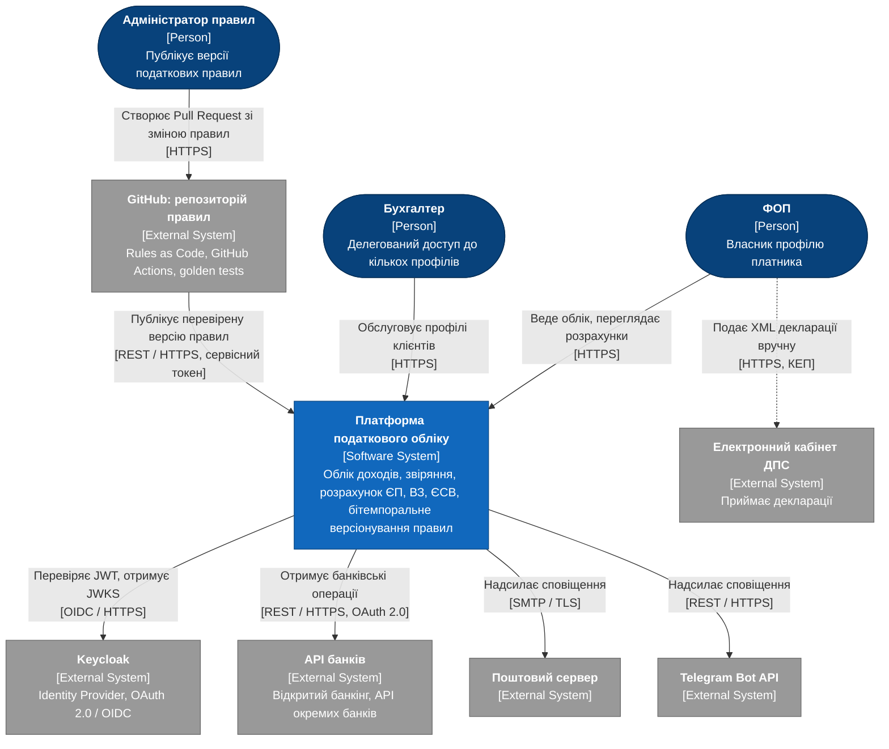
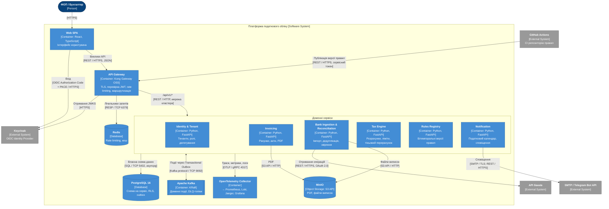
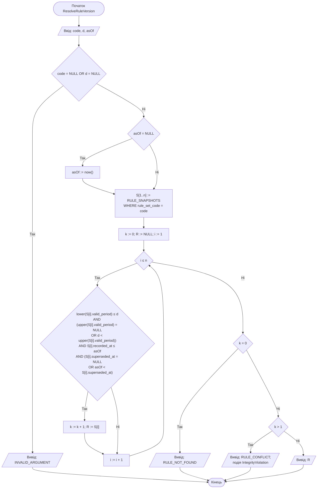
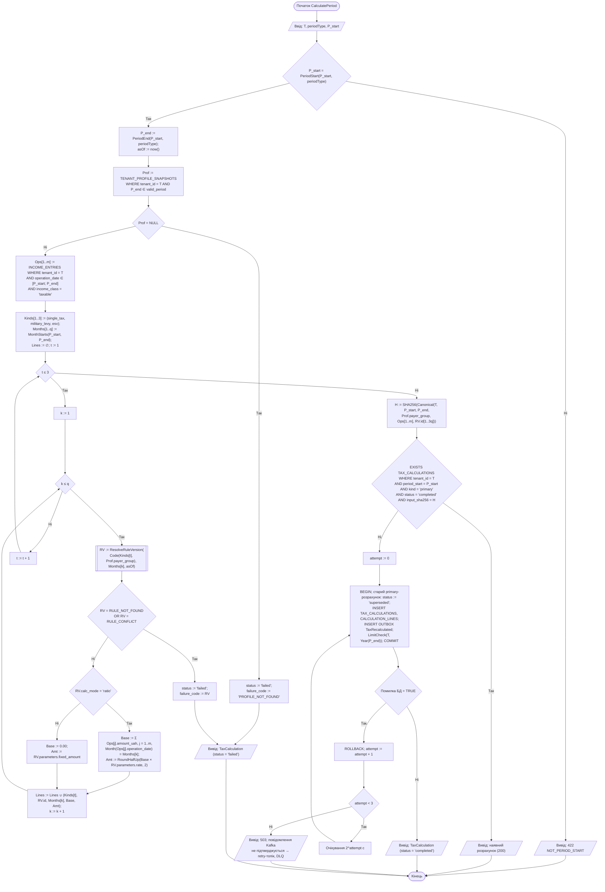
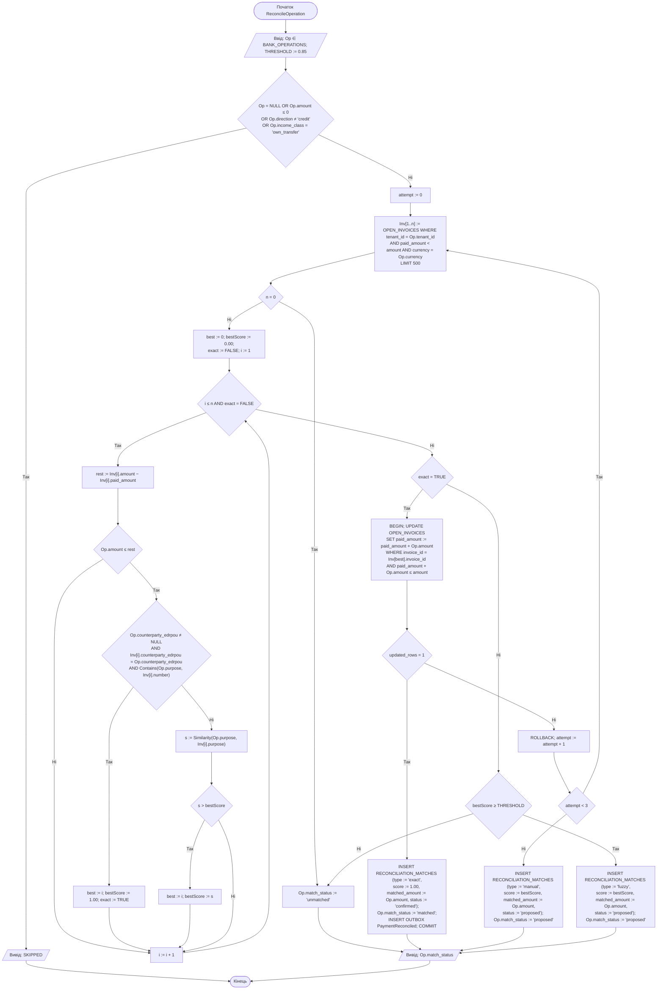
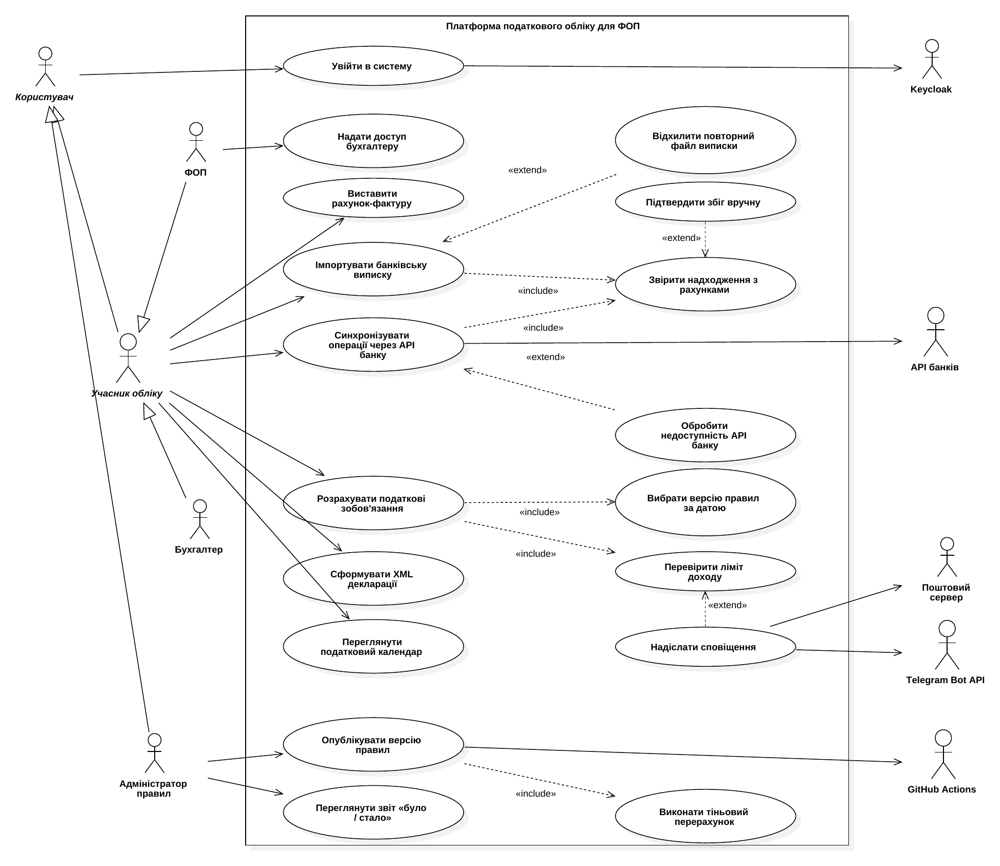
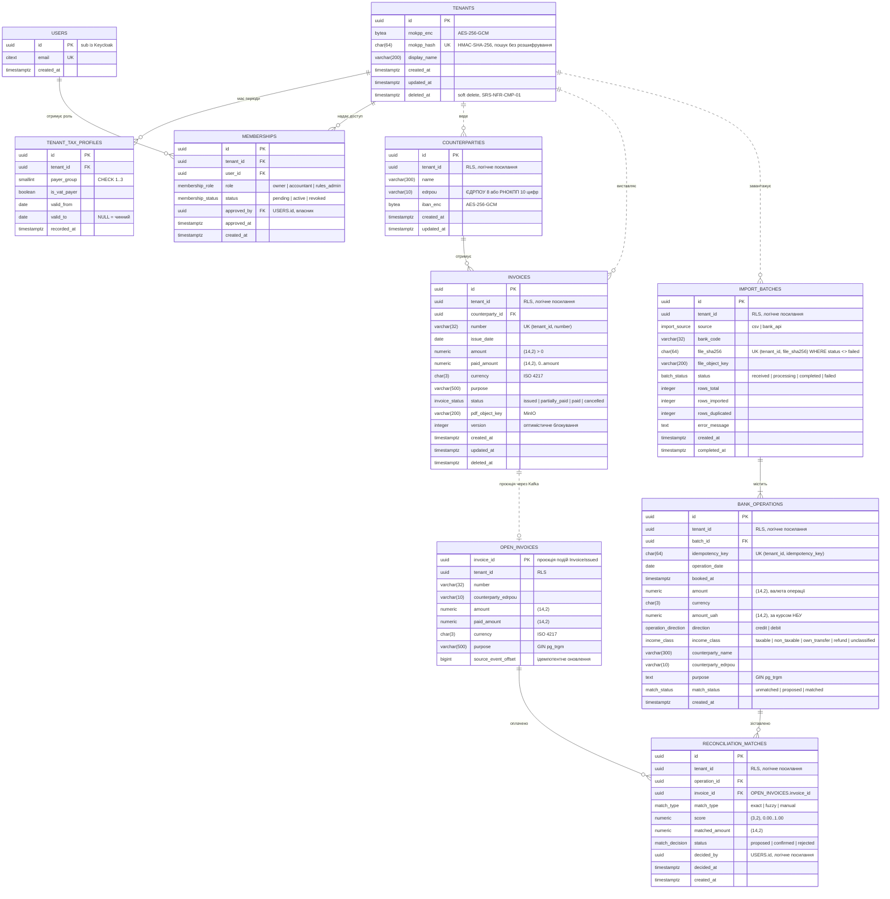
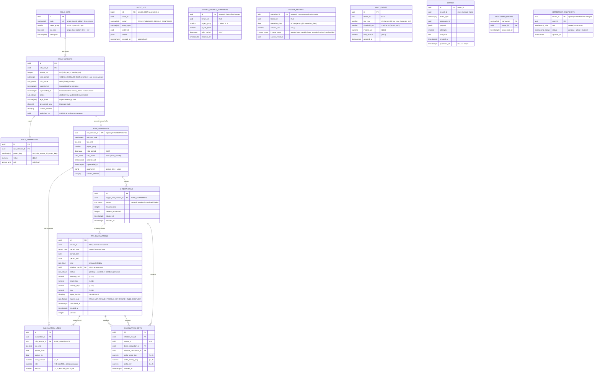

# РОЗДІЛ 2. ОБҐРУНТУВАННЯ АРХІТЕКТУРНИХ РІШЕНЬ ТА ПРОЄКТУВАННЯ СИСТЕМИ

Розділ консолідує архітектурні специфікації платформи: обґрунтування архітектурного стилю й патернів (2.1), модель C4 рівнів Context і Container (2.2), компонентну модель і серверне ядро з алгоритмами критичних вузлів (2.3), контур безпеки застосунку (2.4), API-контракти й топологію маршрутів (2.5), сценарії використання (2.6), модель даних (2.7) та інтеграційний аудит (2.8). Діаграми C4, ER-діаграми й блок-схеми описано кодом Mermaid.js (Diagrams-as-Code); діаграми C4 використовують нотацію C4 і синтаксис `flowchart`, оскільки експериментальний синтаксис C4 у Mermaid не забезпечує читабельного компонування для 15+ елементів. Діаграму прецедентів побудовано в CASE-засобі StarUML. Вимоги, на які посилаються описи, наведено в [srs.md](srs.md), архітектурні рішення — у каталозі [adr/](adr/), API-контракт — у файлі [api/openapi.yaml](api/openapi.yaml).

## 2.1. Обґрунтування архітектурного стилю та патернів проєктування

### 2.1.1. Глобальний архітектурний стиль

Для платформи обрано **подієво-керовану мікросервісну архітектуру з обмеженою кількістю сервісів**: шість сервісів, межі яких збігаються з обмеженими контекстами предметної області (Identity & Tenant, Invoicing, Bank Ingestion & Reconciliation, Tax Engine, Rules Registry, Notification), єдина точка входу API Gateway та асинхронна взаємодія сервісів через журнал подій Apache Kafka ([2.2.2](#diagram-level2), [ADR-001](adr/0001-choice-of-technology.md)). Вибір обґрунтовано трьома вимогами, які модульний моноліт виконує гірше.

1. **Різні профілі навантаження.** Tax Engine під час тіньового перерахунку виконує до 1000 тенантів × 4 квартали за 10 хв ([SRS-NFR-PERF-06](srs.md#srs-nfr-perf-06)) і має CPU-навантаження, тоді як Invoicing та Identity & Tenant обробляють переважно короткі запити читання. Окреме розгортання дає змогу масштабувати лише Tax Engine (HPA від 2 до 6 реплік за CPU 70 %, [SRS-NFR-SCAL-01](srs.md#srs-nfr-scal-01)), не збільшуючи кількість реплік інших сервісів.
2. **Ізоляція збоїв зовнішніх систем.** Недоступність API банку обмежується сервісом Bank Ingestion: Circuit Breaker розмикає виклики після 5 послідовних помилок на 60 с ([SRS-NFR-REL-05](srs.md#srs-nfr-rel-05)), а розрахунки й рахунки продовжують працювати з уже імпортованими даними.
3. **Незалежний цикл змін правил.** Нова версія податкових правил публікується через Rules Registry без повторного розгортання сервісу розрахунків: Tax Engine отримує її подією `RuleSetPublished` і оновлює локальну проєкцію.

**Синхронна та асинхронна взаємодія.** Синхронні виклики REST / HTTPS використовуються лише на межі системи: Web SPA → API Gateway → один сервіс-обробник. Між сервісами синхронних викликів немає: дані іншого контексту зберігаються як локальні проєкції (RULE_SNAPSHOTS, INCOME_ENTRIES, TENANT_PROFILE_SNAPSHOTS, OPEN_INVOICES, MEMBERSHIP_SNAPSHOTS), що оновлюються з подій. Тому ланцюги синхронних залежностей, у яких відмова одного сервісу каскадно блокує інші, архітектурно відсутні, а запит читання обслуговується одним сервісом із власної схеми PostgreSQL за один мережевий перехід. Це забезпечує бюджет затримки p95 ≤ 200 мс при 200 RPS ([SRS-NFR-PERF-01](srs.md#srs-nfr-perf-01)).

**Бюджет затримки конвеєра подій.** Ціль «імпорт операції → оновлений розрахунок ≤ 5 с на p95» ([SRS-NFR-PERF-05](srs.md#srs-nfr-perf-05)) розподілено так: фіксація операції й запису outbox в одній транзакції — до 0,5 с; OutboxRelay вичитує outbox з інтервалом 200 мс і публікує подію — до 0,5 с; доставка в Kafka й отримання консюмером Tax Engine — до 1 с; розрахунок одного місяця з вибором версій правил за індексом GiST — до 1 с; резерв на ребалансування груп консюмерів — 2 с. Відставання консюмерів понад 1000 повідомлень протягом 5 хв є умовою сповіщення ([SRS-NFR-OBS-02](srs.md#srs-nfr-obs-02)).

**Узгодженість даних.** Між сервісами діє eventual consistency. Платформа не має бізнес-операцій, що вимагають атомарної зміни даних кількох сервісів, тому розподілені транзакції та оркестрована Saga не застосовуються. Узгодженість забезпечують три механізми: Transactional Outbox (подія фіксується в тій самій транзакції, що й зміна даних), ідемпотентні консюмери (таблиця PROCESSED_EVENTS, [SRS-NFR-REL-02](srs.md#srs-nfr-rel-02)) і компенсувальні події для зворотних дій користувача (скасування підтвердженого збігу публікує `PaymentUnreconciled`, після чого Invoicing і Tax Engine перераховують стан). Користувач бачить проміжний стан явно: асинхронні операції повертають HTTP 202 і статус `pending`.

**Єдині точки відмови та їх компенсація.** У демонстраційному розгортанні один брокер Kafka (KRaft) і один первинний вузол PostgreSQL є єдиними точками відмови. Недоступність брокера до 15 хв компенсується outbox: події накопичуються в PostgreSQL і публікуються після відновлення без втрат ([SRS-NFR-REL-03](srs.md#srs-nfr-rel-03)). Відмова PostgreSQL компенсується безперервним архівуванням WAL і відновленням на момент часу з RPO ≤ 15 хв і RTO ≤ 1 год ([SRS-NFR-REL-04](srs.md#srs-nfr-rel-04)). Для продуктивного середовища передбачено кластер Kafka з трьох брокерів (`replication.factor = 3`, `min.insync.replicas = 2`) і репліку PostgreSQL у режимі hot standby; демонстраційне середовище цього не реалізує через обмеження ресурсів.

**Вартість експлуатації (FinOps).** Мікросервісна топологія збільшує базове споживання ресурсів. Оцінка для демонстраційного кластера: 6 сервісів × 2 репліки × (0,25 vCPU, 256 МіБ) = 3 vCPU і 3 ГіБ; Kafka — 1 vCPU, 2 ГіБ (JVM heap обмежено 1 ГіБ, retention 14 діб); PostgreSQL — 1 vCPU, 2 ГіБ; Keycloak, Kong, Redis, MinIO і стек спостережуваності — до 3 vCPU і 6 ГіБ. Разом близько 8 vCPU і 13 ГіБ, що вкладається в один вузол Kubernetes середнього розміру. Щоб обмежити операційну складність для одного розробника, застосовано монорепозиторій, спільну бібліотеку для outbox, консюмерів і автентифікації, один Helm-чарт із підчартами та єдиний кластер PostgreSQL зі схемою на сервіс замість окремого екземпляра СУБД для кожного сервісу.

**Умови перегляду стилю.** Якщо навантаження не перевищить одного екземпляра на сервіс, а незалежна публікація правил не знадобиться, сервіси Invoicing, Identity & Tenant і Notification можуть бути об'єднані в модульний моноліт без зміни контрактів подій.

### 2.1.2. Патерни мікрорівня

Таблиця 2.1 – Патерни мікрорівня та проблеми, які вони вирішують

| Патерн | Де застосовано | Проблема зв'язності або ізоляції, яку вирішує |
|---|---|---|
| Clean Architecture (Ports & Adapters) | Усі сервіси; детально — Tax Engine ([2.3.1](#diagram-level3)) | Доменне ядро не імпортує FastAPI, SQLAlchemy чи aiokafka; заміна адаптера (наприклад, джерела правил) не змінює логіку розрахунку |
| Dependency Injection | Механізм `Depends()` FastAPI і композиційний корінь застосунку | Залежність від абстракцій `typing.Protocol` замість конкретних класів; у модульних тестах порти підміняються фейками без мережі й БД |
| Repository | RuleSnapshotRepository, CalculationRepository | Інкапсулює SQL-запити; доменні об'єкти не залежать від схеми таблиць |
| Unit of Work | SqlAlchemyUnitOfWork | Результат розрахунку, рядки й запис outbox фіксуються однією транзакцією; виключено стан «результат збережено, подію втрачено» |
| Transactional Outbox | Кожен сервіс, що публікує події | Усуває подвійний запис у БД і брокер; доставка at-least-once без розподіленої транзакції |
| Idempotent Consumer | EventConsumer + IdempotencyGuard | Повторна доставка події не змінює стан ([SRS-NFR-REL-02](srs.md#srs-nfr-rel-02)) |
| Strategy | TaxCalculators: SingleTax, MilitaryLevy, SocialContribution | Додавання нового виду податку не змінює CalculationUseCase; режим `ratio` / `fixed_monthly` задається версією правил |
| Circuit Breaker, Retry з експоненційною затримкою та jitter | Адаптер API банків у Bank Ingestion | Обмежує каскадне накопичення запитів до недоступного банку; повтори з інтервалом 1–60 с не створюють синхронних сплесків навантаження |
| CQRS-lite (локальні моделі читання) | Проєкції OPEN_INVOICES, RULE_SNAPSHOTS, INCOME_ENTRIES | Читання не потребує запитів до інших сервісів. Повний CQRS з окремим сховищем читання і Event Sourcing не застосовано: при цьому масштабі він подвоює кількість схем без вигоди для вимог продуктивності |

Патерн Singleton застосовано лише для незмінних об'єктів рівня процесу: конфігурації та пулу з'єднань (`AsyncEngine`). Сесії БД, транзакції та контекст тенанта мають область видимості одного запиту або однієї події, що виключає витік `tenant_id` між запитами в спільному пулі з'єднань.

### 2.1.3. Архітектурні рішення (ADR)

Таблиця 2.2 – Реєстр архітектурних рішень

| ADR | Рішення | Статус |
|---|---|---|
| [ADR-001](adr/0001-choice-of-technology.md) | Вибір Apache Kafka (KRaft) як брокера доменних подій | Approved |

Повний текст ADR-001 (Context, Alternatives, Decision, Consequences) наведено у файлі [adr/0001-choice-of-technology.md](adr/0001-choice-of-technology.md). Вирішальними для вибору Kafka є вимоги повторного читання історії подій для тіньового перерахунку ([SRS-FUN-21](srs.md#srs-fun-21)) та впорядкованої паралельної обробки подій за ключем `tenant_id` ([SRS-NFR-SCAL-02](srs.md#srs-nfr-scal-02)).

## 2.2. Контекстне та контейнерне моделювання системи (C4 Model: Levels 1–2)

### 2.2.1. C4 Level 1: System Context

Рисунок 2.1 – Діаграма контексту системи (C4 Level 1: System Context)

**Опис елементів і зв'язків.**

| Елемент | Тип | Роль |
|---|---|---|
| ФОП | Person | Веде облік доходів і переглядає розрахунки ([SRS-FUN-05](srs.md#srs-fun-05), [SRS-FUN-14](srs.md#srs-fun-14)) |
| Бухгалтер | Person | Обслуговує делеговані профілі ([SRS-FUN-03](srs.md#srs-fun-03)) |
| Адміністратор правил | Person | Вносить зміни правил через Pull Request у репозиторій правил ([SRS-FUN-19](srs.md#srs-fun-19)) |
| Платформа податкового обліку | Software System | Система, що проєктується |
| Keycloak | External System | Видає й підписує JWT за OAuth 2.0 / OIDC ([SRS-NFR-SEC-01](srs.md#srs-nfr-sec-01)) |
| API банків | External System | Джерело банківських операцій ([SRS-FUN-09](srs.md#srs-fun-09)) |
| GitHub: репозиторій правил | External System | Зберігає правила як код, виконує golden tests і публікує версію ([SRS-NFR-COR-01](srs.md#srs-nfr-cor-01)) |
| Поштовий сервер, Telegram Bot API | External System | Канали доставки сповіщень ([SRS-FUN-24](srs.md#srs-fun-24)) |
| Електронний кабінет ДПС | External System | Приймає XML декларації, який користувач подає самостійно ([SRS-FUN-17](srs.md#srs-fun-17)); пряма інтеграція поза межами системи |

Протоколи: користувачі звертаються до платформи через HTTPS; публікація правил із CI — REST / HTTPS із сервісним токеном; перевірка токенів — OIDC / HTTPS (JWKS); отримання банківських даних — REST / HTTPS з авторизацією OAuth 2.0; сповіщення — SMTP / TLS і REST / HTTPS.

### 2.2.2. C4 Level 2: Container Diagram

Рисунок 2.2 – Діаграма контейнерів системи (C4 Level 2: Container Diagram)

**Опис контейнерів.**

| Контейнер | Технологія | Відповідальність і трасування |
|---|---|---|
| Web SPA | React, TypeScript | Інтерфейс користувача; вхід за OIDC Authorization Code + PKCE |
| API Gateway | Kong Gateway OSS | Термінація TLS 1.3, перевірка підпису JWT за JWKS, обмеження 100 запитів/хв на користувача з лічильниками в Redis, маршрутизація `/api/v1/*` ([SRS-NFR-SEC-04](srs.md#srs-nfr-sec-04), [SRS-NFR-SEC-05](srs.md#srs-nfr-sec-05), [SRS-NFR-MNT-02](srs.md#srs-nfr-mnt-02)) |
| Identity & Tenant | Python, FastAPI | Тенанти, ролі, делегування ([SRS-FUN-01](srs.md#srs-fun-01) – [SRS-FUN-04](srs.md#srs-fun-04)) |
| Invoicing | Python, FastAPI | Рахунки, акти, PDF у MinIO, статус оплати за подією `PaymentReconciled` ([SRS-FUN-05](srs.md#srs-fun-05) – [SRS-FUN-07](srs.md#srs-fun-07)) |
| Bank Ingestion & Reconciliation | Python, FastAPI | Імпорт CSV і API банків, ключ ідемпотентності, Circuit Breaker, звіряння ([SRS-FUN-08](srs.md#srs-fun-08) – [SRS-FUN-13](srs.md#srs-fun-13), [SRS-NFR-REL-05](srs.md#srs-nfr-rel-05)) |
| Tax Engine | Python, FastAPI | Розрахунок ЄП, ВЗ, ЄСВ, відтворюваність, ліміти, тіньовий перерахунок і diff-звіти ([SRS-FUN-14](srs.md#srs-fun-14) – [SRS-FUN-18](srs.md#srs-fun-18), [SRS-FUN-21](srs.md#srs-fun-21), [SRS-FUN-22](srs.md#srs-fun-22)); деталізацію наведено на [C4 Component](#diagram-level3) |
| Rules Registry | Python, FastAPI | Бітемпоральні версії правил, заборона змін опублікованих версій, журнал аудиту ([SRS-FUN-19](srs.md#srs-fun-19), [SRS-FUN-20](srs.md#srs-fun-20), [SRS-FUN-25](srs.md#srs-fun-25)) |
| Notification | Python, FastAPI | Податковий календар, email і Telegram ([SRS-FUN-23](srs.md#srs-fun-23), [SRS-FUN-24](srs.md#srs-fun-24)) |
| Apache Kafka | KRaft | Транспорт доменних подій, retry- і DLQ-топіки, ≥ 6 партицій із ключем `tenant_id` ([SRS-NFR-SCAL-02](srs.md#srs-nfr-scal-02), [SRS-NFR-REL-03](srs.md#srs-nfr-rel-03)); вибір обґрунтовано в [ADR-001](adr/0001-choice-of-technology.md) |
| PostgreSQL 16 | Database | Окрема схема та роль на сервіс, RLS, таблиці outbox і processed_events, PITR ([SRS-NFR-SEC-03](srs.md#srs-nfr-sec-03), [SRS-NFR-REL-04](srs.md#srs-nfr-rel-04)) |
| Redis | Database | Лічильники rate limiting, кеш моделей читання |
| MinIO | S3 API | PDF документів і вихідні файли виписок |
| OpenTelemetry Collector | OTel | Приймає траси, метрики й логи та передає їх до Prometheus, Loki, Jaeger, Grafana ([SRS-NFR-OBS-01](srs.md#srs-nfr-obs-01), [SRS-NFR-OBS-02](srs.md#srs-nfr-obs-02)) |

**Потоки подій.** Identity & Tenant публікує `TaxProfileChanged` (споживає Tax Engine) і `MembershipChanged` (споживають усі сервіси для проєкції MEMBERSHIP_SNAPSHOTS); Invoicing публікує `InvoiceIssued`, який споживає Bank Ingestion для проєкції відкритих рахунків; Bank Ingestion публікує `StatementReceived` (внутрішня подія для обробника пакетів), `StatementImported`, `IncomeOperationRecorded`, `PaymentReconciled` і компенсувальну `PaymentUnreconciled`; Tax Engine споживає `IncomeOperationRecorded`, Invoicing — `PaymentReconciled` і `PaymentUnreconciled`; Rules Registry публікує `RuleSetPublished`, який споживає Tax Engine; Tax Engine публікує `TaxRecalculated`, `LimitThresholdReached` і `CalculationFailed`, які споживає Notification. Кожен сервіс записує події до власної таблиці outbox у транзакції зміни даних, а фоновий процес OutboxRelay публікує їх до Kafka ([SRS-NFR-REL-02](srs.md#srs-nfr-rel-02)). Сервіси не звертаються до схем даних інших сервісів: потрібні дані зберігаються як локальні проєкції подій (підрозділ 2.7).

**Протоколи.** Зовнішні виклики — REST / HTTPS з JSON; внутрішня маршрутизація від шлюзу — REST / HTTP у мережі кластера, обмеженій політиками Kubernetes NetworkPolicy; доступ до PostgreSQL — SQL / TCP 5432 (asyncpg); Kafka — Kafka protocol / TCP 9092; Redis — RESP / TCP 6379; MinIO — S3 API / HTTP; телеметрія — OTLP / gRPC 4317.

## 2.3. Компонентне моделювання та опис серверного ядра

### 2.3.1. C4 Level 3: Component Diagram — Tax Engine Service

Для декомпозиції обрано Tax Engine Service, оскільки він містить основне обчислювальне навантаження і реалізує ключові вимоги темпоральної коректності та відтворюваності.

```mermaid
flowchart TB
  gw["<b>API Gateway</b><br/>[Container: Kong]"]
  kin[["<b>Apache Kafka</b><br/>[Container]<br/>IncomeOperationRecorded, TaxProfileChanged, RuleSetPublished"]]
  subgraph te["Tax Engine Service [Container: Python 3.12, FastAPI]"]
    subgraph inbound["Inbound: адаптери входу"]
      mw["<b>Middleware Pipeline</b><br/>[Component: ASGI middleware]<br/>Correlation ID, OpenTelemetry, Global Error Handler (RFC 9457)"]
      auth["<b>AuthGuard</b><br/>[Component: FastAPI Depends]<br/>Перевірка JWT RS256, RBAC"]
      tctx["<b>TenantContext</b><br/>[Component: FastAPI Depends]<br/>Членство (MEMBERSHIP_SNAPSHOTS), SET LOCAL app.tenant_id"]
      api["<b>TaxController</b><br/>[Component: FastAPI Router]<br/>/api/v1/tax-calculations, /api/v1/shadow-runs, DTO Pydantic v2"]
      cons["<b>EventConsumer</b><br/>[Component: aiokafka]<br/>Десеріалізація та валідація подій"]
      idem["<b>IdempotencyGuard</b><br/>[Component]<br/>Таблиця processed_events"]
    end
    subgraph core["Core: прикладний і доменний шар"]
      uc["<b>CalculationUseCase</b><br/>[Component: Application Service]<br/>Оркестрація розрахунку періоду"]
      shadow["<b>ShadowRecalculationUseCase</b><br/>[Component: Application Service]<br/>Тіньовий перерахунок, diff-звіт"]
      resolver["<b>RuleResolver</b><br/>[Component: Domain Service]<br/>Вибір версії правил за датою операції"]
      calc["<b>TaxCalculators</b><br/>[Component: Strategy]<br/>SingleTax, MilitaryLevy, SocialContribution; Decimal"]
      limit["<b>LimitMonitor</b><br/>[Component: Domain Service]<br/>Пороги 80/95/100 %"]
      hasher["<b>InputHasher</b><br/>[Component]<br/>SHA-256 канонічного входу"]
      ports{{"<b>Ports</b><br/>[Interfaces: typing.Protocol]<br/>RuleSnapshotPort, CalculationRepoPort, IncomePort, UnitOfWork, EventPublisherPort"}}
    end
    subgraph outbound["Outbound: адаптери виходу"]
      rulerepo["<b>RuleSnapshotRepository</b><br/>[Component: SQLAlchemy 2.0]<br/>Локальна проєкція версій правил"]
      increpo["<b>IncomeEntryRepository</b><br/>[Component: SQLAlchemy 2.0]<br/>Проєкція доходів INCOME_ENTRIES"]
      calcrepo["<b>CalculationRepository</b><br/>[Component: SQLAlchemy 2.0]<br/>Результати, diff-звіти"]
      uow["<b>SqlAlchemyUnitOfWork</b><br/>[Component]<br/>Одна транзакція: результат + outbox"]
      outbox["<b>OutboxRelay</b><br/>[Component: фоновий worker]<br/>Публікація з outbox, retry, DLQ"]
    end
  end
  pg[("<b>PostgreSQL 16</b><br/>[Database]<br/>схема tax_engine, RLS")]
  kout[["<b>Apache Kafka</b><br/>[Container]<br/>TaxRecalculated, LimitThresholdReached, DLQ"]]
  gw -->|"[REST / HTTP]"| mw
  mw -->|"ASGI call chain"| api
  api -->|"Depends()"| auth
  api -->|"Depends()"| tctx
  api -->|"Виклик use case через DI"| uc
  api -->|"Виклик use case через DI"| shadow
  kin -->|"[Kafka protocol / TCP 9092]"| cons
  cons -->|"Перевірка event_id"| idem
  cons -->|"Виклик use case через DI"| uc
  cons -->|"RuleSetPublished"| shadow
  uc --> resolver
  uc --> calc
  uc --> limit
  uc --> hasher
  shadow --> resolver
  shadow --> calc
  resolver -->|"через RuleSnapshotPort"| ports
  uc -->|"через UnitOfWork, CalculationRepoPort, IncomePort"| ports
  shadow -->|"через RuleSnapshotPort, CalculationRepoPort"| ports
  rulerepo -.->|"реалізує"| ports
  calcrepo -.->|"реалізує"| ports
  increpo -.->|"реалізує"| ports
  uow -.->|"реалізує"| ports
  idem -->|"через UnitOfWork"| ports
  rulerepo -->|"[SQL / TCP 5432]"| pg
  calcrepo -->|"[SQL / TCP 5432]"| pg
  increpo -->|"[SQL / TCP 5432]"| pg
  uow -->|"[SQL / TCP 5432]"| pg
  outbox -->|"Читає outbox [SQL / TCP 5432]"| pg
  outbox -->|"[Kafka protocol / TCP 9092]"| kout
  classDef container fill:#438dd5,stroke:#2e6295,color:#ffffff
  classDef comp fill:#85bbf0,stroke:#5d82a8,color:#000000
  classDef port fill:#ffffff,stroke:#5d82a8,color:#000000
  classDef db fill:#438dd5,stroke:#2e6295,color:#ffffff
  class gw,kin,kout container
  class mw,auth,tctx,api,cons,idem,uc,shadow,resolver,calc,limit,hasher,rulerepo,increpo,calcrepo,uow,outbox comp
  class ports port
  class pg db
```

Рисунок 2.3 – Діаграма компонентів Tax Engine Service (C4 Level 3: Component Diagram)

**Опис компонентів.**

| Шар | Компонент | Роль і взаємодія |
|---|---|---|
| Inbound | Middleware Pipeline | ASGI-middleware: correlation ID, інструментування OpenTelemetry, глобальний обробник помилок із відповіддю у форматі RFC 9457 (Problem Details) ([SRS-NFR-OBS-01](srs.md#srs-nfr-obs-01)) |
| Inbound | AuthGuard | Залежність FastAPI `Depends()`: перевірка JWT RS256 і ролей за політикою deny-by-default ([SRS-NFR-SEC-01](srs.md#srs-nfr-sec-01), [SRS-NFR-SEC-02](srs.md#srs-nfr-sec-02)) |
| Inbound | TenantContext | Перевіряє `active`-членство за проєкцією MEMBERSHIP_SNAPSHOTS і виконує `SET LOCAL app.tenant_id` у транзакції для політик RLS ([SRS-FUN-04](srs.md#srs-fun-04)) |
| Inbound | TaxController | Маршрути `/api/v1/tax-calculations` і `/api/v1/shadow-runs` ([openapi.yaml](api/openapi.yaml)), валідація DTO Pydantic v2; викликає лише use case, без доступу до репозиторіїв |
| Inbound | EventConsumer | Споживач aiokafka для `IncomeOperationRecorded`, `TaxProfileChanged` і `RuleSetPublished`; валідація схем подій |
| Inbound | IdempotencyGuard | Перевіряє `event_id` у таблиці `processed_events` у транзакції обробки ([SRS-NFR-REL-02](srs.md#srs-nfr-rel-02)) |
| Core | CalculationUseCase | Оркеструє розрахунок періоду ([SRS-FUN-14](srs.md#srs-fun-14)) |
| Core | ShadowRecalculationUseCase | Оновлює проєкцію правил, виконує тіньовий перерахунок і формує diff-звіт ([SRS-FUN-21](srs.md#srs-fun-21), [SRS-FUN-22](srs.md#srs-fun-22)) |
| Core | RuleResolver | Вибирає версію правил, чинну на дату операції, з урахуванням transaction time ([SRS-FUN-14](srs.md#srs-fun-14)) |
| Core | TaxCalculators | Стратегії SingleTax, MilitaryLevy, SocialContribution на `Decimal` ([SRS-NFR-COR-02](srs.md#srs-nfr-cor-02)) |
| Core | LimitMonitor | Пороги 80/95/100 % ліміту доходу ([SRS-FUN-18](srs.md#srs-fun-18)) |
| Core | InputHasher | SHA-256 канонічного подання вхідних даних ([SRS-FUN-15](srs.md#srs-fun-15), [SRS-FUN-16](srs.md#srs-fun-16)) |
| Core | Ports | Інтерфейси `typing.Protocol`: RuleSnapshotPort, CalculationRepoPort, IncomePort, UnitOfWork, EventPublisherPort; ядро залежить лише від них (Dependency Inversion) |
| Outbound | RuleSnapshotRepository | Локальна проєкція версій правил, оновлювана з подій `RuleSetPublished`; усуває синхронну залежність від Rules Registry під час розрахунку |
| Outbound | IncomeEntryRepository | Читання податкових доходів тенанта за період з проєкції INCOME_ENTRIES (індекс `(tenant_id, operation_date)`) |
| Outbound | CalculationRepository | Збереження результатів з ідентифікатором версії правил і хешем, diff-звітів |
| Outbound | SqlAlchemyUnitOfWork | Одна транзакція для результату розрахунку та запису до outbox (реалізує EventPublisherPort) |
| Outbound | OutboxRelay | Фоновий процес: публікація з outbox, повторні спроби з експоненційною затримкою, DLQ ([SRS-NFR-REL-03](srs.md#srs-nfr-rel-03)) |

**Взаємодія всередині процесу.** Залежності впроваджуються через механізм `Depends()` FastAPI та композиційний корінь застосунку; ядро не імпортує SQLAlchemy, aiokafka чи FastAPI. Зв'язки між шарами спрямовані лише всередину: Inbound → Core → Ports ← Outbound.

### 2.3.2. Опис серверного ядра та взаємодії рівнів

Кожен сервіс побудовано за однаковою трирівневою схемою; нижче вона описана на прикладі Tax Engine, для якого наведено діаграму компонентів (рисунок 2.3). Залежності спрямовані лише всередину: Inbound → Core → Ports ← Outbound. Ядро залежить тільки від інтерфейсів `typing.Protocol`, а їх реалізації підставляє композиційний корінь застосунку під час старту процесу.

**Inbound Layer (адаптери входу)** приймає зовнішні стимули двох типів: HTTP-запити від API Gateway і події з Kafka.

- *Middleware Pipeline* виконується першим для кожного HTTP-запиту: зчитує або генерує `X-Request-ID`, відкриває span OpenTelemetry з атрибутами `tenant_id` і `http.route`, обмежує тіло запиту 64 КіБ для JSON-маршрутів і перетворює будь-який необроблений виняток на відповідь Problem Details (RFC 9457) без стеку викликів і внутрішніх повідомлень СУБД.
- *AuthGuard* — залежність `Depends()`, що зчитує вже перевірений шлюзом JWT, повторно перевіряє `iss`, `aud`, `exp` і роль з `realm_access.roles` за декларативною матрицею «маршрут → дозволені ролі». Маршрут без явної політики відхиляється (deny-by-default).
- *TenantContext* перевіряє, що пара (`sub`, `X-Tenant-ID`) має статус `active` у локальній проєкції MEMBERSHIP_SNAPSHOTS, і в межах транзакції виконує `SET LOCAL app.tenant_id`, від якого залежать політики RLS.
- *TaxController* приймає DTO Pydantic v2 з `extra="forbid"` і строгими типами, викликає лише use case і перетворює доменні помилки на HTTP-статуси (`RULE_NOT_FOUND` → збережений розрахунок зі статусом `failed`, конфлікт → 409).
- *EventConsumer* десеріалізує подію, перевіряє її схему й версію, а *IdempotencyGuard* у тій самій транзакції виконує `INSERT INTO processed_events … ON CONFLICT DO NOTHING`; якщо рядок не вставлено, подію вже оброблено, і вона підтверджується без повторних дій.

**Core Layer (прикладний і доменний рівень)** містить бізнес-логіку без звернень до мережі та файлової системи.

- *CalculationUseCase* і *ShadowRecalculationUseCase* оркеструють алгоритм 2.3.3.2 і відкривають Unit of Work.
- *RuleResolver* реалізує вибір версії правил за двома осями часу (алгоритм 2.3.3.1).
- *TaxCalculators* (Strategy) обчислюють суми типом `Decimal` з округленням `ROUND_HALF_UP` до 0,01 грн ([SRS-NFR-COR-02](srs.md#srs-nfr-cor-02)).
- *LimitMonitor* визначає досягнення порогів 80/95/100 % ліміту доходу, *InputHasher* формує SHA-256 канонічного JSON вхідних даних.

Інваріанти ядра: завершений розрахунок не змінюється, а лише замінюється новим зі статусом `superseded` для попереднього; для тенанта й періоду існує не більше одного завершеного основного розрахунку; кожен рядок розрахунку посилається на конкретну версію правил.

**Ports (контракти між ядром і інфраструктурою):**

Таблиця 2.3 – Порти серверного ядра Tax Engine

| Порт | Операції | Реалізація (Outbound) |
|---|---|---|
| RuleSnapshotPort | `find_effective(code, on_date, as_of) -> RuleSnapshot \| None` | RuleSnapshotRepository |
| CalculationRepoPort | `get_completed(tenant_id, period_start, input_sha256)`, `add(calculation)`, `supersede(calculation_id)` | CalculationRepository |
| IncomePort | `list_taxable(tenant_id, period_start, period_end) -> list[IncomeEntry]` | IncomeEntryRepository |
| UnitOfWork | `__aenter__`, `commit()`, `rollback()` | SqlAlchemyUnitOfWork |
| EventPublisherPort | `add(event)` — запис події до outbox поточної транзакції | SqlAlchemyUnitOfWork |

**Outbound Layer (адаптери виходу)** реалізує порти засобами SQLAlchemy 2.0 (asyncpg). Усі запити формуються конструктором запитів SQLAlchemy з параметрами, конкатенація рядків SQL заборонена правилами Ruff (S608) і Bandit (B608). *OutboxRelay* — окремий процес, що вибирає непублікувані події за частковим індексом, публікує їх у Kafka з ключем партиції `tenant_id`, позначає `published_at` і після 5 невдалих спроб переносить подію до DLQ-топіка ([SRS-NFR-REL-03](srs.md#srs-nfr-rel-03)).

**Приклад проходження запиту** `POST /api/v1/tax-calculations`: API Gateway перевіряє підпис JWT і ліміт запитів → Middleware Pipeline створює span і `X-Request-ID` → AuthGuard дозволяє ролі `owner` і `accountant` → TenantContext перевіряє членство й встановлює `app.tenant_id` → TaxController валідує DTO → CalculationUseCase створює розрахунок `pending` через CalculationRepoPort, фіксує Unit of Work і повертає 202 → фоновий обробник виконує алгоритм 2.3.3.2 і в одній транзакції зберігає результат та подію `TaxRecalculated` → OutboxRelay публікує подію в Kafka.

### 2.3.3. Алгоритми критичних вузлів

Алгоритмізовано три вузли, від яких залежить коректність податкових розрахунків: вибір версії правил за двома осями часу, розрахунок зобов'язань за період і звіряння платежів. Блок-схеми побудовано за ДСТУ ISO 5807:2016 засобами Mermaid.js: термінатор — овал, процес — прямокутник, рішення — ромб, введення / виведення — паралелограм, визначений процес (виклик підпрограми) — прямокутник із подвійними бічними межами. У підписах використано оператор присвоювання `:=`, порівняння `=`, логічні оператори AND, OR, NOT та індекси елементів масивів.

#### 2.3.3.1. Алгоритм вибору версії правил (ResolveRuleVersion)

**Призначення:** визначити версію правил, чинну на дату операції `d` за станом знань на момент `asOf` (бітемпоральна модель, [SRS-FUN-14](srs.md#srs-fun-14), [SRS-FUN-19](srs.md#srs-fun-19)). Компонент RuleResolver ([2.3.1](#diagram-level3)).

**Вхід:** `code` — код набору правил; `d` — дата операції; `asOf` — момент знань (за замовчуванням поточний). **Вихід:** версія `R` або код `RULE_NOT_FOUND`, `RULE_CONFLICT`, `INVALID_ARGUMENT`.

1. Якщо `code = NULL OR d = NULL`, вивести `INVALID_ARGUMENT` і завершити.
2. Якщо `asOf = NULL`, то `asOf := now()`.
3. `S[1..n] :=` записи RULE_SNAPSHOTS, де `rule_set_code = code`.
4. `k := 0; R := NULL; i := 1`.
5. Поки `i ≤ n`: якщо `lower(S[i].valid_period) ≤ d AND (upper(S[i].valid_period) = NULL OR d < upper(S[i].valid_period)) AND S[i].recorded_at ≤ asOf AND (S[i].superseded_at = NULL OR asOf < S[i].superseded_at)`, то `k := k + 1; R := S[i]`; далі `i := i + 1`.
6. Якщо `k = 0`, вивести `RULE_NOT_FOUND`; якщо `k > 1`, вивести `RULE_CONFLICT` і опублікувати подію `IntegrityViolation`; інакше вивести `R`.

У реалізації цикл кроку 5 виконується одним SQL-запитом з умовою `valid_period @> d` за індексом GiST; блок-схема описує його логічну семантику.

Рисунок 2.4 – Блок-схема алгоритму вибору версії правил (ResolveRuleVersion)

#### 2.3.3.2. Алгоритм розрахунку податкових зобов'язань за період (CalculatePeriod)

**Призначення:** обчислити ЄП, ВЗ і ЄСВ за період із вибором версії правил для кожного місяця, зафіксувати хеш вхідних даних і перевірити ліміт доходу ([SRS-FUN-14](srs.md#srs-fun-14) – [SRS-FUN-16](srs.md#srs-fun-16), [SRS-FUN-18](srs.md#srs-fun-18)). Компоненти CalculationUseCase, TaxCalculators, InputHasher, LimitMonitor ([2.3.1](#diagram-level3)).

**Вхід:** `T` — тенант; `periodType ∈ {month, quarter, year}`; `P_start` — перший день періоду. **Вихід:** TaxCalculation зі статусом `completed` або `failed`.

1. Якщо `NOT (P_start = PeriodStart(P_start, periodType))`, вивести 422 `NOT_PERIOD_START` і завершити.
2. `P_end := PeriodEnd(P_start, periodType); asOf := now()`.
3. `Prof :=` запис TENANT_PROFILE_SNAPSHOTS тенанта `T`, чинний на `P_end`. Якщо `Prof = NULL`, то `status := 'failed'; failure_code := 'PROFILE_NOT_FOUND'`, зберегти й завершити.
4. `Ops[1..m] :=` записи INCOME_ENTRIES, де `tenant_id = T AND operation_date ∈ [P_start; P_end] AND income_class = 'taxable'`.
5. `Kinds[1..3] := (single_tax, military_levy, esv); Months[1..q] := MonthStarts(P_start, P_end); Lines := ∅; t := 1`.
6. Поки `t ≤ 3`: `k := 1`; поки `k ≤ q`:
   - `RV := ResolveRuleVersion(Code(Kinds[t], Prof.payer_group), Months[k], asOf)`;
   - якщо `RV = RULE_NOT_FOUND OR RV = RULE_CONFLICT`, то `status := 'failed'; failure_code := RV`, зберегти й завершити;
   - якщо `RV.calc_mode = 'ratio'`, то `Base := Σ Ops[j].amount_uah` для `j = 1..m`, де `Month(Ops[j].operation_date) = Months[k]`, і `Amt := RoundHalfUp(Base × RV.parameters.rate, 2)`; інакше `Base := 0.00; Amt := RV.parameters.fixed_amount`;
   - `Lines := Lines ∪ (Kinds[t], RV.id, Months[k], Base, Amt); k := k + 1`.

   Після внутрішнього циклу `t := t + 1`.
7. `H := SHA256(Canonical(T, P_start, P_end, Prof.payer_group, Ops[1..m], RV.id[1..3q]))`, де Canonical — JSON із впорядкованими ключами та сортуванням `Ops` за `operation_id`.
8. Якщо існує розрахунок `kind = 'primary' AND status = 'completed'` тенанта `T` за `P_start` з `input_sha256 = H`, вивести наявний розрахунок (HTTP 200) і завершити.
9. `attempt := 0`. В одній транзакції: попередній завершений primary-розрахунок отримує `status := 'superseded'`; вставити TAX_CALCULATIONS (`status := 'completed'`, `input_sha256 := H`) і CALCULATION_LINES; вставити до OUTBOX подію `TaxRecalculated`; виконати LimitCheck.
10. Якщо транзакція завершилася помилкою БД: `ROLLBACK; attempt := attempt + 1`; якщо `attempt < 3`, очікувати `2^attempt` с і повторити крок 9; інакше вивести 503, а повідомлення Kafka не підтверджувати (повтор через retry-топік, після 5 спроб — DLQ, [SRS-NFR-REL-03](srs.md#srs-nfr-rel-03)).
11. Вивести TaxCalculation.

**Підпрограма LimitCheck(T, Y):** `IncomeYTD := Σ INCOME_ENTRIES.amount_uah` тенанта `T` за рік `Y` з `income_class = 'taxable'`; `L := ResolveRuleVersion(Code(single_tax, Prof.payer_group), P_end, asOf).parameters.income_limit`; для кожного `p ∈ (80, 95, 100)`: якщо `IncomeYTD ≥ L × p / 100 AND NOT EXISTS LIMIT_EVENTS(T, Y, p)`, вставити LIMIT_EVENTS і подію `LimitThresholdReached` до OUTBOX. Унікальний ключ `(tenant_id, tax_year, threshold_pct)` гарантує одну подію на поріг.

Рисунок 2.5 – Блок-схема алгоритму розрахунку податкових зобов'язань за період (CalculatePeriod)

#### 2.3.3.3. Алгоритм звіряння платежу з рахунками (ReconcileOperation)

**Призначення:** зіставити вхідне надходження з відкритим рахунком за точним або нечітким збігом ([SRS-FUN-11](srs.md#srs-fun-11) – [SRS-FUN-13](srs.md#srs-fun-13)). Сервіс Bank Ingestion & Reconciliation.

**Вхід:** операція `Op` з BANK_OPERATIONS; поріг `THRESHOLD := 0.85`. **Вихід:** `Op.match_status ∈ {matched, proposed, unmatched}` або `SKIPPED`.

1. Якщо `Op = NULL OR Op.amount ≤ 0 OR Op.direction ≠ 'credit' OR Op.income_class = 'own_transfer'`, вивести `SKIPPED` і завершити.
2. `attempt := 0`.
3. `Inv[1..n] :=` записи OPEN_INVOICES, де `tenant_id = Op.tenant_id AND paid_amount < amount AND currency = Op.currency`, не більше 500.
4. Якщо `n = 0`, то `Op.match_status := 'unmatched'` і перейти до кроку 9.
5. `best := 0; bestScore := 0.00; exact := FALSE; i := 1`.
6. Поки `i ≤ n AND exact = FALSE`: `rest := Inv[i].amount − Inv[i].paid_amount`; якщо `Op.amount ≤ rest`, то:
   - якщо `Op.counterparty_edrpou ≠ NULL AND Inv[i].counterparty_edrpou = Op.counterparty_edrpou AND Contains(Op.purpose, Inv[i].number)`, то `best := i; bestScore := 1.00; exact := TRUE`;
   - інакше `s := Similarity(Op.purpose, Inv[i].purpose)`; якщо `s > bestScore`, то `best := i; bestScore := s`.

   Далі `i := i + 1`.
7. Якщо `exact = TRUE`: у транзакції виконати `UPDATE OPEN_INVOICES SET paid_amount := paid_amount + Op.amount WHERE invoice_id = Inv[best].invoice_id AND paid_amount + Op.amount ≤ amount`.
   - Якщо `updated_rows = 1`: вставити RECONCILIATION_MATCHES (`type := 'exact'`, `status := 'confirmed'`), `Op.match_status := 'matched'`, вставити до OUTBOX подію `PaymentReconciled`, COMMIT.
   - Інакше (рахунок паралельно оплачено іншою операцією): `ROLLBACK; attempt := attempt + 1`; якщо `attempt < 3`, повторити з кроку 3; інакше вставити збіг `type := 'manual'`, `status := 'proposed'`, `Op.match_status := 'proposed'`.
8. Якщо `exact = FALSE AND bestScore ≥ THRESHOLD`, вставити збіг `type := 'fuzzy'`, `status := 'proposed'`, `Op.match_status := 'proposed'`; якщо `bestScore < THRESHOLD`, то `Op.match_status := 'unmatched'`.
9. Вивести `Op.match_status`.

Рисунок 2.6 – Блок-схема алгоритму звіряння платежу з рахунками (ReconcileOperation)

Таблиця 2.4 – Обробка виняткових ситуацій в алгоритмах

| Ситуація | Алгоритм | Поведінка |
|---|---|---|
| Порожні вхідні параметри | 2.3.3.1, 2.3.3.3 | `INVALID_ARGUMENT` або `SKIPPED` без звернення до БД |
| Немає операцій за період (`m = 0`) | 2.3.3.2 | Розрахунок виконується: для `ratio` база 0.00, фіксовані суми (ЄСВ, ЄП 1–2 груп) нараховуються |
| Немає чинної версії правил | 2.3.3.1, 2.3.3.2 | `RULE_NOT_FOUND`, розрахунок зберігається зі статусом `failed` і відображається користувачу |
| Дві чинні версії (порушення EXCLUDE) | 2.3.3.1 | `RULE_CONFLICT`, подія `IntegrityViolation`, розрахунок `failed` |
| Немає податкового профілю | 2.3.3.2 | `PROFILE_NOT_FOUND`, `failed` |
| Повторне надходження тих самих даних | 2.3.3.2 | Збіг `input_sha256` → повернення наявного розрахунку без нового запису |
| Помилка або недоступність БД | 2.3.3.2, 2.3.3.3 | ROLLBACK, до 3 повторів з експоненційною затримкою, далі 503 або retry-топік і DLQ |
| Паралельна оплата одного рахунку | 2.3.3.3 | Умовний UPDATE з перевіркою залишку; при конфлікті до 3 повторів, далі ручна черга |
| Відсутній ЄДРПОУ або порожнє призначення | 2.3.3.3 | Точний збіг неможливий; `Similarity = 0` для порожнього тексту, операція потрапляє в `unmatched` |
| Переплата (`Op.amount > rest`) | 2.3.3.3 | Автоматичний збіг не створюється, рішення в ручній черзі |

Усі цикли обмежені: `n` — кількістю знайдених записів (не більше 500 для 2.3.3.3), `q` — кількістю місяців періоду (не більше 12), повтори — лічильником `attempt < 3`.

## 2.4. Контур безпеки програмного рішення (Application Security)

Контур безпеки побудовано за принципом багаторівневого захисту: кожен рівень (клієнт, API Gateway, Inbound, Core, Outbound, інфраструктура) виконує власні перевірки й не покладається на те, що попередній рівень відфільтрував усі загрози. Цільовий рівень відповідності — OWASP ASVS 4.0 L2 ([SRS-NFR-SEC-06](srs.md#srs-nfr-sec-06)); вразливості класифікуються за OWASP Top 10:2021 і OWASP API Security Top 10:2023.

### 2.4.1. Ідентифікація, автентифікація та сесії

- **Постачальник ідентичності.** Облікові записи й паролі зберігає лише Keycloak; сервіси платформи паролів не отримують і не зберігають. Паролі хешуються алгоритмом Argon2id з параметрами m = 7 МіБ, t = 5, p = 1 (одна з конфігурацій, рекомендованих OWASP Password Storage Cheat Sheet). Політика паролів: щонайменше 12 символів, перевірка за списком скомпрометованих паролів.
- **Захист від перебору.** Увімкнено Brute Force Detection Keycloak: після 5 невдалих спроб вхід блокується з наростаючою затримкою від 60 с до 15 хв. Для ролі `rules_admin` обов'язкова двофакторна автентифікація TOTP.
- **Потік входу Web SPA.** OIDC Authorization Code з PKCE (S256). Access token — JWT RS256 з терміном дії 15 хв, refresh token — 8 год з ротацією та виявленням повторного використання: повторне пред'явлення відкликаного refresh token анулює всю сесію ([SRS-NFR-SEC-01](srs.md#srs-nfr-sec-01)).
- **Зберігання токенів на клієнті.** Токени зберігаються лише в пам'яті застосунку (не в `localStorage` і не в `sessionStorage`), тому XSS-скрипт не може прочитати їх зі сховища браузера. Після перезавантаження сторінки сесія відновлюється тихим повторним входом через Keycloak. Content Security Policy забороняє вбудовані скрипти та сторонні джерела, що зменшує ризик XSS.
- **Сервісні облікові записи.** GitHub Actions публікує правила через OAuth 2.0 Client Credentials з окремим клієнтом Keycloak і єдиною роллю `rules_publisher`; секрет клієнта зберігається в GitHub Encrypted Secrets і ротується кожні 90 днів.

### 2.4.2. Авторизація та контроль доступу до об'єктів

- **RBAC.** Ролі `owner`, `accountant`, `rules_admin`, `rules_publisher` перевіряються AuthGuard за декларативною матрицею маршрутів з політикою deny-by-default ([SRS-NFR-SEC-02](srs.md#srs-nfr-sec-02)).
- **Захист від BOLA / IDOR (API1:2023).** Ідентифікатори ресурсів — UUIDv7; вони не є секретом, тому захист спирається на перевірку належності. TenantContext перевіряє членство користувача в тенанті за локальною проєкцією MEMBERSHIP_SNAPSHOTS (оновлюється подією `MembershipChanged` від Identity & Tenant, тому відкликання доступу бухгалтера набирає чинності за секунди, а не після спливання токена). Політики PostgreSQL RLS з `FORCE ROW LEVEL SECURITY` фільтрують кожен запит за `app.tenant_id`; ресурс іншого тенанта повертає 404, а не 403, що не розкриває факт його існування ([SRS-NFR-SEC-03](srs.md#srs-nfr-sec-03)).
- **Ізоляція контексту в пулі з'єднань.** `app.tenant_id` встановлюється командою `SET LOCAL` усередині транзакції й автоматично скидається після її завершення, тому повторно використане з'єднання пулу не успадковує тенанта попереднього запиту.
- **Принцип найменших привілеїв у БД.** Кожен сервіс підключається окремою роллю з правами лише на власну схему; міграції Alembic виконує окрема роль у Kubernetes Job; ролі застосунку заборонено DDL, а для AUDIT_LOG надано лише `INSERT` ([SRS-NFR-AUD-01](srs.md#srs-nfr-aud-01)).

### 2.4.3. Валідація вхідних даних і захист від ін'єкцій

- **Mass Assignment (API3:2023).** Усі DTO Pydantic v2 оголошено з `extra="forbid"` і строгими типами; поля `tenant_id`, `status`, `input_sha256`, `version` ніколи не приймаються від клієнта, а встановлюються сервером. Це узгоджено з `additionalProperties: false` у контракті [openapi.yaml](api/openapi.yaml).
- **SQL-ін'єкції (A03:2021).** Доступ до БД — лише через конструктор запитів SQLAlchemy 2.0 з параметрами; функції `text()` з конкатенацією рядків заборонено правилами Ruff S608 і Bandit B608, що перевіряються в CI. Значення для `pg_trgm` (`similarity`) передаються як параметри.
- **Обмеження розміру й формату.** API Gateway обмежує тіло запиту: 10 МБ для `/api/v1/bank-statements`, 64 КіБ для решти маршрутів. Для файлу виписки сервер перевіряє фактичний тип вмісту (не лише заголовок `Content-Type`), кодування UTF-8 або Windows-1251, не більше 10 000 рядків і відповідність заголовка шаблону банку.
- **CSV / Formula Injection.** Під час експорту звітів у CSV значення, що починаються з `=`, `+`, `-`, `@`, екрануються префіксом `'`, щоб табличний редактор не виконав їх як формули.
- **SSRF (API7:2023).** Адреси API банків задаються лише конфігурацією сервісу (allowlist доменів), користувач не може передати довільний URL; вихідний трафік pod обмежено Kubernetes NetworkPolicy.

### 2.4.4. Захист даних і секретів

- **Транспорт.** Зовнішній трафік — лише TLS 1.3 з HSTS (`max-age=31536000`); внутрішній трафік кластера обмежено NetworkPolicy за принципом «заборонено все, що не дозволено» ([SRS-NFR-SEC-04](srs.md#srs-nfr-sec-04)).
- **Шифрування полів.** IBAN і РНОКПП шифруються AES-256-GCM з унікальним 96-бітним nonce для кожного запису (envelope encryption: ключ даних зашифровано ключем шифрування ключів, ідентифікатор ключа зберігається поруч із шифротекстом для ротації). Пошук за РНОКПП виконується за HMAC-SHA-256, а не за відкритим значенням.
- **Файли.** Бакет MinIO приватний, із шифруванням на боці сервера (SSE); завантаження файлів користувачем виконується через presigned URL з терміном дії 5 хв.
- **Секрети.** Секрети зберігаються в Kubernetes Secrets із шифруванням etcd (EncryptionConfiguration); файли `.env` виключено з репозиторію `.gitignore`; gitleaks перевіряє кожен коміт у pre-commit і в CI ([SRS-NFR-SEC-07](srs.md#srs-nfr-sec-07)).
- **Персональні дані в журналах.** Структурований логер маскує IBAN, РНОКПП, токени й заголовок `Authorization`; плагін журналювання Kong налаштовано без запису заголовків автентифікації.

### 2.4.5. Обмеження частоти, журнал аудиту та виявлення інцидентів

- **Rate Limiting (API4:2023).** API Gateway обмежує 100 запитів/хв на користувача з лічильниками в Redis і 300 запитів/хв на IP-адресу для неавтентифікованих запитів; перевищення повертає 429 з `Retry-After` ([SRS-NFR-SEC-05](srs.md#srs-nfr-sec-05)). Ресурсомісткі операції мають додаткові обмеження: не більше 10 завантажень виписок за годину на тенанта і один тіньовий перерахунок на версію правил.
- **Журнал аудиту.** До AUDIT_LOG записуються публікація версій правил, підтвердження й скасування збігів, зміни членства та доступу бухгалтера, запуск тіньових перерахунків — з `actor_id`, `trace_id`, IP-адресою та часом.
- **Виявлення аномалій.** Події безпеки Keycloak (невдалі входи, блокування) і відповіді 401/403/429 передаються до Loki; Prometheus Alertmanager сповіщає, якщо з однієї IP-адреси надходить понад 20 відповідей 401 за хвилину або частка 403 для одного користувача перевищує 10 % запитів.

### 2.4.6. Безпека ланцюга постачання та конвеєра CI/CD

- **Залежності.** Версії зафіксовано lock-файлами з хешами; Trivy сканує залежності й Docker-образи, `pip-audit` — пакети Python, Dependabot створює Pull Request на оновлення. Збірка блокується за наявності вразливостей рівня Critical ([SRS-NFR-SEC-06](srs.md#srs-nfr-sec-06)).
- **Статичний аналіз.** SonarQube Quality Gate (0 Blocker / Critical) і Bandit (0 High) є обов'язковими перевірками Pull Request.
- **Образи.** Мінімальний базовий образ, запуск від непривілейованого користувача, файлова система контейнера лише для читання ([SRS-NFR-INF-01](srs.md#srs-nfr-inf-01)).

Таблиця 2.5 – Відповідність механізмів захисту категоріям OWASP

| Категорія OWASP | Загроза для платформи | Механізм захисту | Компонент |
|---|---|---|---|
| A01:2021, API1:2023 Broken Object Level Authorization | Читання розрахунку іншого тенанта зміною UUID | MEMBERSHIP_SNAPSHOTS, RLS з `FORCE`, відповідь 404 | TenantContext, PostgreSQL |
| API5:2023 Broken Function Level Authorization | Запуск тіньового перерахунку роллю `owner` | Матриця «маршрут → роль», deny-by-default | AuthGuard |
| API3:2023 Broken Object Property Level Authorization | Передача `status` або `tenant_id` у тілі запиту | DTO з `extra="forbid"` | TaxController, DTO |
| A02:2021 Cryptographic Failures | Витік IBAN / РНОКПП із резервної копії | AES-256-GCM, TLS 1.3, SSE MinIO | Outbound, інфраструктура |
| A03:2021 Injection | SQL-ін'єкція через параметри пошуку | Параметризовані запити, Ruff S608, Bandit B608 | Repositories |
| A04:2021 Insecure Design | Повторний імпорт, що подвоює дохід | Ключ ідемпотентності, UNIQUE-обмеження | Bank Ingestion |
| A05:2021 Security Misconfiguration | Відкриті CORS, детальні помилки | Точний CORS allowlist, Problem Details без стеку | API Gateway, Middleware |
| A06:2021 Vulnerable and Outdated Components | Вразлива бібліотека розбору CSV | Trivy, pip-audit, Dependabot | CI/CD |
| A07:2021 Identification and Authentication Failures | Перебір паролів, крадіжка refresh token | Argon2id, Brute Force Detection, ротація refresh token | Keycloak |
| A08:2021 Software and Data Integrity Failures | Підміна версії правил | `content_sha256`, `git_commit_sha`, golden tests, окрема роль `rules_publisher` | Rules Registry, CI |
| A09:2021 Security Logging and Monitoring Failures | Непомічена атака перебором | AUDIT_LOG, Loki, правила Alertmanager | Спостережуваність |
| A10:2021 SSRF | Запит до внутрішньої адреси через URL банку | Allowlist доменів, NetworkPolicy | Bank Ingestion |
| API4:2023 Unrestricted Resource Consumption | Завантаження файлів 1 ГБ або 10 000 запитів/хв | Ліміти тіла, rate limiting, ліміти рядків | API Gateway, Bank Ingestion |

## 2.5. Специфікація міжсервісних контрактів та топологія API-маршрутів

Контракти розроблено за підходом API-First Design у форматі OpenAPI 3.0.3. Деталізовану специфікацію ендпоінтів, схем запитів, відповідей і помилок зафіксовано у файлі [openapi.yaml](api/openapi.yaml). Файл пройшов перевірку `openapi-spec-validator` і `redocly lint` без помилок і придатний для генерації серверних стабів FastAPI та клієнтського SDK TypeScript для Web SPA.

Ключові рішення контракту:

- **Безпека.** Схема `bearerAuth` (HTTP Bearer, JWT) застосована глобально; підпис RS256 перевіряє API Gateway, ролі — AuthGuard сервісу ([SRS-NFR-SEC-01](srs.md#srs-nfr-sec-01), [SRS-NFR-SEC-02](srs.md#srs-nfr-sec-02)). Заголовок `X-Tenant-ID` перевіряється за локальною проєкцією MEMBERSHIP_SNAPSHOTS і встановлює контекст RLS.
- **Ідемпотентність.** Усі POST-запити вимагають заголовок `Idempotency-Key` (UUID); повтор протягом 24 год повертає першу відповідь, збережену в Redis ([SRS-NFR-REL-02](srs.md#srs-nfr-rel-02)).
- **Асинхронні операції.** Імпорт, розрахунок і тіньовий перерахунок повертають 202; публікація версії правил — 201 із заголовком `Location`, оскільки виконуються через події Kafka ([ADR-001](adr/0001-choice-of-technology.md)).
- **Помилки.** Єдиний формат Problem Details (RFC 9457) з полем `trace_id`; помилки валідації містять масив `errors` з полем, кодом і повідомленням. 429 і 503 повертають заголовок `Retry-After` ([SRS-NFR-SEC-05](srs.md#srs-nfr-sec-05), [SRS-NFR-REL-05](srs.md#srs-nfr-rel-05)).
- **Типи.** Грошові суми — рядок із шаблоном `^-?\d{1,12}\.\d{2}$` (відповідає `numeric(14,2)`), ідентифікатори — `format: uuid`, дати — `format: date`; переліки статусів збігаються з типами ENUM БД.
- **Версіонування.** Префікс `/api/v1` ([SRS-NFR-MNT-02](srs.md#srs-nfr-mnt-02)); несумісні зміни виносяться у `/api/v2`.

### 2.5.1. Карта інтерфейсних маршрутів системи

Таблиця 2.6 – Карта інтерфейсних маршрутів системи

| ID | Метод | Шлях (URI) | Вхідні параметри / Payload | Призначення та контейнер-обробник | Ролі | Відповіді |
|---|---|---|---|---|---|---|
| API-REQ-01 | POST | `/api/v1/bank-statements` | Header: `X-Tenant-ID` (uuid), `Idempotency-Key` (uuid). Body `multipart/form-data`: `file` (binary, text/csv, ≤ 10 МБ, ≤ 10 000 рядків), `bank_code` (enum: monobank, privatbank, pumb, generic_csv) | Завантаження виписки та створення пакета імпорту ([SRS-FUN-08](srs.md#srs-fun-08)); Bank Ingestion & Reconciliation | owner, accountant | 202, 400, 401, 403, 409, 413, 415, 422, 429, 500, 503 |
| API-REQ-02 | GET | `/api/v1/bank-statements/{batchId}` | Path: `batchId` (uuid). Header: `X-Tenant-ID` | Стан пакета імпорту та статистика рядків; Bank Ingestion & Reconciliation | owner, accountant | 200, 400, 401, 403, 404, 429, 500 |
| API-REQ-03 | POST | `/api/v1/tax-calculations` | Header: `X-Tenant-ID`, `Idempotency-Key`. Body JSON: `period_type` (enum: month, quarter, year), `period_start` (date, перше число періоду); додаткові поля заборонено | Запуск розрахунку ЄП, ВЗ, ЄСВ за період ([SRS-FUN-14](srs.md#srs-fun-14)); Tax Engine | owner, accountant | 200, 202, 400, 401, 403, 409, 422, 429, 500, 503 |
| API-REQ-04 | GET | `/api/v1/tax-calculations` | Header: `X-Tenant-ID`. Query: `period_from`, `period_to` (date), `kind` (enum), `status` (enum), `cursor` (string ≤ 200, підписаний HMAC), `limit` (1–100, типово 20) | Перелік розрахунків тенанта з курсорною пагінацією; Tax Engine | owner, accountant | 200, 400, 401, 403, 429, 500 |
| API-REQ-05 | GET | `/api/v1/tax-calculations/{calculationId}` | Path: `calculationId` (uuid). Header: `X-Tenant-ID` | Розрахунок із рядками, версіями правил і `input_sha256` ([SRS-FUN-15](srs.md#srs-fun-15)); Tax Engine | owner, accountant | 200, 400, 401, 403, 404, 429, 500 |
| API-REQ-06 | POST | `/api/v1/shadow-runs` | Header: `Idempotency-Key`. Body JSON: `trigger_rule_version_id` (uuid) | Запуск тіньового перерахунку ([SRS-FUN-21](srs.md#srs-fun-21)); Tax Engine | rules_admin | 202, 400, 401, 403, 404, 409, 429, 500 |
| API-REQ-07 | GET | `/api/v1/shadow-runs/{shadowRunId}` | Path: `shadowRunId` (uuid) | Стан тіньового перерахунку і прогрес; Tax Engine | rules_admin | 200, 400, 401, 403, 404, 429, 500 |
| API-REQ-08 | GET | `/api/v1/shadow-runs/{shadowRunId}/diffs` | Path: `shadowRunId` (uuid). Header: `X-Tenant-ID` (обов'язковий для owner, accountant). Query: `cursor`, `limit` (1–100) | Звіт «було / стало» з ненульовими різницями ([SRS-FUN-22](srs.md#srs-fun-22)); Tax Engine | rules_admin, owner, accountant | 200, 400, 401, 403, 404, 429, 500 |
| API-REQ-09 | POST | `/api/v1/rule-versions` | Header: `Idempotency-Key`. Body JSON: `rule_set_code`, `version_no`, `valid_from` (date), `valid_to` (date \| null), `supersedes_version_no`, `calc_mode` (enum), `parameters[1..10]` (`param_key`, `value` — рядок Decimal, `unit`), `legal_basis`, `git_commit_sha`, `content_sha256` | Публікація перевіреної версії правил ([SRS-FUN-19](srs.md#srs-fun-19), [SRS-FUN-20](srs.md#srs-fun-20)); Rules Registry, виклик від GitHub Actions | rules_publisher (сервісний обліковий запис) | 201, 400, 401, 403, 409, 422, 429, 500, 503 |

Таблиця збігається з контрактом [openapi.yaml](api/openapi.yaml): 9 операцій, однакові методи, шляхи, типи параметрів і переліки кодів відповідей. Ідентифікатори ресурсів передаються лише в шляху, контекст тенанта й ключ ідемпотентності — у заголовках; облікові дані, токени та персональні дані в query-параметрах не передаються, оскільки рядки URL потрапляють у журнали шлюзу й проксі.

### 2.5.2. Мережеві інваріанти взаємодії

Таблиця 2.7 – Мережеві обмеження та політики API Gateway

| Інваріант | Значення | Механізм |
|---|---|---|
| Транспорт | Лише HTTPS, TLS 1.3, HSTS `max-age=31536000` | Термінація TLS на Kong |
| Автентифікація | `Authorization: Bearer <JWT RS256>` на всіх маршрутах, включно з GET | Плагін JWT Kong, JWKS Keycloak з кешем 10 хв |
| CORS | `Access-Control-Allow-Origin`: лише `https://app.tax-platform.local`; методи GET, POST, OPTIONS; заголовки `Authorization`, `Content-Type`, `X-Tenant-ID`, `Idempotency-Key`; `Allow-Credentials: false`; `Max-Age: 600` | Плагін CORS Kong; запити з інших origin відхиляються на етапі preflight |
| Максимальний розмір тіла | 10 МБ для API-REQ-01; 64 КіБ для решти маршрутів | Плагін request-size-limiting, повторна перевірка в Middleware Pipeline |
| Обмеження частоти | 100 запитів/хв на користувача; 300 запитів/хв на IP без автентифікації; 10 завантажень виписок/год на тенанта | Плагін rate-limiting з лічильниками в Redis; 429 + `Retry-After` |
| Пагінація | Курсорна, `limit` ≤ 100, курсор підписаний HMAC-SHA-256 і містить останній ключ сортування | Сервіс-обробник; змінений курсор → 400 |
| Ідемпотентність | `Idempotency-Key` для всіх POST; повтор протягом 24 год повертає збережену першу відповідь | Redis `SET NX` з TTL 24 год, ключ `idem:{service}:{subject}:{key}` |
| Тайм-аути | Шлюз → сервіс: з'єднання 2 с, читання 10 с; для API-REQ-01 читання 60 с | Параметри upstream Kong |
| Заголовки відповіді | `X-Content-Type-Options: nosniff`, `Cache-Control: no-store` для даних тенанта, `X-Request-ID` | Плагін response-transformer Kong |

### 2.5.3. Опис наскрізних потоків даних (Data Flows)

**DF-01. Завантаження банківської виписки (API-REQ-01, API-REQ-02).**

1. Web SPA формує запит `POST /api/v1/bank-statements` типу `multipart/form-data` з файлом CSV і полем `bank_code`, заголовками `Authorization`, `X-Tenant-ID` та новим `Idempotency-Key` для кожної спроби користувача, і надсилає його через HTTPS.
2. API Gateway виконує preflight CORS, термінує TLS, перевіряє підпис і `exp` токена за JWKS, обмеження частоти та розмір тіла (≤ 10 МБ). Запит, що перевищує ліміт, відхиляється з кодом 413 без передачі до сервісу.
3. Bank Ingestion: AuthGuard перевіряє роль, TenantContext — членство за MEMBERSHIP_SNAPSHOTS; перевіряється `Idempotency-Key` у Redis.
4. Файл потоково передається до приватного бакета MinIO (`statements/{tenant_id}/{uuid}`) з одночасним обчисленням SHA-256; вміст не буферизується в пам'яті повністю.
5. Виконується `INSERT INTO import_batches … ON CONFLICT DO NOTHING` за частковим унікальним індексом `(tenant_id, file_sha256) WHERE status <> 'failed'` і запис події `StatementReceived` до outbox в одній транзакції. Конфлікт повертає 409 з `existing_batch_id`.
6. Клієнт отримує 202 і `Location`, після чого опитує API-REQ-02 з інтервалом 2 с (не частіше, ніж дозволяє ліміт частоти).
7. Обробник пакета вичитує подію, розбирає CSV за шаблоном банку, вставляє операції пакетами по 1000 рядків з `ON CONFLICT (tenant_id, idempotency_key) DO NOTHING`, для кожного податкового надходження записує подію `IncomeOperationRecorded`, викликає алгоритм звіряння (2.3.3.3) і переводить пакет у стан `completed` ([SRS-NFR-PERF-04](srs.md#srs-nfr-perf-04): ≤ 30 с для 10 000 операцій).
8. OutboxRelay публікує події в топік `ingestion.events` з ключем `tenant_id`; Tax Engine і Invoicing оновлюють власні проєкції. Контекст трасування W3C `traceparent` передається в заголовках повідомлень Kafka, тому весь шлях видно однією трасою в Jaeger.

**DF-02. Розрахунок зобов'язань і доставка результату (API-REQ-03, API-REQ-05).**

1. Web SPA надсилає `POST /api/v1/tax-calculations` з JSON `{period_type, period_start}`; тіло обмежене 64 КіБ.
2. API Gateway перевіряє JWT, CORS і ліміт частоти; Tax Engine перевіряє роль, членство й DTO (`extra="forbid"`), встановлює `SET LOCAL app.tenant_id`.
3. CalculationUseCase перевіряє відсутність розрахунку `pending` за період (інакше 409) і створює розрахунок `pending`; клієнт отримує 202.
4. Фоновий обробник виконує алгоритм 2.3.3.2: читає TENANT_PROFILE_SNAPSHOTS і INCOME_ENTRIES (індекс `(tenant_id, operation_date)`), вибирає версії правил з RULE_SNAPSHOTS (GiST), обчислює суми й хеш, зберігає результат і подію `TaxRecalculated` однією транзакцією.
5. Клієнт отримує результат запитом `GET /api/v1/tax-calculations/{calculationId}`; ресурс іншого тенанта повертає 404 через RLS.
6. Notification споживає `TaxRecalculated` і `LimitThresholdReached`, оновлює податковий календар і надсилає сповіщення через SMTP / TLS і Telegram Bot API (REST / HTTPS).

**DF-03. Публікація версії правил і тіньовий перерахунок (API-REQ-09, API-REQ-06 – API-REQ-08).**

1. Після злиття Pull Request у репозиторій правил GitHub Actions виконує golden tests, отримує токен Client Credentials від Keycloak і надсилає `POST /api/v1/rule-versions` з `Idempotency-Key`, похідним від `git_commit_sha` (UUIDv5), тому повторний запуск конвеєра не створює дубліката.
2. Rules Registry перевіряє роль `rules_publisher`, збіг `content_sha256` з канонічним вмістом, правило «початок дії — перше число місяця» і обмеження EXCLUDE; в одній транзакції зберігає версію, параметри, запис AUDIT_LOG і подію `RuleSetPublished`; повертає 201.
3. Tax Engine споживає `RuleSetPublished` ідемпотентно й оновлює RULE_SNAPSHOTS.
4. Адміністратор правил запускає `POST /api/v1/shadow-runs`; обробник перераховує зачеплені тенанти пакетами по 50 і записує лише ненульові різниці ([SRS-NFR-PERF-06](srs.md#srs-nfr-perf-06)).
5. Звіт отримується посторінково запитом `GET /api/v1/shadow-runs/{shadowRunId}/diffs?limit=50&cursor=…`; основні розрахунки не змінюються ([SRS-FUN-21](srs.md#srs-fun-21)).

## 2.6. Моделювання користувацького досвіду та транзакційних сценаріїв (Use Cases)

### 2.6.1. Діаграма прецедентів

Діаграму прецедентів побудовано в CASE-засобі StarUML за нотацією UML 2.5 (модель — файл [models/F2_UseCase_Ishchuk.mdj](models/F2_UseCase_Ishchuk.mdj)). Межа системи (Subject) — «Платформа податкового обліку для ФОП». Зліва розміщено первинних акторів, справа — вторинних (зовнішні системи).

Рисунок 2.7 – Діаграма прецедентів платформи податкового обліку

Таблиця 2.8 – Актори та зв'язки діаграми прецедентів

| Елемент | Тип | Пояснення |
|---|---|---|
| Користувач | Абстрактний первинний актор | Будь-яка автентифікована особа; асоціація з «Увійти в систему» |
| Учасник обліку | Абстрактний первинний актор, узагальнює ФОП і Бухгалтера | Спільні прецеденти обліку, імпорту й розрахунків |
| ФОП, Бухгалтер | Первинні актори | Узагальнення до «Учасник обліку»; лише ФОП надає доступ бухгалтеру ([SRS-FUN-03](srs.md#srs-fun-03)) |
| Адміністратор правил | Первинний актор, узагальнення до «Користувач» | Публікація версій правил і перегляд звіту «було / стало» |
| Keycloak, API банків, Поштовий сервер, Telegram Bot API, GitHub Actions | Вторинні актори | Направлені асоціації від прецедентів до зовнішніх систем |
| «include» | Обов'язкова внутрішня залежність | Звіряння входить в імпорт і синхронізацію; вибір версії правил і перевірка ліміту — у розрахунок; тіньовий перерахунок — у публікацію правил |
| «extend» | Умовне розширення | Відхилення повторного файлу, обробка недоступності API банку, ручне підтвердження збігу, надсилання сповіщення при досягненні порогу ліміту |

Для детальної специфікації обрано три прецеденти, від яких залежить коректність податкових даних: UC-01 (вхід даних), UC-02 (обчислення) і UC-03 (зміна правил).

### 2.6.2. UC-01: Імпорт банківської виписки зі звірянням надходжень

| Поле | Значення |
|---|---|
| ID та назва | UC-01: Імпорт банківської виписки зі звірянням надходжень |
| Первинний актор | Учасник обліку (ФОП або Бухгалтер) |
| Вторинні актори | Keycloak (перевірка токена за JWKS) |
| Короткий опис | Завантажити CSV-виписку банку, імпортувати операції без дублікатів, автоматично звірити надходження з рахунками й передати податкові доходи до Tax Engine ([SRS-FUN-08](srs.md#srs-fun-08), [SRS-FUN-10](srs.md#srs-fun-10) – [SRS-FUN-13](srs.md#srs-fun-13)) |

**Preconditions.**

*Продуктові:*

- **П1.** Користувач автентифікований: access token JWT дійсний (не прострочений), роль `owner` або `accountant`.
- **П2.** Користувач має членство зі статусом `active` у тенанті з `X-Tenant-ID`; для бухгалтера доступ підтверджено власником.
- **П3.** Відкрито екран «Імпорт виписки»; користувач має CSV-файл підтримуваного шаблону банку розміром до 10 МБ і до 10 000 рядків.

*Інфраструктурні:*

- **І1.** API Gateway і Bank Ingestion проходять readiness-перевірку: пул з'єднань PostgreSQL має вільні з'єднання, бакет MinIO `statements` доступний на запис.
- **І2.** Ліміт 10 завантажень за годину для тенанта не вичерпано.
- **І3.** Відставання консюмера проєкції OPEN_INVOICES не перевищує 1000 повідомлень (інакше звіряння виконується з неповними даними, [SRS-NFR-OBS-02](srs.md#srs-nfr-obs-02)).

**Main Success Scenario (Happy Path).**

| Крок | Дія актора | Реакція та відповідь системи |
|---|---|---|
| 1 | Обирає шаблон банку й файл виписки та ініціює завантаження | Web SPA генерує новий `Idempotency-Key` (UUID) і надсилає `POST /api/v1/bank-statements` (`multipart/form-data`) із заголовками `Authorization` і `X-Tenant-ID` |
| 2 | — | API Gateway перевіряє CORS, підпис RS256 і `exp` токена за кешованим JWKS, ліміт 100 запитів/хв (Redis) і розмір тіла ≤ 10 МБ; передає запит до Bank Ingestion |
| 3 | — | AuthGuard перевіряє роль; TenantContext перевіряє `active`-членство в MEMBERSHIP_SNAPSHOTS; Redis `SET NX idem:…` фіксує ключ ідемпотентності |
| 4 | — | Файл потоково записується до MinIO з обчисленням SHA-256; перевіряються тип вмісту, кодування й заголовок шаблону |
| 5 | — | Однією транзакцією: `INSERT INTO import_batches (…, status='received') ON CONFLICT DO NOTHING RETURNING id` за частковим унікальним індексом `(tenant_id, file_sha256) WHERE status <> 'failed'` і `INSERT INTO outbox` події `StatementReceived`; відповідь 202 з `ImportBatch` і заголовком `Location` |
| 6 | Бачить індикатор «Виписка обробляється» | Web SPA кожні 2 с виконує `GET /api/v1/bank-statements/{batchId}`; сервіс повертає `status = processing` |
| 7 | — | Обробник пакета розбирає CSV, обчислює для кожного рядка `idempotency_key = SHA-256(банк, рахунок, ID операції в банку, дата, сума)`, вставляє операції пакетами по 1000 з `ON CONFLICT (tenant_id, idempotency_key) DO NOTHING`, класифікує доходи, записує події `IncomeOperationRecorded`, виконує алгоритм звіряння 2.3.3.3 для кожного надходження й оновлює `rows_imported`, `rows_duplicated`, `status = 'completed'` в одній транзакції |
| 8 | Переглядає підсумок: імпортовано, дублікатів, звірено автоматично, передано на ручне підтвердження | `GET /api/v1/bank-statements/{batchId}` повертає `status = completed` і лічильники; Web SPA показує звіт |

**Postconditions.**

1. Файл збережено в MinIO, у IMPORT_BATCHES — рядок зі статусом `completed`, `file_sha256` і лічильниками.
2. У BANK_OPERATIONS додано лише нові операції; повторні рядки відхилено ключем ідемпотентності.
3. Для точних збігів створено RECONCILIATION_MATCHES (`exact`, `confirmed`) і збільшено `paid_amount` в OPEN_INVOICES; нечіткі збіги мають статус `proposed`.
4. Події `StatementImported`, `IncomeOperationRecorded`, `PaymentReconciled` опубліковано (`published_at` заповнено); Tax Engine оновив INCOME_ENTRIES, Invoicing — статуси рахунків.
5. Трасу всього потоку збережено в Jaeger з одним `trace_id`.

**Alternative Flows.**

| Поле | AF-01A |
|---|---|
| Старт із кроку Happy Path | Крок 5 |
| Умова-тригер | Файл з тим самим SHA-256 уже імпортовано для тенанта (пакет не в стані `failed`) |
| Повернення на крок | Крок 8 (для наявного пакета) |

| Крок | Дія актора | Реакція та відповідь системи |
|---|---|---|
| 1 | — | `INSERT … ON CONFLICT DO NOTHING` не повертає рядок; сервіс видаляє щойно записаний об'єкт з MinIO і повертає 409 `DuplicateFileProblem` з `existing_batch_id` |
| 2 | Обирає «Відкрити наявний імпорт» | Web SPA виконує `GET /api/v1/bank-statements/{existing_batch_id}` і переходить до кроку 8 |

| Поле | AF-01B |
|---|---|
| Старт із кроку Happy Path | Крок 7 |
| Умова-тригер | Заголовок файлу не відповідає обраному шаблону банку |
| Повернення на крок | Крок 1 |

| Крок | Дія актора | Реакція та відповідь системи |
|---|---|---|
| 1 | — | Обробник не вставляє жодної операції, встановлює `status = 'failed'`, `error_message = 'TEMPLATE_MISMATCH'` і очікувані назви стовпців; частковий унікальний індекс не враховує пакети `failed`, тому файл можна завантажити повторно |
| 2 | Бачить повідомлення з переліком очікуваних стовпців, обирає інший шаблон і повторює завантаження | Сценарій продовжується з кроку 1 |

| Поле | AF-01C |
|---|---|
| Старт із кроку Happy Path | Крок 7 |
| Умова-тригер | Окремі рядки мають некоректну дату, суму (не Decimal) або валюту поза ISO 4217 |
| Повернення на крок | Крок 8 |

| Крок | Дія актора | Реакція та відповідь системи |
|---|---|---|
| 1 | — | Некоректні рядки не вставляються; їх номери й причини записуються до звіту помилок пакета; коректні рядки імпортуються в тій самій транзакції |
| 2 | Бачить підсумок із кількістю відхилених рядків і завантажує звіт помилок | Сценарій завершується на кроці 8 |

**Exception Flows.**

| Поле | EF-01A |
|---|---|
| Назва збою | Недоступність об'єктного сховища MinIO під час завантаження |
| Умова тригеру | Запис до MinIO завершується тайм-аутом або помилкою 5xx на кроці 4 |

| Крок | Дії для UI / користувача | Технічні дії сервера та БД |
|---|---|---|
| 1 | Бачить повідомлення «Сховище файлів тимчасово недоступне, повторіть через 30 с» | Сервіс перериває потік, видаляє частково записаний об'єкт (multipart abort), не створює рядка в IMPORT_BATCHES і звільняє ключ ідемпотентності в Redis; повертає 503 з `Retry-After: 30` |
| 2 | Повторює завантаження після паузи | Стан БД не змінився, повторна спроба починається з кроку 1 |

| Поле | EF-01B |
|---|---|
| Назва збою | Відмова PostgreSQL під час вставлення операцій |
| Умова тригеру | Транзакція кроку 7 завершується помилкою з'єднання або тайм-аутом |

| Крок | Дії для UI / користувача | Технічні дії сервера та БД |
|---|---|---|
| 1 | Індикатор «Виписка обробляється» залишається | Транзакція відкочується повністю (ROLLBACK), часткового імпорту немає; повідомлення `StatementReceived` не підтверджується |
| 2 | — | Консюмер повторює обробку з затримкою 1, 2, 4, 8, 16 с; повторна обробка безпечна завдяки `ON CONFLICT` |
| 3 | Після 5 невдалих спроб бачить «Імпорт не завершено, спробуйте пізніше» | Подія переноситься до DLQ-топіка, після відновлення БД фоновий наглядач переводить пакет у `failed` з `error_message = 'PROCESSING_TIMEOUT'`; Alertmanager сповіщає про подію в DLQ |

| Поле | EF-01C |
|---|---|
| Назва збою | Недоступність брокера Kafka після фіксації імпорту |
| Умова тригеру | OutboxRelay не може опублікувати події після кроку 7 |

| Крок | Дії для UI / користувача | Технічні дії сервера та БД |
|---|---|---|
| 1 | Бачить завершений імпорт (дані вже збережено) | Події залишаються в OUTBOX з `published_at = NULL`; OutboxRelay повторює публікацію з затримкою до 60 с ([SRS-NFR-REL-03](srs.md#srs-nfr-rel-03)) |
| 2 | Оновлений розрахунок податку з'являється із затримкою | Після відновлення брокера події публікуються в початковому порядку за ключем `tenant_id`; втрати подій немає |

### 2.6.3. UC-02: Розрахунок податкових зобов'язань за період

| Поле | Значення |
|---|---|
| ID та назва | UC-02: Розрахунок податкових зобов'язань за період |
| Первинний актор | Учасник обліку (ФОП або Бухгалтер) |
| Вторинні актори | Keycloak (перевірка токена); Поштовий сервер і Telegram Bot API (через розширення «Надіслати сповіщення») |
| Короткий опис | Обчислити ЄП, ВЗ і ЄСВ за місяць, квартал або рік із застосуванням версії правил, чинної для кожного місяця, і зафіксувати дані для відтворення ([SRS-FUN-14](srs.md#srs-fun-14) – [SRS-FUN-16](srs.md#srs-fun-16), [SRS-FUN-18](srs.md#srs-fun-18)) |

**Preconditions.**

*Продуктові:*

- **П1.** Користувач автентифікований, роль `owner` або `accountant`, членство в тенанті `active`.
- **П2.** Для тенанта існує податковий профіль (група, статус платника ПДВ), чинний на кінець періоду.
- **П3.** Відкрито екран «Розрахунки»; обраний період не починається пізніше поточної дати.

*Інфраструктурні:*

- **І1.** У RULE_SNAPSHOTS є опубліковані версії правил для ЄП, ВЗ і ЄСВ, що покривають кожен місяць періоду.
- **І2.** Відставання консюмерів INCOME_ENTRIES і TENANT_PROFILE_SNAPSHOTS не перевищує 1000 повідомлень.
- **І3.** Для тенанта й періоду немає розрахунку зі статусом `pending`.

**Main Success Scenario (Happy Path).**

| Крок | Дія актора | Реакція та відповідь системи |
|---|---|---|
| 1 | Обирає тип і початок періоду (наприклад, I квартал 2026 року) та запускає розрахунок | Web SPA надсилає `POST /api/v1/tax-calculations` з `{period_type: "quarter", period_start: "2026-01-01"}` і новим `Idempotency-Key` |
| 2 | — | API Gateway перевіряє JWT і ліміт частоти; AuthGuard — роль; TenantContext — членство й `SET LOCAL app.tenant_id`; TaxController валідує DTO (`extra="forbid"`, `period_start` — перше число кварталу) |
| 3 | — | `SELECT … FROM tax_calculations WHERE tenant_id = :t AND period_start = :p AND status = 'pending'` не повертає рядків; `INSERT INTO tax_calculations (…, status='pending')`; COMMIT; відповідь 202 з `Location` |
| 4 | Бачить статус «Розраховується» | Web SPA опитує `GET /api/v1/tax-calculations/{calculationId}` кожні 2 с |
| 5 | — | Фоновий обробник виконує алгоритм 2.3.3.2: читає профіль, вибирає операції з INCOME_ENTRIES за індексом `(tenant_id, operation_date)`, для кожного місяця й виду податку викликає RuleResolver (GiST), обчислює суми `Decimal` з `ROUND_HALF_UP` і `input_sha256` |
| 6 | — | Однією транзакцією: попередній завершений розрахунок періоду → `superseded`; поточний → `completed` з підсумками; `INSERT` рядків CALCULATION_LINES з `rule_version_id`; `INSERT INTO outbox` події `TaxRecalculated`; LimitCheck; COMMIT |
| 7 | Переглядає підсумки й розбивку за місяцями з посиланням на версію правил і нормативну підставу | `GET` повертає `status = completed`, суми, `lines[]` і `input_sha256` |

**Postconditions.**

1. У TAX_CALCULATIONS є один завершений основний розрахунок за період із `input_sha256`; попередній має статус `superseded` і зберігається для аудиту.
2. CALCULATION_LINES містять для кожного місяця й виду податку базу, ставку, суму і `rule_version_id`.
3. Подію `TaxRecalculated` опубліковано; Notification оновив суми в податковому календарі.
4. Якщо дохід з початку року перетнув поріг 80, 95 або 100 % ліміту, у LIMIT_EVENTS є відповідний запис і подія `LimitThresholdReached` (розширення «Надіслати сповіщення»).

**Alternative Flows.**

| Поле | AF-02A |
|---|---|
| Старт із кроку Happy Path | Крок 2 |
| Умова-тригер | `period_start` не є першим днем обраного типу періоду (наприклад, 2026-02-01 для кварталу) |
| Повернення на крок | Крок 1 |

| Крок | Дія актора | Реакція та відповідь системи |
|---|---|---|
| 1 | — | TaxController повертає 422 `ValidationProblem` з `errors[0].code = NOT_PERIOD_START`; запис у БД не створюється |
| 2 | Виправляє початок періоду й повторює запит | Сценарій продовжується з кроку 1 |

| Поле | AF-02B |
|---|---|
| Старт із кроку Happy Path | Крок 5 |
| Умова-тригер | Завершений розрахунок за період з тим самим `input_sha256` уже існує (вхідні дані не змінилися) |
| Повернення на крок | Крок 7 |

| Крок | Дія актора | Реакція та відповідь системи |
|---|---|---|
| 1 | — | Обробник не створює нових рядків розрахунку; поточний `pending` переводиться в `superseded` із посиланням на наявний результат; повторна обробка подій `TaxRecalculated` не відбувається |
| 2 | Переглядає наявний розрахунок | Сценарій продовжується з кроку 7 |

| Поле | AF-02C |
|---|---|
| Старт із кроку Happy Path | Крок 3 |
| Умова-тригер | Для періоду вже виконується розрахунок зі статусом `pending` (наприклад, запущений з іншої вкладки) |
| Повернення на крок | Крок 4 |

| Крок | Дія актора | Реакція та відповідь системи |
|---|---|---|
| 1 | — | Сервіс повертає 409 і `Location` наявного розрахунку |
| 2 | Продовжує спостерігати за наявним розрахунком | Сценарій продовжується з кроку 4 |

**Exception Flows.**

| Поле | EF-02A |
|---|---|
| Назва збою | Відсутня чинна версія податкових правил |
| Умова тригеру | RuleResolver повертає `RULE_NOT_FOUND` або `RULE_CONFLICT` для одного з місяців (наприклад, правила на новий рік ще не опубліковано) |

| Крок | Дії для UI / користувача | Технічні дії сервера та БД |
|---|---|---|
| 1 | Бачить «Розрахунок неможливий: правила на березень 2026 року не опубліковано» | Рядки CALCULATION_LINES не вставляються; розрахунок отримує `status = 'failed'`, `failure_code`; попередній завершений розрахунок не змінюється |
| 2 | — | До outbox записується подія `CalculationFailed`; Notification сповіщає адміністратора правил, при `RULE_CONFLICT` додатково публікується `IntegrityViolation` |

| Поле | EF-02B |
|---|---|
| Назва збою | Відмова PostgreSQL під час фіксації результату |
| Умова тригеру | Транзакція кроку 6 завершується помилкою з'єднання |

| Крок | Дії для UI / користувача | Технічні дії сервера та БД |
|---|---|---|
| 1 | Статус «Розраховується» залишається; запити опитування можуть повертати 503 з `Retry-After` | ROLLBACK; до 3 повторів з затримкою 2, 4, 8 с; частковий результат не зберігається |
| 2 | Після відновлення бачить завершений розрахунок або повідомлення про збій | Якщо повтори невдалі, фоновий наглядач після відновлення БД переводить `pending` старше 5 хв у `failed`; користувач може запустити розрахунок повторно, а збіг `input_sha256` виключає дублікати |

| Поле | EF-02C |
|---|---|
| Назва збою | Аварійне завершення pod під час розрахунку |
| Умова тригеру | Pod Tax Engine завершено (OOMKilled, перезапуск вузла) між кроками 5 і 6 |

| Крок | Дії для UI / користувача | Технічні дії сервера та БД |
|---|---|---|
| 1 | Затримка відповіді до 30 с | Незафіксована транзакція відкочується СУБД автоматично; завдання на розрахунок не підтверджено, тому інша репліка отримує його повторно |
| 2 | Отримує завершений розрахунок | Повторне виконання детерміноване (той самий `input_sha256`); унікальний частковий індекс не дозволяє двох завершених розрахунків за період |

### 2.6.4. UC-03: Публікація версії податкових правил з тіньовим перерахунком

| Поле | Значення |
|---|---|
| ID та назва | UC-03: Публікація версії податкових правил з тіньовим перерахунком |
| Первинний актор | Адміністратор правил |
| Вторинні актори | GitHub Actions (конвеєр CI репозиторію правил), Keycloak |
| Короткий опис | Опублікувати перевірену версію правил без зміни коду сервісів і до застосування оцінити її вплив на розрахунки платників ([SRS-FUN-19](srs.md#srs-fun-19) – [SRS-FUN-22](srs.md#srs-fun-22), [SRS-FUN-25](srs.md#srs-fun-25)) |

**Preconditions.**

*Продуктові:*

- **П1.** Адміністратор має роль `rules_admin` і пройшов вхід із двофакторною автентифікацією.
- **П2.** Pull Request зі зміною правил (YAML з кодом набору, періодом дії, параметрами й нормативною підставою) пройшов рев'ю.

*Інфраструктурні:*

- **І1.** Golden tests для всіх версій правил проходять у GitHub Actions ([SRS-NFR-COR-01](srs.md#srs-nfr-cor-01)).
- **І2.** Клієнт `rules_publisher` у Keycloak активний, секрет збережено в GitHub Encrypted Secrets.
- **І3.** Rules Registry і Tax Engine проходять readiness-перевірку; консюмер `RuleSetPublished` не має відставання.

**Main Success Scenario (Happy Path).**

| Крок | Дія актора | Реакція та відповідь системи |
|---|---|---|
| 1 | Зливає погоджений Pull Request у гілку `main` репозиторію правил | GitHub Actions запускає workflow: golden tests, обчислення `content_sha256` канонічного JSON версії |
| 2 | — | Workflow отримує токен Client Credentials від Keycloak і надсилає `POST /api/v1/rule-versions` з `Idempotency-Key = UUIDv5(git_commit_sha)` |
| 3 | — | Rules Registry перевіряє роль `rules_publisher`, збіг `content_sha256`, правило «`valid_from` — перше число місяця»; однією транзакцією вставляє RULE_VERSIONS (`published`, `recorded_at = now()`) і RULE_PARAMETERS, AUDIT_LOG (`RULE_PUBLISHED`) і подію `RuleSetPublished` в outbox; обмеження EXCLUDE гарантує відсутність перетину з чинними версіями; відповідь 201 |
| 4 | — | Tax Engine споживає `RuleSetPublished`, перевіряє PROCESSED_EVENTS і виконує `INSERT … ON CONFLICT DO UPDATE` у RULE_SNAPSHOTS |
| 5 | Відкриває нову версію в адміністративному інтерфейсі й запускає тіньовий перерахунок | Web SPA надсилає `POST /api/v1/shadow-runs` з `trigger_rule_version_id`; Tax Engine перевіряє роль `rules_admin`, наявність знімка й відсутність активного запуску, створює SHADOW_RUNS (`queued`) і визначає `tenants_total` — тенанти з основними розрахунками, періоди яких перетинаються з `valid_period` версії; відповідь 202 |
| 6 | Спостерігає за прогресом | Обробник виконує алгоритм 2.3.3.2 з `kind = 'shadow'` пакетами по 50 тенантів, зберігає ненульові різниці в CALCULATION_DIFFS і оновлює `tenants_processed`; `GET /api/v1/shadow-runs/{id}` повертає прогрес |
| 7 | Переглядає звіт «було / стало» і приймає рішення про застосування | `GET /api/v1/shadow-runs/{id}/diffs?limit=50` повертає сторінки різниць за ЄП, ВЗ, ЄСВ із `next_cursor` |

**Postconditions.**

1. У RULE_VERSIONS є нова незмінна версія `published`; виправлена попередня версія (за наявності) має `superseded_at`.
2. AUDIT_LOG містить запис про публікацію з `git_commit_sha` і `actor_id` сервісного облікового запису.
3. RULE_SNAPSHOTS у Tax Engine містить нову версію.
4. SHADOW_RUNS має статус `completed`, CALCULATION_DIFFS — різниці для зачеплених тенантів; основні розрахунки не змінено ([SRS-FUN-21](srs.md#srs-fun-21)).

**Alternative Flows.**

| Поле | AF-03A |
|---|---|
| Старт із кроку Happy Path | Крок 3 |
| Умова-тригер | Період дії нової версії перетинається з чинною версією, а `supersedes_version_no` не вказано |
| Повернення на крок | Крок 1 |

| Крок | Дія актора | Реакція та відповідь системи |
|---|---|---|
| 1 | — | Обмеження EXCLUDE відхиляє вставлення; транзакція відкочується; сервіс повертає 409 з кодом `RULE_VERSION_OVERLAP`; workflow завершується з помилкою і додає коментар до Pull Request |
| 2 | Виправляє межі періоду або вказує версію, яку виправляє, і створює новий Pull Request | Сценарій продовжується з кроку 1 |

| Поле | AF-03B |
|---|---|
| Старт із кроку Happy Path | Крок 5 |
| Умова-тригер | Подія `RuleSetPublished` ще не оброблена, знімка версії в RULE_SNAPSHOTS немає |
| Повернення на крок | Крок 5 |

| Крок | Дія актора | Реакція та відповідь системи |
|---|---|---|
| 1 | — | Tax Engine повертає 404 з поясненням «версію ще не синхронізовано» |
| 2 | Повторює запуск через кілька секунд | Сценарій продовжується з кроку 5 |

| Поле | AF-03C |
|---|---|
| Старт із кроку Happy Path | Крок 5 |
| Умова-тригер | Для цієї версії вже виконується тіньовий перерахунок |
| Повернення на крок | Крок 6 |

| Крок | Дія актора | Реакція та відповідь системи |
|---|---|---|
| 1 | — | Tax Engine повертає 409 і `Location` активного запуску |
| 2 | Відкриває активний запуск | Сценарій продовжується з кроку 6 |

**Exception Flows.**

| Поле | EF-03A |
|---|---|
| Назва збою | Недоступність Rules Registry під час публікації |
| Умова тригеру | `POST /api/v1/rule-versions` повертає 503 або завершується тайм-аутом |

| Крок | Дії для UI / користувача | Технічні дії сервера та БД |
|---|---|---|
| 1 | Адміністратор бачить у Pull Request статус «Публікація не виконана» | Транзакція не зафіксована, у БД змін немає; workflow повторює запит 3 рази з затримкою 10, 20, 40 с з тим самим `Idempotency-Key` |
| 2 | Перезапускає workflow після відновлення сервісу | Повторний запуск з тим самим `git_commit_sha` безпечний: ключ ідемпотентності повертає першу відповідь, якщо попередня спроба встигла завершитися |

| Поле | EF-03B |
|---|---|
| Назва збою | Аварійне завершення обробника тіньового перерахунку |
| Умова тригеру | Pod Tax Engine перезапущено на кроці 6 |

| Крок | Дії для UI / користувача | Технічні дії сервера та БД |
|---|---|---|
| 1 | Прогрес тимчасово не змінюється | Незавершена транзакція поточного тенанта відкочується; запуск залишається `running` |
| 2 | Прогрес продовжується з місця зупинки | Нова репліка відновлює обробку, пропускаючи тенантів, для яких уже існує тіньовий розрахунок цього запуску |
| 3 | Якщо запуск триває понад 30 хв, бачить статус «Помилка» | Наглядач переводить запуск у `failed`; наявні різниці зберігаються з позначкою неповного звіту; публікується подія `ShadowRunFailed` для адміністратора |

## 2.7. Проєктування та документування моделей даних

Шар збереження даних реалізовано в PostgreSQL 16 за принципом Data-as-Code: схему описано кодом Mermaid.js (`erDiagram`, нотація Crow's Foot), що зберігається в репозиторії разом із документацією. Відповідно до C4 Container ([2.2.2](#diagram-level2)) кожен сервіс має власну схему й роль БД: `identity`, `invoicing`, `ingestion`, `rules_registry`, `tax_engine`.

Прийняті угоди проєктування:

- **Первинні ключі** — `uuid` (UUIDv7, генерується застосунком): не розкриває кількість записів, не потребує координації між сервісами, а впорядкованість за часом зменшує фрагментацію B-Tree.
- **Грошові суми** — `numeric(14,2)`, ставки — `numeric(7,4)`; тип `float` не використовується ([SRS-NFR-COR-02](srs.md#srs-nfr-cor-02)).
- **Час** — `timestamptz` в UTC; юридичні дати — `date`; періоди дії — `daterange` з напіввідкритими межами `[from, to)`.
- **Статуси** — типи `ENUM` PostgreSQL; значення збігаються з переліками в [openapi.yaml](api/openapi.yaml).
- **Мультитенантність** — кожна таблиця з даними платника містить `tenant_id` і політику RLS `tenant_id = current_setting('app.tenant_id')::uuid` ([SRS-FUN-04](srs.md#srs-fun-04), [SRS-NFR-SEC-03](srs.md#srs-nfr-sec-03)).
- **Межі сервісів** — зовнішні ключі (суцільні лінії) існують лише всередині однієї схеми. Посилання між схемами (пунктирні лінії) є логічними: дані іншого сервісу зберігаються як локальна проєкція, що оновлюється з подій Kafka ([ADR-001](adr/0001-choice-of-technology.md)).
- **Технічні таблиці** `OUTBOX`, `PROCESSED_EVENTS` і `MEMBERSHIP_SNAPSHOTS` створюються в кожній схемі за однаковою структурою (Transactional Outbox, ідемпотентні консюмери та локальна перевірка членства, [SRS-NFR-REL-02](srs.md#srs-nfr-rel-02), [SRS-FUN-04](srs.md#srs-fun-04)).

### 2.7.1. Схеми Identity & Tenant, Invoicing, Bank Ingestion & Reconciliation

Рисунок 2.8 – ER-діаграма схем identity, invoicing і ingestion

### 2.7.2. Схеми Rules Registry і Tax Engine

Рисунок 2.9 – ER-діаграма схем rules_registry і tax_engine

### 2.7.3. Специфікація таблиць

Таблиця 2.9 – Специфікація таблиць схеми `identity`

| Таблиця | Поле | Тип | Обмеження | Призначення |
|---|---|---|---|---|
| TENANTS | id | uuid | PK | Ідентифікатор тенанта (платника) |
| | rnokpp_enc | bytea | NOT NULL | РНОКПП, зашифрований AES-256-GCM ([SRS-NFR-SEC-04](srs.md#srs-nfr-sec-04)) |
| | rnokpp_hash | char(64) | UNIQUE | HMAC-SHA-256 від РНОКПП (ключ у Kubernetes Secret) для пошуку без розшифрування; простий SHA-256 не застосовано, бо 10-значний код перебирається за хвилини |
| | display_name | varchar(200) | NOT NULL | Назва профілю |
| | created_at, updated_at, deleted_at | timestamptz | deleted_at NULL | Технічні поля; soft delete з фізичним видаленням через 30 днів ([SRS-NFR-CMP-01](srs.md#srs-nfr-cmp-01)) |
| TENANT_TAX_PROFILES | id, tenant_id | uuid | PK; FK → TENANTS | Податковий профіль у часі |
| | payer_group | smallint | CHECK 1..3 | Група платника ЄП |
| | is_vat_payer | boolean | NOT NULL | Статус платника ПДВ (впливає на ставку ЄП 3 групи) |
| | valid_from, valid_to | date | valid_to NULL = чинний; EXCLUDE перетину періодів | Період дії профілю |
| | recorded_at | timestamptz | NOT NULL | Момент реєстрації зміни |
| USERS | id | uuid | PK | Значення `sub` із JWT Keycloak |
| | email | citext | UNIQUE | Електронна пошта без урахування регістру |
| MEMBERSHIPS | id, tenant_id, user_id | uuid | PK; FK; UNIQUE (tenant_id, user_id) | Членство користувача в тенанті ([SRS-FUN-02](srs.md#srs-fun-02)) |
| | role | membership_role | owner, accountant, rules_admin | Роль RBAC |
| | status | membership_status | pending, active, revoked | Доступ бухгалтера активується після підтвердження власником ([SRS-FUN-03](srs.md#srs-fun-03)) |
| | approved_by, approved_at | uuid, timestamptz | FK → USERS | Хто й коли підтвердив доступ |

Таблиця 2.10 – Специфікація таблиць схем `invoicing` та `ingestion`

| Таблиця | Поле | Тип | Обмеження | Призначення |
|---|---|---|---|---|
| COUNTERPARTIES | id, tenant_id | uuid | PK; RLS | Контрагент платника |
| | name, edrpou | varchar(300), varchar(10) | CHECK edrpou ~ '^\d{8}(\d{2})?$' | Назва та код ЄДРПОУ / РНОКПП |
| | iban_enc | bytea | — | IBAN, зашифрований AES-256-GCM |
| INVOICES | id, tenant_id, counterparty_id | uuid | PK; RLS; FK → COUNTERPARTIES | Рахунок-фактура або акт ([SRS-FUN-05](srs.md#srs-fun-05)) |
| | number | varchar(32) | UNIQUE (tenant_id, number) | Номер документа, використовується для точного зіставлення |
| | amount, paid_amount | numeric(14,2) | CHECK amount > 0 AND paid_amount BETWEEN 0 AND amount | Сума та оплачена частина ([SRS-FUN-13](srs.md#srs-fun-13)) |
| | currency | char(3) | ISO 4217 | Валюта документа |
| | status | invoice_status | issued, partially_paid, paid, cancelled | Статус оплати ([SRS-FUN-07](srs.md#srs-fun-07)) |
| | pdf_object_key | varchar(200) | — | Ключ PDF у MinIO ([SRS-FUN-06](srs.md#srs-fun-06)) |
| | version | integer | NOT NULL DEFAULT 1 | Оптимістичне блокування |
| IMPORT_BATCHES | id, tenant_id | uuid | PK; RLS | Пакет імпорту виписки ([SRS-FUN-08](srs.md#srs-fun-08)) |
| | file_sha256 | char(64) | UNIQUE (tenant_id, file_sha256) WHERE status <> 'failed' | Захист від повторного завантаження файлу; невдалий пакет не блокує повторне завантаження |
| | status | batch_status | received, processing, completed, failed | Стан обробки |
| | rows_total, rows_imported, rows_duplicated | integer | CHECK ≥ 0 | Статистика пакета |
| BANK_OPERATIONS | id, tenant_id, batch_id | uuid | PK; RLS; FK → IMPORT_BATCHES | Банківська операція |
| | idempotency_key | char(64) | UNIQUE (tenant_id, idempotency_key) | SHA-256 від (банк, рахунок, ідентифікатор операції в банку, дата, сума) ([SRS-FUN-10](srs.md#srs-fun-10)) |
| | amount, amount_uah | numeric(14,2) | CHECK amount > 0 | Сума у валюті операції та в гривнях за курсом НБУ |
| | direction, income_class | ENUM | — | Напрям і класифікація доходу для Tax Engine |
| | purpose | text | GIN (pg_trgm) | Призначення платежу для нечіткого зіставлення |
| | match_status | match_status | unmatched, proposed, matched | Стан звіряння |
| OPEN_INVOICES | invoice_id | uuid | PK | Проєкція відкритих рахунків із подій `InvoiceIssued` і `PaymentReconciled` |
| | amount, paid_amount, currency, number, counterparty_edrpou, purpose | — | Як в INVOICES | Поля, потрібні алгоритму 2.3.3.3 |
| | source_event_offset | bigint | — | Offset останньої застосованої події (ідемпотентне оновлення) |
| RECONCILIATION_MATCHES | id, tenant_id, operation_id, invoice_id | uuid | PK; RLS; FK → BANK_OPERATIONS, OPEN_INVOICES | Збіг операції з рахунком ([SRS-FUN-11](srs.md#srs-fun-11)) |
| | match_type | match_type | exact, fuzzy, manual | Спосіб зіставлення |
| | score | numeric(3,2) | CHECK 0.00..1.00 | Коефіцієнт схожості ([SRS-FUN-12](srs.md#srs-fun-12)) |
| | matched_amount | numeric(14,2) | CHECK > 0 | Сума, віднесена на рахунок |
| | status, decided_by, decided_at | ENUM, uuid, timestamptz | proposed, confirmed, rejected | Рішення ручної черги |

Таблиця 2.11 – Специфікація таблиць схем `rules_registry` та `tax_engine`

| Таблиця | Поле | Тип | Обмеження | Призначення |
|---|---|---|---|---|
| RULE_SETS | id, code | uuid, varchar(64) | PK; UNIQUE code | Набір правил (`single_tax.g3`, `military_levy.g3`, `esv`) |
| | tax_kind, payer_group | ENUM, smallint | payer_group NULL = для всіх груп | Вид податку й група |
| RULE_VERSIONS | id, rule_set_id | uuid | PK; FK → RULE_SETS; UNIQUE (rule_set_id, version_no) | Версія правила ([SRS-FUN-19](srs.md#srs-fun-19)) |
| | valid_period | daterange | EXCLUDE USING gist (rule_set_id WITH =, valid_period WITH &&) WHERE status = 'published' AND superseded_at IS NULL; CHECK lower(valid_period) = date_trunc('month', lower(valid_period)) | Valid time; початок завжди перше число місяця |
| | recorded_at, superseded_at | timestamptz | superseded_at NULL = актуальний запис | Transaction time |
| | calc_mode | calc_mode | ratio, fixed_monthly | Спосіб розрахунку: відсоток від доходу або фіксована місячна сума |
| | status | rule_status | draft, review, published, superseded | Цикл публікації; тригер забороняє UPDATE опублікованої версії ([SRS-FUN-20](srs.md#srs-fun-20)) |
| | legal_basis, git_commit_sha, content_sha256 | varchar(500), char(40), char(64) | NOT NULL для published | Нормативна підстава та прив'язка до коміту Rules as Code |
| RULE_PARAMETERS | id, rule_version_id | uuid | PK; FK → RULE_VERSIONS; UNIQUE (rule_version_id, param_key) | Параметр версії |
| | param_key, value, unit | varchar(64), numeric(18,6), ENUM | unit: ratio, uah | `rate`, `fixed_amount`, `income_limit` |
| AUDIT_LOG | id | bigint identity | PK; ролі застосунку дозволено лише INSERT | Журнал публікацій і перерахунків ([SRS-FUN-25](srs.md#srs-fun-25), [SRS-NFR-AUD-01](srs.md#srs-nfr-aud-01)) |
| RULE_SNAPSHOTS | rule_version_id | uuid | PK | Проєкція опублікованих версій із `RuleSetPublished`; параметри — `jsonb` |
| TENANT_PROFILE_SNAPSHOTS | id, tenant_id | uuid | PK; RLS; EXCLUDE перетину valid_period | Проєкція податкового профілю з `TaxProfileChanged` |
| INCOME_ENTRIES | operation_id | uuid | PK | Проєкція операцій із `IncomeOperationRecorded`: дата, сума в гривнях, клас доходу |
| TAX_CALCULATIONS | id, tenant_id, shadow_run_id | uuid | PK; RLS; FK → SHADOW_RUNS | Розрахунок за період ([SRS-FUN-14](srs.md#srs-fun-14)) |
| | period_type, period_start, period_end | ENUM, date, date | CHECK period_start ≤ period_end; UNIQUE (tenant_id, period_start, kind) WHERE status = 'completed' AND kind = 'primary' | Податковий період |
| | income_total, single_tax, military_levy, esv | numeric(14,2) | NULL до завершення | Підсумки |
| | input_sha256 | char(64) | NOT NULL для completed | Хеш вхідних даних ([SRS-FUN-15](srs.md#srs-fun-15)) |
| | status, failure_code | ENUM | pending, completed, failed, superseded; RULE_NOT_FOUND, PROFILE_NOT_FOUND, RULE_CONFLICT | Стан і причина відмови |
| CALCULATION_LINES | id, calculation_id, rule_version_id | uuid | PK; FK → TAX_CALCULATIONS, RULE_SNAPSHOTS | Рядок розрахунку за місяцем і версією правил ([SRS-FUN-16](srs.md#srs-fun-16)) |
| | base_amount, rate, amount | numeric(14,2), numeric(7,4), numeric(14,2) | rate NULL для fixed_monthly | База, ставка, сума (ROUND_HALF_UP) |
| SHADOW_RUNS | id, trigger_rule_version_id | uuid | PK; FK → RULE_SNAPSHOTS | Тіньовий перерахунок ([SRS-FUN-21](srs.md#srs-fun-21)) |
| CALCULATION_DIFFS | id, shadow_run_id, base_calculation_id, shadow_calculation_id | uuid | PK; FK | Різниця «було / стало» ([SRS-FUN-22](srs.md#srs-fun-22)); період береться з базового розрахунку |
| LIMIT_EVENTS | id, tenant_id | uuid | PK; RLS; UNIQUE (tenant_id, tax_year, threshold_pct) | Досягнення порогів 80/95/100 % ліміту ([SRS-FUN-18](srs.md#srs-fun-18)) |
| OUTBOX | id | uuid | PK (= event_id) | Подія до публікації; `published_at` NULL — очікує OutboxRelay |
| PROCESSED_EVENTS | consumer, event_id | varchar(64), uuid | PK (consumer, event_id) | Захист від повторної обробки подій |
| MEMBERSHIP_SNAPSHOTS | tenant_id, user_id | uuid | PK (tenant_id, user_id) | Проєкція членства з `MembershipChanged` для перевірки доступу в кожному сервісі без звернення до схеми `identity` |

### 2.7.4. План індексування

Таблиця 2.12 – Індекси для оптимізації швидкодії

| Індекс | Таблиця | Тип | Запит, який прискорюється | Вимога |
|---|---|---|---|---|
| (tenant_id, idempotency_key) UNIQUE | BANK_OPERATIONS | B-Tree | Відхилення дубліката при імпорті | [SRS-FUN-10](srs.md#srs-fun-10) |
| (tenant_id, operation_date) | BANK_OPERATIONS, INCOME_ENTRIES | B-Tree | Вибірка операцій за період для розрахунку | [SRS-NFR-PERF-05](srs.md#srs-nfr-perf-05) |
| purpose gin_trgm_ops | BANK_OPERATIONS, OPEN_INVOICES | GIN (pg_trgm) | `similarity()` для нечіткого зіставлення | [SRS-FUN-12](srs.md#srs-fun-12) |
| (tenant_id, currency) WHERE paid_amount < amount | OPEN_INVOICES | B-Tree, частковий | Пошук відкритих рахунків (алгоритм 2.3.3.3) | [SRS-FUN-11](srs.md#srs-fun-11) |
| (rule_set_id, valid_period) | RULE_VERSIONS | GiST | Обмеження EXCLUDE і пошук версії за датою | [SRS-FUN-19](srs.md#srs-fun-19) |
| (rule_set_code, valid_period) | RULE_SNAPSHOTS | GiST | Алгоритм 2.3.3.1 (`valid_period @> d`) | [SRS-FUN-14](srs.md#srs-fun-14) |
| (tenant_id, period_start, kind) UNIQUE, частковий | TAX_CALCULATIONS | B-Tree | Один чинний розрахунок на період; пошук за хешем | [SRS-FUN-16](srs.md#srs-fun-16) |
| (calculation_id) | CALCULATION_LINES | B-Tree | Читання рядків розрахунку | [SRS-NFR-PERF-01](srs.md#srs-nfr-perf-01) |
| (shadow_run_id, tenant_id) | CALCULATION_DIFFS | B-Tree | Сторінка звіту «було / стало» | [SRS-FUN-22](srs.md#srs-fun-22) |
| (created_at) WHERE published_at IS NULL | OUTBOX | B-Tree, частковий | Вибірка подій для OutboxRelay без сканування опублікованих | [SRS-NFR-REL-03](srs.md#srs-nfr-rel-03) |
| (created_at) | AUDIT_LOG | BRIN | Діапазонні запити до журналу, що лише доповнюється | [SRS-NFR-AUD-01](srs.md#srs-nfr-aud-01) |

Індекси для `tenant_id` у складених ключах розміщено першим стовпцем, оскільки всі запити виконуються в контексті одного тенанта через RLS.

## 2.8. Інтеграційний аудит та висновок про готовність архітектури до реалізації

Після завершення підрозділів 2.3.3, 2.5 і 2.7 виконано перехресну перевірку трьох артефактів: схеми даних, контракту [openapi.yaml](api/openapi.yaml) та алгоритмів. Перевірялися збіг типів і розмірності полів, наявність у схемі даних усіх сутностей і атрибутів, з якими працюють алгоритми та API, а також відповідність контракту діаграмі C4 Component.

Таблиця 2.13 – Виявлені розбіжності та їх усунення

| № | Тип розбіжності | Опис | Виправлення |
|---|---|---|---|
| 1 | Logic-to-Data | Алгоритм 2.3.3.2 читає доходи з BANK_OPERATIONS, які належать схемі `ingestion`; у схемі `tax_engine` даних про доходи немає | Додано проєкцію INCOME_ENTRIES і подію `IncomeOperationRecorded`; оновлено потоки подій у [2.2.2](#diagram-level2) та вхід EventConsumer у [2.3.1](#diagram-level3) |
| 2 | Logic-to-Data | Алгоритму 2.3.3.2 потрібна група платника, якої немає в схемі `tax_engine` | Додано проєкцію TENANT_PROFILE_SNAPSHOTS і подію `TaxProfileChanged` від Identity & Tenant |
| 3 | Logic-to-Data | Спосіб розрахунку (`ratio` / `fixed`) неможливо зберегти в RULE_PARAMETERS.value типу numeric | Додано поле `calc_mode` (ENUM) у RULE_VERSIONS і RULE_SNAPSHOTS; додано CHECK «початок дії — перше число місяця», на якому базується помісячний розрахунок |
| 4 | Logic-to-Data | Алгоритм 2.3.3.3 фільтрує рахунки за валютою, а OPEN_INVOICES не містить поля валюти | Додано `currency char(3)` у OPEN_INVOICES |
| 5 | API-to-Database | `failure_code` в API має значення `RULE_CONFLICT`, а в БД — довільний рядок без цього значення | Поле переведено на ENUM `calc_failure` з трьома значеннями, ідентичними API |
| 6 | API-to-Architecture | TaxController на C4 Component обслуговував `/api/v1/tax/*`, контракт визначає `/api/v1/tax-calculations` і `/api/v1/shadow-runs` | Оновлено підпис і опис TaxController у [2.3.1](#diagram-level3) |
| 7 | API-to-Database | CalculationDiff в API повертає `period_start`, `period_end`, яких немає в CALCULATION_DIFFS | Схему не змінено: поля отримуються JOIN з TAX_CALCULATIONS за `base_calculation_id` (індекс PK); рішення задокументовано в 2.7.3 |

Таблиця 2.14 – Перевірка відповідності типів API та БД

| Поле API | Тип OpenAPI | Поле та тип БД | Результат |
|---|---|---|---|
| Ідентифікатори (`id`, `*_id`) | string, format uuid | uuid | Збігається |
| Грошові суми (`amount`, `single_tax`, `delta_*`) | string, `^-?\d{1,12}\.\d{2}$` | numeric(14,2): 12 цифр до коми, 2 після | Збігається за розмірністю |
| `rate` | string, `^\d\.\d{4}$` | numeric(7,4) | Збігається (ставки менші за 1) |
| `period_start`, `period_end`, `applies_from` | string, format date | date | Збігається |
| `created_at`, `calculated_at`, `completed_at` | string, format date-time | timestamptz | Збігається |
| `status` пакета імпорту | enum received, processing, completed, failed | batch_status | Збігається |
| `status`, `kind`, `period_type` розрахунку | enum | calc_status, calc_kind, period_type | Збігається |
| `tax_kind` | enum single_tax, military_levy, esv | tax_kind | Збігається |
| `file_sha256`, `input_sha256` | string, `^[0-9a-f]{64}$` | char(64) | Збігається |
| `bank_code` | enum (4 значення), maxLength 32 | varchar(32) | Збігається |

**Production Readiness Report.** Після усунення розбіжностей 1–7 повторна перевірка не виявила конфліктів між схемою даних, API-контрактом та алгоритмами:

- кожне поле запитів і відповідей API має відповідне поле в схемі БД з еквівалентним типом і розмірністю (таблиця 2.14);
- кожна сутність і атрибут, з якими працюють алгоритми 2.3.3.1–2.3.3.3, присутні в схемі сервісу, що виконує алгоритм; звернення до схем інших сервісів відсутні;
- переліки статусів і кодів помилок однакові в алгоритмах, API та типах ENUM БД;
- контракт пройшов автоматизовану валідацію (`openapi-spec-validator`, `redocly lint`), діаграми Mermaid рендеряться без помилок.

**Висновок:** специфікації Розділу 2 готові до передачі в реалізацію (Розділ 3); критичних блокерів не виявлено. Ризики, що контролюються під час реалізації: узгодженість проєкцій (INCOME_ENTRIES, OPEN_INVOICES, RULE_SNAPSHOTS, TENANT_PROFILE_SNAPSHOTS) з джерелами — інтеграційні тести з Testcontainers і моніторинг відставання консюмерів ([SRS-NFR-OBS-02](srs.md#srs-nfr-obs-02)); продуктивність `similarity()` на великих обсягах рахунків — навантажувальний тест k6 ([SRS-NFR-PERF-04](srs.md#srs-nfr-perf-04)).

## Висновки до розділу 2

У розділі обґрунтовано архітектуру платформи податкового обліку як подієво-керовану систему з шести мікросервісів, межі яких збігаються з обмеженими контекстами предметної області. Вибір стилю трасовано до нефункціональних вимог специфікації: незалежне масштабування Tax Engine забезпечує виконання тіньового перерахунку за 10 хв, відсутність синхронних викликів між сервісами виключає каскадні збої та дає бюджет затримки p95 ≤ 200 мс, а Transactional Outbox з ідемпотентними консюмерами гарантує відсутність втрат і дублікатів подій. Компромісні рішення — eventual consistency, єдині точки відмови демонстраційного середовища та вища вартість експлуатації — визнано явно й компенсовано конкретними механізмами (статус `pending` для асинхронних операцій, PITR із RPO ≤ 15 хв, обмеження ресурсів Kafka). Ключове технологічне рішення щодо брокера подій зафіксовано в ADR-001.

Архітектуру деталізовано на трьох рівнях моделі C4, у шарі даних (п'ять схем PostgreSQL з бітемпоральною моделлю правил і RLS), у контракті OpenAPI на дев'ять операцій із топологією маршрутів і мережевими інваріантами, у трьох алгоритмах критичних вузлів та у трьох специфікаціях прецедентів з альтернативними й аварійними сценаріями. Контур безпеки охоплює всі рівні системи й зіставлений з категоріями OWASP Top 10:2021 і OWASP API Security Top 10:2023: від Argon2id і ротації refresh token у Keycloak до RLS із `FORCE`, DTO з `extra="forbid"` та журналу аудиту.

Інтеграційний аудит підтвердив узгодженість схеми даних, API-контрактів, алгоритмів і сценаріїв використання, а автоматизований конвеєр Docs Quality Gate забезпечує контроль якості документації під час кожного Pull Request. Отже, специфікації розділу 2 є достатніми для переходу до реалізації: розділ 3 описуватиме програмну реалізацію сервісів, інфраструктуру розгортання та інструментальну перевірку критеріїв верифікації, визначених у SRS.
