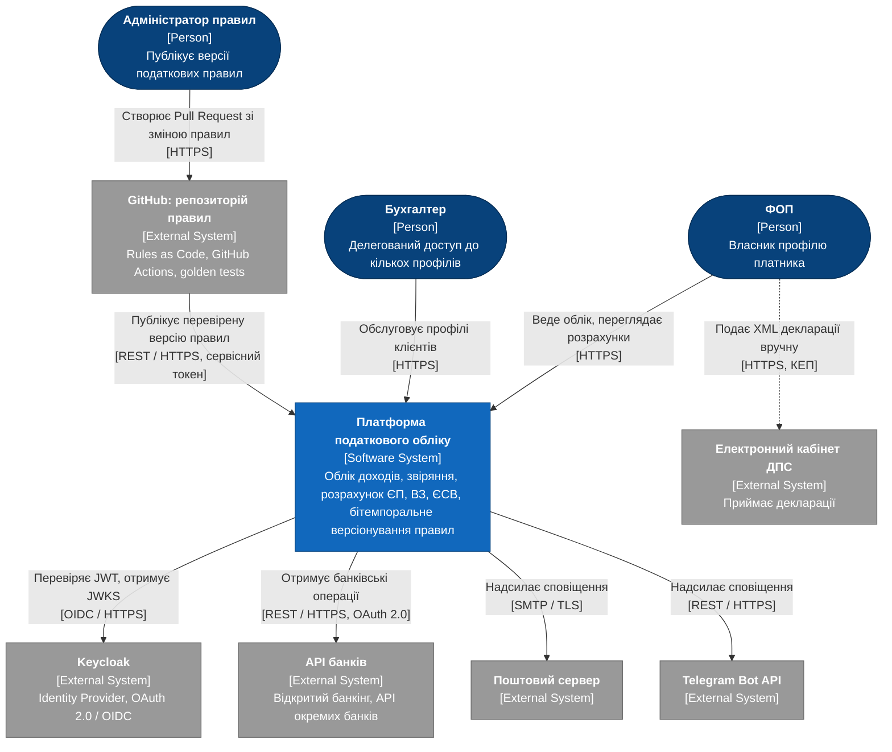
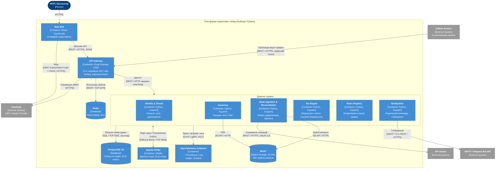

# РОЗДІЛ 2. ПРОЄКТУВАННЯ АРХІТЕКТУРИ СИСТЕМИ

Архітектуру описано за моделлю C4 (рівні Context, Container, Component) у форматі Diagrams-as-Code (Mermaid.js). Діаграми використовують нотацію C4 (стереотипи Person, Software System, Container, Component, External System; протокол на кожному зв'язку) і побудовані синтаксисом `flowchart`, оскільки експериментальний синтаксис C4 у Mermaid не забезпечує читабельного компонування для 15+ елементів. Вимоги, на які посилаються описи, наведено в [srs.md](srs.md), архітектурні рішення — у каталозі [adr/](adr/).

## 2.1. Контекстне та контейнерне моделювання системи (C4 Model)

### 2.1.1. C4 Level 1: System Context

**Опис елементів і зв'язків.**

| Елемент | Тип | Роль |
|---|---|---|
| ФОП | Person | Веде облік доходів і переглядає розрахунки ([SRS-FUN-05](srs.md#srs-fun-05), [SRS-FUN-14](srs.md#srs-fun-14)) |
| Бухгалтер | Person | Обслуговує делеговані профілі ([SRS-FUN-03](srs.md#srs-fun-03)) |
| Адміністратор правил | Person | Вносить зміни правил через Pull Request у репозиторій правил ([SRS-FUN-19](srs.md#srs-fun-19)) |
| Платформа податкового обліку | Software System | Система, що проєктується |
| Keycloak | External System | Видає й підписує JWT за OAuth 2.0 / OIDC ([SRS-NFR-SEC-01](srs.md#srs-nfr-sec-01)) |
| API банків | External System | Джерело банківських операцій ([SRS-FUN-09](srs.md#srs-fun-09)) |
| GitHub: репозиторій правил | External System | Зберігає правила як код, виконує golden tests і публікує версію ([SRS-NFR-COR-01](srs.md#srs-nfr-cor-01)) |
| Поштовий сервер, Telegram Bot API | External System | Канали доставки сповіщень ([SRS-FUN-24](srs.md#srs-fun-24)) |
| Електронний кабінет ДПС | External System | Приймає XML декларації, який користувач подає самостійно ([SRS-FUN-17](srs.md#srs-fun-17)); пряма інтеграція поза межами системи |

Протоколи: користувачі звертаються до платформи через HTTPS; публікація правил із CI — REST / HTTPS із сервісним токеном; перевірка токенів — OIDC / HTTPS (JWKS); отримання банківських даних — REST / HTTPS з авторизацією OAuth 2.0; сповіщення — SMTP / TLS і REST / HTTPS.

### 2.1.2. C4 Level 2: Container Diagram

**Опис контейнерів.**

| Контейнер | Технологія | Відповідальність і трасування |
|---|---|---|
| Web SPA | React, TypeScript | Інтерфейс користувача; вхід за OIDC Authorization Code + PKCE |
| API Gateway | Kong Gateway OSS | Термінація TLS 1.3, перевірка підпису JWT за JWKS, обмеження 100 запитів/хв на користувача з лічильниками в Redis, маршрутизація `/api/v1/*` ([SRS-NFR-SEC-04](srs.md#srs-nfr-sec-04), [SRS-NFR-SEC-05](srs.md#srs-nfr-sec-05), [SRS-NFR-MNT-02](srs.md#srs-nfr-mnt-02)) |
| Identity & Tenant | Python, FastAPI | Тенанти, ролі, делегування ([SRS-FUN-01](srs.md#srs-fun-01) – [SRS-FUN-04](srs.md#srs-fun-04)) |
| Invoicing | Python, FastAPI | Рахунки, акти, PDF у MinIO, статус оплати за подією `PaymentReconciled` ([SRS-FUN-05](srs.md#srs-fun-05) – [SRS-FUN-07](srs.md#srs-fun-07)) |
| Bank Ingestion & Reconciliation | Python, FastAPI | Імпорт CSV і API банків, ключ ідемпотентності, Circuit Breaker, звіряння ([SRS-FUN-08](srs.md#srs-fun-08) – [SRS-FUN-13](srs.md#srs-fun-13), [SRS-NFR-REL-05](srs.md#srs-nfr-rel-05)) |
| Tax Engine | Python, FastAPI | Розрахунок ЄП, ВЗ, ЄСВ, відтворюваність, ліміти, тіньовий перерахунок і diff-звіти ([SRS-FUN-14](srs.md#srs-fun-14) – [SRS-FUN-18](srs.md#srs-fun-18), [SRS-FUN-21](srs.md#srs-fun-21), [SRS-FUN-22](srs.md#srs-fun-22)); деталізацію наведено на [C4 Component](#diagram-level3) |
| Rules Registry | Python, FastAPI | Бітемпоральні версії правил, заборона змін опублікованих версій, журнал аудиту ([SRS-FUN-19](srs.md#srs-fun-19), [SRS-FUN-20](srs.md#srs-fun-20), [SRS-FUN-25](srs.md#srs-fun-25)) |
| Notification | Python, FastAPI | Податковий календар, email і Telegram ([SRS-FUN-23](srs.md#srs-fun-23), [SRS-FUN-24](srs.md#srs-fun-24)) |
| Apache Kafka | KRaft | Транспорт доменних подій, retry- і DLQ-топіки, ≥ 6 партицій із ключем `tenant_id` ([SRS-NFR-SCAL-02](srs.md#srs-nfr-scal-02), [SRS-NFR-REL-03](srs.md#srs-nfr-rel-03)); вибір обґрунтовано в [ADR-001](adr/0001-choice-of-technology.md) |
| PostgreSQL 16 | Database | Окрема схема та роль на сервіс, RLS, таблиці outbox і processed_events, PITR ([SRS-NFR-SEC-03](srs.md#srs-nfr-sec-03), [SRS-NFR-REL-04](srs.md#srs-nfr-rel-04)) |
| Redis | Database | Лічильники rate limiting, кеш моделей читання |
| MinIO | S3 API | PDF документів і вихідні файли виписок |
| OpenTelemetry Collector | OTel | Приймає траси, метрики й логи та передає їх до Prometheus, Loki, Jaeger, Grafana ([SRS-NFR-OBS-01](srs.md#srs-nfr-obs-01), [SRS-NFR-OBS-02](srs.md#srs-nfr-obs-02)) |

**Потоки подій.** Bank Ingestion публікує `StatementImported` і `PaymentReconciled`; Invoicing і Tax Engine споживають `PaymentReconciled`; Rules Registry публікує `RuleSetPublished`, який споживає Tax Engine; Tax Engine публікує `TaxRecalculated` і `LimitThresholdReached`, які споживає Notification. Кожен сервіс записує події до власної таблиці outbox у транзакції зміни даних, а фоновий процес OutboxRelay публікує їх до Kafka ([SRS-NFR-REL-02](srs.md#srs-nfr-rel-02)).

**Протоколи.** Зовнішні виклики — REST / HTTPS з JSON; внутрішня маршрутизація від шлюзу — REST / HTTP у мережі кластера, обмеженій політиками Kubernetes NetworkPolicy; доступ до PostgreSQL — SQL / TCP 5432 (asyncpg); Kafka — Kafka protocol / TCP 9092; Redis — RESP / TCP 6379; MinIO — S3 API / HTTP; телеметрія — OTLP / gRPC 4317.

## 2.2. Компонентне моделювання критичного сервісу системи

### 2.2.1. C4 Level 3: Component Diagram — Tax Engine Service

Для декомпозиції обрано Tax Engine Service, оскільки він містить основне обчислювальне навантаження і реалізує ключові вимоги темпоральної коректності та відтворюваності.

```mermaid
flowchart TB
  gw["<b>API Gateway</b><br/>[Container: Kong]"]
  kin[["<b>Apache Kafka</b><br/>[Container]<br/>PaymentReconciled, RuleSetPublished"]]
  subgraph te["Tax Engine Service [Container: Python 3.12, FastAPI]"]
    subgraph inbound["Inbound: адаптери входу"]
      mw["<b>Middleware Pipeline</b><br/>[Component: ASGI middleware]<br/>Correlation ID, OpenTelemetry, Global Error Handler (RFC 9457)"]
      auth["<b>AuthGuard</b><br/>[Component: FastAPI Depends]<br/>Перевірка JWT RS256, RBAC"]
      tctx["<b>TenantContext</b><br/>[Component: FastAPI Depends]<br/>SET app.tenant_id для RLS"]
      api["<b>TaxController</b><br/>[Component: FastAPI Router]<br/>/api/v1/tax/*, DTO Pydantic v2"]
      cons["<b>EventConsumer</b><br/>[Component: aiokafka]<br/>Десеріалізація та валідація подій"]
      idem["<b>IdempotencyGuard</b><br/>[Component]<br/>Таблиця processed_events"]
    end
    subgraph core["Core: прикладний і доменний шар"]
      uc["<b>CalculationUseCase</b><br/>[Component: Application Service]<br/>Оркестрація розрахунку періоду"]
      shadow["<b>ShadowRecalculationUseCase</b><br/>[Component: Application Service]<br/>Тіньовий перерахунок, diff-звіт"]
      resolver["<b>RuleResolver</b><br/>[Component: Domain Service]<br/>Вибір версії правил за датою операції"]
      calc["<b>TaxCalculators</b><br/>[Component: Strategy]<br/>SingleTax, MilitaryLevy, SocialContribution; Decimal"]
      limit["<b>LimitMonitor</b><br/>[Component: Domain Service]<br/>Пороги 80/95/100 %"]
      hasher["<b>InputHasher</b><br/>[Component]<br/>SHA-256 канонічного входу"]
      ports{{"<b>Ports</b><br/>[Interfaces: typing.Protocol]<br/>RuleSnapshotPort, CalculationRepoPort, UnitOfWork, EventPublisherPort"}}
    end
    subgraph outbound["Outbound: адаптери виходу"]
      rulerepo["<b>RuleSnapshotRepository</b><br/>[Component: SQLAlchemy 2.0]<br/>Локальна проєкція версій правил"]
      calcrepo["<b>CalculationRepository</b><br/>[Component: SQLAlchemy 2.0]<br/>Результати, diff-звіти"]
      uow["<b>SqlAlchemyUnitOfWork</b><br/>[Component]<br/>Одна транзакція: результат + outbox"]
      outbox["<b>OutboxRelay</b><br/>[Component: фоновий worker]<br/>Публікація з outbox, retry, DLQ"]
    end
  end
  pg[("<b>PostgreSQL 16</b><br/>[Database]<br/>схема tax_engine, RLS")]
  kout[["<b>Apache Kafka</b><br/>[Container]<br/>TaxRecalculated, LimitThresholdReached, DLQ"]]
  gw -->|"[REST / HTTP]"| mw
  mw -->|"ASGI call chain"| api
  api -->|"Depends()"| auth
  api -->|"Depends()"| tctx
  api -->|"Виклик use case через DI"| uc
  api -->|"Виклик use case через DI"| shadow
  kin -->|"[Kafka protocol / TCP 9092]"| cons
  cons -->|"Перевірка event_id"| idem
  cons -->|"Виклик use case через DI"| uc
  cons -->|"RuleSetPublished"| shadow
  uc --> resolver
  uc --> calc
  uc --> limit
  uc --> hasher
  shadow --> resolver
  shadow --> calc
  resolver -->|"через RuleSnapshotPort"| ports
  uc -->|"через UnitOfWork, CalculationRepoPort"| ports
  shadow -->|"через RuleSnapshotPort, CalculationRepoPort"| ports
  rulerepo -.->|"реалізує"| ports
  calcrepo -.->|"реалізує"| ports
  uow -.->|"реалізує"| ports
  idem -->|"через UnitOfWork"| ports
  rulerepo -->|"[SQL / TCP 5432]"| pg
  calcrepo -->|"[SQL / TCP 5432]"| pg
  uow -->|"[SQL / TCP 5432]"| pg
  outbox -->|"Читає outbox [SQL / TCP 5432]"| pg
  outbox -->|"[Kafka protocol / TCP 9092]"| kout
  classDef container fill:#438dd5,stroke:#2e6295,color:#ffffff
  classDef comp fill:#85bbf0,stroke:#5d82a8,color:#000000
  classDef port fill:#ffffff,stroke:#5d82a8,color:#000000
  classDef db fill:#438dd5,stroke:#2e6295,color:#ffffff
  class gw,kin,kout container
  class mw,auth,tctx,api,cons,idem,uc,shadow,resolver,calc,limit,hasher,rulerepo,calcrepo,uow,outbox comp
  class ports port
  class pg db
```

**Опис компонентів.**

| Шар | Компонент | Роль і взаємодія |
|---|---|---|
| Inbound | Middleware Pipeline | ASGI-middleware: correlation ID, інструментування OpenTelemetry, глобальний обробник помилок із відповіддю у форматі RFC 9457 (Problem Details) ([SRS-NFR-OBS-01](srs.md#srs-nfr-obs-01)) |
| Inbound | AuthGuard | Залежність FastAPI `Depends()`: перевірка JWT RS256 і ролей за політикою deny-by-default ([SRS-NFR-SEC-01](srs.md#srs-nfr-sec-01), [SRS-NFR-SEC-02](srs.md#srs-nfr-sec-02)) |
| Inbound | TenantContext | Встановлює `app.tenant_id` у сесії PostgreSQL для політик RLS ([SRS-FUN-04](srs.md#srs-fun-04)) |
| Inbound | TaxController | Маршрути `/api/v1/tax/*`, валідація DTO Pydantic v2; викликає лише use case, без доступу до репозиторіїв |
| Inbound | EventConsumer | Споживач aiokafka для `PaymentReconciled` і `RuleSetPublished`; валідація схем подій |
| Inbound | IdempotencyGuard | Перевіряє `event_id` у таблиці `processed_events` у транзакції обробки ([SRS-NFR-REL-02](srs.md#srs-nfr-rel-02)) |
| Core | CalculationUseCase | Оркеструє розрахунок періоду ([SRS-FUN-14](srs.md#srs-fun-14)) |
| Core | ShadowRecalculationUseCase | Оновлює проєкцію правил, виконує тіньовий перерахунок і формує diff-звіт ([SRS-FUN-21](srs.md#srs-fun-21), [SRS-FUN-22](srs.md#srs-fun-22)) |
| Core | RuleResolver | Вибирає версію правил, чинну на дату операції, з урахуванням transaction time ([SRS-FUN-14](srs.md#srs-fun-14)) |
| Core | TaxCalculators | Стратегії SingleTax, MilitaryLevy, SocialContribution на `Decimal` ([SRS-NFR-COR-02](srs.md#srs-nfr-cor-02)) |
| Core | LimitMonitor | Пороги 80/95/100 % ліміту доходу ([SRS-FUN-18](srs.md#srs-fun-18)) |
| Core | InputHasher | SHA-256 канонічного подання вхідних даних ([SRS-FUN-15](srs.md#srs-fun-15), [SRS-FUN-16](srs.md#srs-fun-16)) |
| Core | Ports | Інтерфейси `typing.Protocol`: RuleSnapshotPort, CalculationRepoPort, UnitOfWork, EventPublisherPort; ядро залежить лише від них (Dependency Inversion) |
| Outbound | RuleSnapshotRepository | Локальна проєкція версій правил, оновлювана з подій `RuleSetPublished`; усуває синхронну залежність від Rules Registry під час розрахунку |
| Outbound | CalculationRepository | Збереження результатів з ідентифікатором версії правил і хешем, diff-звітів |
| Outbound | SqlAlchemyUnitOfWork | Одна транзакція для результату розрахунку та запису до outbox (реалізує EventPublisherPort) |
| Outbound | OutboxRelay | Фоновий процес: публікація з outbox, повторні спроби з експоненційною затримкою, DLQ ([SRS-NFR-REL-03](srs.md#srs-nfr-rel-03)) |

**Взаємодія всередині процесу.** Залежності впроваджуються через механізм `Depends()` FastAPI та композиційний корінь застосунку; ядро не імпортує SQLAlchemy, aiokafka чи FastAPI. Зв'язки між шарами спрямовані лише всередину: Inbound → Core → Ports ← Outbound.

## 2.3. Документування архітектурних рішень (Architecture Decision Records)

| ADR | Рішення | Статус |
|---|---|---|
| [ADR-001](adr/0001-choice-of-technology.md) | Вибір Apache Kafka (KRaft) як брокера доменних подій | Approved |
