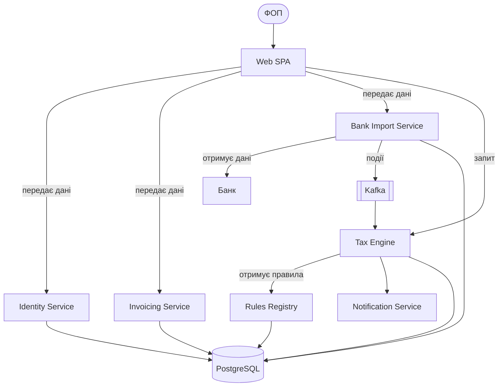
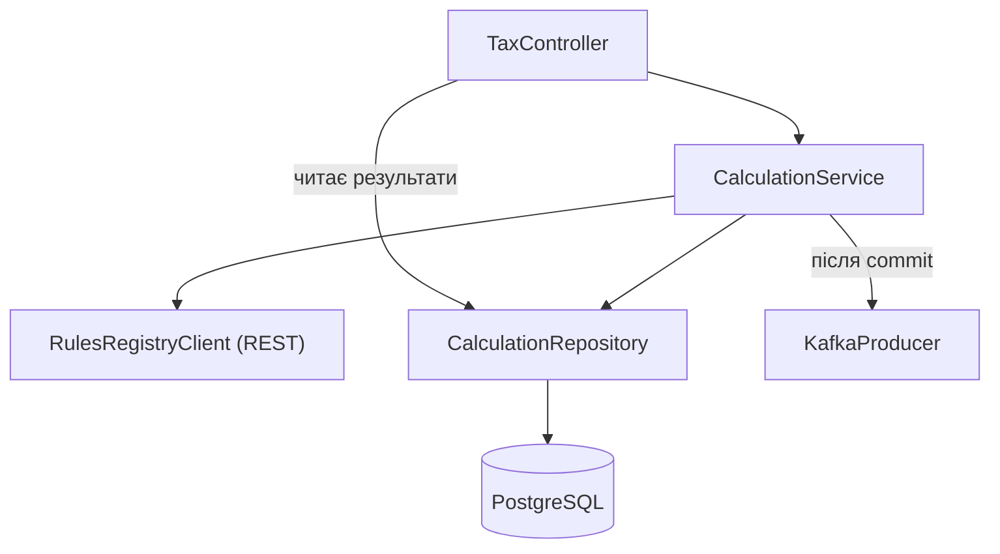

# AI Disclosure: протокол валідації теми

| Параметр | Значення |
|---|---|
| Модель | Claude Opus 5.5 (Anthropic) |
| Дата | 04.11.2026 |
| Мета | Перевірка відповідності теми рівню спеціальності F2, очищення стилю, формування фінального Thesis Proposal |
| Результат | [`proposal.md`](proposal.md), версія 1.0 |

## 1. Початковий текст

Первинний опис ідеї, сформульований студентом до AI-аудиту (зафіксований у коміті `docs(proposal): add initial thesis proposal draft`):

> **Назва:** Веб-платформа обліку фінансів, формування рахунків-фактур і розрахунку податків для ФОП та юридичних осіб.
>
> **Ключові функції:** профілі платників та ізоляція даних між користувачами; рахунки-фактури й акти; облік операцій та імпорт банківських виписок; автоматичне звіряння платежів; рушій податкових розрахунків із версіонованими правилами; календар зобов'язань і сповіщення; аналіз впливу змін законодавства.
>
> **Стек:** Python, FastAPI, PostgreSQL, React, Docker.

Альтернативний варіант, розглянутий і відхилений під час аудиту: «Платформа розрахунку заробітної плати та кадрового обліку для малого бізнесу».

## 2. Використаний промпт

Застосовано шаблон «під еталонні архітектурні рішення» з методичних вказівок до ЛР №1:

> **Роль:** Senior Software Engineer, Technical Writer та Голова Екзаменаційної Комісії зі спеціальності F2 Інженерія програмного забезпечення.
>
> **Контекст:** Я студент 4 курсу. Мені потрібно захистити кваліфікаційний проєкт бакалавра. Надано суворі вимоги до архітектурно-інфраструктурної складності майбутнього проєкту (проєкт повинен містити повний життєвий цикл: від System Design до DevSecOps, хмарного розгортання та Observability, на рівні з патернами Saga/CQRS, Kafka, SonarQube, k6, Trivy). Просто CRUD-сайти не приймаються.
>
> Ось мій первинний Thesis Proposal: *[текст із розділу 1]*
>
> **Завдання для ШІ:**
> 1. Проаналізуй мою ідею. Чи відповідає вона задекларованій інженерній глибині спеціальності F2?
> 2. Запропонуй конкретні архітектурні та інфраструктурні ускладнення (наприклад, додавання асинхронної взаємодії, патернів відмовостійкості, безпеки Application Security або автоматизації контролю технічного боргу), які піднімуть цінність моєї роботи до рівня Enterprise-орієнтованих архітектурних рішень.
> 3. Очисти текст від розмовного стилю та канцеляризмів. Зроби формулювання чіткими, інженерними та лаконічними.
> 4. Згенеруй фінальний відформатований варіант пропозиції українською та англійською мовами.

Додаткові уточнювальні запити в межах тієї самої сесії: порівняння двох варіантів теми; модель роботи системи зі змінами законодавства; оцінка складності розширення на юридичних осіб; вибір мови та фреймворку бекенду.

## 3. Аналітичні рекомендації ШІ

### 3.1. Оцінка відповідності рівню F2

- Ідея не є простим CRUD-застосунком: імпорт виписок, звіряння платежів і версіонований рушій правил потребують асинхронної обробки, ідемпотентності та аудиту.
- Варіант із заробітною платою відхилено: частина функцій (кадровий реєстр, табель, кабінет працівника) має CRUD-характер, а основна складність є предметною, а не інженерною.
- Ключова інженерна проблема проєкту — темпоральна коректність розрахунків в умовах змін законодавства.

### 3.2. Рекомендовані ускладнення архітектури

| Напрям | Рекомендація |
|---|---|
| Модель даних | Бітемпоральне версіонування правил (valid time та transaction time); незмінність опублікованих версій |
| Рушій правил | Розділення параметрів (дані з періодом дії) і формул (версіоновані стратегії); Rules as Code у Git із CI-гейтом на golden tests |
| Асинхронна взаємодія | Event-driven архітектура на Apache Kafka; Transactional Outbox; ідемпотентні консюмери; Dead Letter Queue |
| Звітність | CQRS: окрема модель читання для звітів і diff-звітів аналізу впливу |
| Мультитенантність | Row-Level Security у PostgreSQL; делегований доступ бухгалтера |
| Безпека | SonarQube, Bandit, Trivy у CI; шифрування фінансових даних; незмінний журнал аудиту |
| Якість | Property-based тести (Hypothesis), Testcontainers, k6 на масовому імпорті |
| Спостережуваність | OpenTelemetry, Prometheus, Grafana; наскрізне трасування від імпорту до сповіщення |
| Процес змін законодавства | Human-in-the-loop замість автоматичного розбору законів; тіньовий what-if перерахунок перед застосуванням |

### 3.3. Рекомендації щодо обсягу

- Звузити предметну область до ФОП 1–3 груп. Підтримка юридичних осіб потребує подвійного бухгалтерського запису, ПДВ і податку на прибуток, що збільшує обсяг предметної логіки в кілька разів без пропорційного зростання інженерної складності.
- Розширюваність на інші категорії платників продемонструвати архітектурно (тип платника як вимір правил, ADR), а не функціонально.
- Спростити назву теми; бітемпоральну модель розкрити в описі та ADR.

### 3.4. Стилістичні виправлення

- Вилучено розмовні конструкції («часто ведуть облік вручну», «важко вчасно все перераховувати»).
- Проблематику переформульовано як перелік вимірюваних інженерних вимог (темпоральна коректність, відтворюваність, керована еволюція правил, надійність).
- Стек структуровано за категоріями відповідно до вимог Завдання 2.

## 4. Рішення студента

Прийнято рекомендації 3.1–3.4. Фінальну назву обрано зі спрощених варіантів, запропонованих ШІ. Мову бекенду (Python / FastAPI) обрано студентом з урахуванням власного досвіду. Остаточну відповідність теми підтверджує науковий керівник.

---

# ЛР №2. Науковий апарат і календарний план

| Параметр | Значення |
|---|---|
| Модель | Claude Opus 5.5 (Anthropic) |
| Дата | 05.11.2026 |
| Результат | [`0_intro.md`](0_intro.md), календарний план у [`README.md`](README.md) |

## Сесія 1. Науковий апарат («Вступ» за ДСТУ 3008:2015)

### Промпт

Застосовано калібрувальний промпт із методичних вказівок до ЛР №2 (роль: Technical Writer, Senior Software Engineer та Голова Екзаменаційної Комісії ЧНУ зі спеціальності F2/121). У тіло промпту вставлено повний текст [`proposal.md`](proposal.md) версії 1.0. Завдання: згенерувати п'ять блоків — Актуальність, Об'єкт, Предмет, Мета, 6–7 завдань інженерного pipeline, кожне з інфінітива.

### Початковий результат (ітерація 1)

- **Об'єкт:** процес податкового обліку фізичних осіб-підприємців.
- **Предмет:** мікросервісна архітектура, Apache Kafka, PostgreSQL та FastAPI для автоматизації податкового обліку.
- **Мета:** розробка платформи податкового обліку для ФОП з метою автоматизації розрахунку податків.
- **Завдання (6):** проаналізувати предметну область і аналоги; обґрунтувати стек; спроєктувати архітектуру системи; реалізувати серверну частину та інтерфейс; провести тестування; підготувати статтю.

### Рев'ю та коригування

| № | Виявлена проблема | Вимога до виправлення |
|---|---|---|
| 1 | Об'єкт сформульовано надто широко, без зв'язку з основною проблемою теми | Уточнити об'єкт: розрахунок податкових зобов'язань в умовах змін законодавства |
| 2 | Предмет містить лише перелік технологій, без методів | Сформулювати предмет як методи та засоби: бітемпоральне версіонування, Transactional Outbox, ідемпотентні консюмери, CQRS, мультитенантна ізоляція |
| 3 | Мета не містить якісного покращення («автоматизація» не є інженерною характеристикою) | Додати вимірювані якості: темпоральна коректність, відтворюваність, відмовостійкість |
| 4 | Лише 6 завдань; відсутні окремі етапи алгоритмізації критичних вузлів і схеми розгортання; реалізацію змішано з проєктуванням інтерфейсу | Переписати як 7 завдань за pipeline методички; деталізувати алгоритми та інструментальний аудит |
| 5 | Актуальність описує проблему загально, без інженерного контексту | Додати асинхронність, пікові навантаження, ідемпотентність, узгодженість і ізоляцію даних |

### Фінальний результат (ітерація 2)

Прийнято до [`0_intro.md`](0_intro.md) без змін після повторної перевірки: об'єкт є процесом, предмет є частиною об'єкта, мета містить якісне покращення, 7 завдань починаються з інфінітива та покривають аналіз, обґрунтування стеку, архітектуру C4/UML, алгоритми, інтерфейс і розгортання, інструментальний аудит, апробацію.

## Сесія 2. Календарний план

### Промпт

Застосовано календарний промпт із методичних вказівок до ЛР №2 (роль: IT Project Manager та Нормоконтролер). Передано тему, мету та 7 завдань із сесії 1. Обмеження: 8–10 етапів; етапи 1–4 завершуються не пізніше лютого 2027 року; етапи 5–7 — не пізніше кінця квітня 2027 року; травень залишається вільним для нормоконтролю та передзахисту.

### Результат і валідація

Сформовано 9 етапів: етап 1 (тема та науковий апарат) і етап 9 (оформлення пояснювальної записки) доповнюють 7 завдань наукового апарату, які відображено в етапах 2–8 у тому самому порядку.

| Перевірка | Результат |
|---|---|
| Етапи аналітики, стеку, архітектури, алгоритмів і базового коду (1–5) завершуються до 28.02.2027 | Виконано |
| Етапи інтерфейсу та інфраструктури, аудиту, апробації та оформлення (6–9) завершуються до 30.04.2027 | Виконано |
| Травень 2027 вільний | Виконано |
| Відсутні часові розриви між етапами | Виконано: етапи йдуть послідовно з частковим перекриттям |
| Архітектурі відведено достатньо часу | Виконано: 7 тижнів на проєктування, 8 тижнів на алгоритми та базову реалізацію |

---

# ЛР №3. Інженерний аналіз аналогів

| Параметр | Значення |
|---|---|
| Модель | Claude Opus 5.5 (Anthropic) з інструментом вебпошуку |
| Дата | 12.11.2026 |
| Результат | [`1_analysis.md`](1_analysis.md), підрозділ 1.2 |

## Сесія 1. Інженерний скаутинг аналогів

**Початкові дані:** тема, стек із [`proposal.md`](proposal.md). Вимога до вибору: лише українські системи різних архітектурних класів. Обрано M.E.Doc (десктопний клієнт-сервер), Таксер (хмарний SaaS для ФОП) та Електронний кабінет платника податків ДПС (державна платформа з API).

**Промпт:** калібрувальний аналітичний промпт із методичних вказівок до ЛР №3 (роль: Senior Software Architect, Technical Writer та Технічний Аудитор систем) зі структурою: архітектурний патерн, протоколи, стек даних і консистентність, технічні обмеження.

**Валідація та верифікація.** Кожне твердження про аналоги перевірено за публічними джерелами (перелік джерел наведено в кінці підрозділу 1.2). Коригування:

| № | Початкове твердження | Результат перевірки |
|---|---|---|
| 1 | M.E.Doc використовує СУБД Firebird | Уточнено: Firebird (Super Classic / Classic, до 100 ГБ), для більших баз — Oracle або PostgreSQL |
| 2 | Таксер зберігає ключі КЕП на сервері для підписання звітів | Спростовано: криптоперетворення виконуються в браузері, ключі зберігаються в зашифрованій базі й за замовчуванням не передаються на сервер |
| 3 | Таксер синхронізує виписки всіх українських банків | Уточнено: автоматична синхронізація — monobank, ПриватБанк, ПУМБ; для інших банків — імпорт CSV |
| 4 | API Електронного кабінету приймає звіти у форматі XML | Уточнено: JSON із вкладеним підписаним і зашифрованим XML у Base64 у форматі транспортного контейнера (наказ ДПА № 499 від 12.07.2010) |
| 5 | API відкритої частини Електронного кабінету доступний без обмежень | Уточнено: використання API відкритої частини припинено на період воєнного стану |
| 6 | Внутрішній стек даних Таксера та Електронного кабінету | Позначено як публічно не задокументований; аналіз обмежено рівнем інтерфейсів |

## Сесія 2. Порівняльна матриця та аналітичний висновок

**Промпт:** промпт архітектурного висновку з методичних вказівок до ЛР №3 (роль: Senior Software Architect та Team Lead). Передано дані матриці: стек проєкту та архітектуру, API, СУБД і обмеження трьох аналогів.

**Критерії матриці (6):** тип архітектури та розгортання; протоколи обміну; СУБД та консистентність; масштабування та відмовостійкість; безпека та ланцюг постачання; керування версіями податкових правил. Нетехнічні критерії (ціна, популярність) виключено.

**Результат:** висновок підрозділу 1.2 у трьох абзацах — порівняння трьох архітектурних підходів, запозичені рішення та способи усунення недоліків, архітектурний компроміс і перехід до розділу 2.

## Сесія 3. Стилістичний AI-лінтер

**Промпт:** промпт стилістичного лінтера з методичних вказівок до ЛР №3 (роль: Головний редактор наукових ІТ-видань, Technical Writer та Нормоконтролер). На вхід передано робочий текст картки «Інженерний опис аналогів» і висновок із PKM Workspace.

**Внесені зміни:**

- особові форми («обрали», «запозичимо», «наш реєстр») переведено в безособові («обрано», «запозичено», «проєктований реєстр»);
- оцінні формулювання замінено нейтральними; твердження постачальників позначено посиланням «за даними постачальника»;
- назву таблиці розміщено над таблицею з номером за розділом (Таблиця 1.1);
- англомовні терміни та назви технологій (Apache Kafka, PostgreSQL, REST API, CQRS, Transactional Outbox) збережено мовою оригіналу;
- додано посилання на джерела у квадратних дужках.

---

# ЛР №4. Аналіз предметної області, вимоги та консолідація Розділу 1

| Параметр | Значення |
|---|---|
| Модель | Claude Opus 5.5 (Anthropic) з інструментом вебпошуку |
| Дата | 12.11.2026 |
| Результат | [`1_analysis.md`](1_analysis.md) (підрозділи 1.1–1.5, висновки), документ F2_Diploma_Chapter1_Ishchuk |

## Лог №1. Аналіз предметної області (Завдання 1)

**Промпт:** промпт ШІ-аналітика доменів із методичних вказівок до ЛР №4 (роль: Senior Business Analyst, Product Owner та Технічний writer) з темою та стеком проєкту; структура: характеристика домену, актори та сутності, 2–3 процеси As-Is із bottlenecks, регуляторні обмеження.

| № | Проблема в результаті ШІ | Внесене коригування |
|---|---|---|
| 1 | Процеси описано загально («облік доходів є трудомістким») | Конкретизовано пайплайн: канали надходження даних, класифікація доходу, зіставлення з рахунками |
| 2 | Числові параметри домену подано без перевірки | Значення на 2026 рік (МЗП 8647 грн, ЄСВ 1902,34 грн, ВЗ 864,7 грн / 1 %, ліміт 3 групи 10 091 049 грн) звірено з фаховими виданнями та Законом № 4695-IX |
| 3 | Відкритий банкінг подано як уже доступний для ФОП | Уточнено: спершу API для рахунків фізичних осіб, для ФОП — пізніше; система підтримує кілька каналів |
| 4 | Вузькі місця не мали ідентифікаторів | Додано таблицю B1–B9 для трасування до вимог To-Be |
| 5 | Бракувало стандартів обміну з ДПС | Додано формат транспортного контейнера (наказ ДПА № 499) і Положення НБУ про відкритий банкінг |

## Лог №2. Модель To-Be, Core Features і NFRs (Завдання 2)

**Промпт:** промпт ШІ-інженера вимог із методичних вказівок до ЛР №4 (роль: Senior Systems Analyst, Lead Software Architect та Нормоконтролер) з текстом підрозділу 1.4 як контекстом.

| № | Початкове формулювання | Фінальне формулювання та обґрунтування |
|---|---|---|
| 1 | «Система має забезпечувати високу продуктивність» | NFR-01/02: p95 ≤ 200 мс при 200 RPS (читання), p95 ≤ 300 мс при 50 RPS (запис); 200 RPS замість 500 RPS із прикладу методички відповідає ресурсам демонстраційного кластера |
| 2 | «Висока доступність і відмовостійкість» | NFR-07–NFR-10: SLO 99,5 %, 0 дублікатів при повторній доставці, збереження подій при недоступності брокера до 15 хв, RPO ≤ 15 хв, RTO ≤ 1 год |
| 3 | «Захищена автентифікація користувачів» | NFR-12: OAuth 2.0 / OIDC (Keycloak), JWT RS256, TTL 15 хв / 8 год; Keycloak додано до стеку |
| 4 | «Відповідність стандартам безпеки» | NFR-15: OWASP ASVS 4.0 L2 і числові пороги SonarQube, Bandit, Trivy |
| 5 | Відсутня вимога до відтворюваності | Додано NFR-11: 100 % відтворюваних розрахунків, CI-гейт на golden tests |
| 6 | 10 функцій, зокрема мобільний застосунок і подання декларації з КЕП | Скорочено до 8: обидві функції виходять за межі проєкту з Thesis Proposal |

## Лог №3. Висновки до розділу 1 (Завдання 3)

**Промпт:** промпт ШІ-редактора висновків із методичних вказівок до ЛР №4 (роль: Senior Technical Writer, Голова Екзаменаційної Комісії) з темою, стеком і змістом підрозділів 1.1–1.5.

**Коригування:** вилучено оцінні прикметники; у другий абзац додано обґрунтування вибору Python (FastAPI) і роль відкритого банкінгу; третій абзац переписано як явний місток до розділу 2 (архітектура, модель даних, схема розгортання) і розділу 3 (реалізація, верифікація NFRs, аудит коду); кількість вузьких місць і вимог звірено з таблицями 1.3 і 1.5.

---

# ЛР №5. SRS, C4 Model та ADR

| Параметр | Значення |
|---|---|
| Модель | Claude Opus 5.5 (Anthropic) |
| Дата | 12.11.2026 |
| Результат | [`srs.md`](srs.md), [`2_design.md`](2_design.md), [`adr/0001-choice-of-technology.md`](adr/0001-choice-of-technology.md) |

## Лог №1. Аудит SRS за ISO/IEC/IEEE 29148 (Завдання 1)

**Початкова чернетка (імпорт із ЛР №4):** 8 функціональних вимог FR-1 – FR-8, згрупованих за сервісами, без модальних дієслів; 19 нефункціональних вимог NFR-01 – NFR-19; критерії верифікації — стовпець «Метод перевірки» з однослівними значеннями («k6», «Інтеграційні тести»); глосарій відсутній.

**Промпт:** промпт ШІ-аудитора вимог із методичних вказівок до ЛР №5 (роль: Principal Systems Analyst, Lead Requirements Engineer, технічний аудитор ISO/IEEE) зі стеком проєкту та чернеткою SRS.

**Звіт ШІ-аудитора:**

1. *Атомарність.* FR-1 містить чотири системні дії (створення тенанта, призначення ролей, делегування, RLS); FR-2 — три (створення документа, генерація PDF, статус); FR-4 — три; FR-5 — чотири (розрахунок, збереження версії, відтворення, експорт XML); FR-7 — чотири. Рекомендація: одна вимога — одна дія, модальне дієслово «повинна». Суб'єктивний поріг «нечіткий збіг» не визначено числом.
2. *Вимірюваність NFRs.* NFR-01 – NFR-05 вимірювані. Для NFR-01 відсутній критерій допустимої частки помилок під навантаженням, без якого p95 можна виконати за рахунок відхилених запитів. NFR-07 (99,5 %) не має вікна вимірювання. Вимога до грошової точності відсутня, хоча предметна область фінансова.
3. *Критерії верифікації.* Однослівні методи не є критеріями проходження. Рекомендовано вказати інструмент і поріг: k6 thresholds, Testcontainers для PostgreSQL/Kafka/Keycloak, Postman/Newman для API, валідацію XSD, Prometheus для доступності, gitleaks для секретів.
4. *Gap Analysis.* Відсутні: rate limiting на рівні шлюзу; обробка недоступності банківських API (Circuit Breaker); health checks; версіонування API; комплаєнс обробки персональних даних і строки видалення; керування секретами; формат логів для кореляції; mTLS між сервісами (service mesh); реплікація PostgreSQL і SLA 99,9 % з multi-AZ; відповідність GDPR.

**Опрацювання зауважень:**

| № | Зауваження | Рішення |
|---|---|---|
| 1 | Неатомарні FR | Прийнято: 8 вимог розбито на 25 атомарних SRS-FUN-01 – SRS-FUN-25 із дієсловом «повинна»; поріг нечіткого збігу задано як 0,85 |
| 2 | Немає критерію помилок під навантаженням | Прийнято: SRS-NFR-PERF-03 (5xx ≤ 0,5 %) |
| 3 | Немає вимоги до грошової точності | Прийнято: SRS-NFR-COR-02 (`Decimal`, ROUND_HALF_UP, заборона `float`) |
| 4 | Однослівні критерії верифікації | Прийнято: розділ 5 з інструментами та порогами для кожної групи вимог |
| 5 | Rate limiting, Circuit Breaker, health checks, версіонування API, секрети, логи | Прийнято: SRS-NFR-SEC-05, SRS-NFR-REL-05, SRS-NFR-REL-06, SRS-NFR-MNT-02, SRS-NFR-SEC-07, SRS-NFR-OBS-02 |
| 6 | Комплаєнс персональних даних | Прийнято з уточненням: замість GDPR — Закон України «Про захист персональних даних» (SRS-NFR-CMP-01), оскільки система обробляє дані резидентів України |
| 7 | Реплікація PostgreSQL і SLA 99,9 % з multi-AZ | Відхилено: демонстраційне розгортання виконується в одному кластері з обмеженими ресурсами; ризик компенсується PITR з RPO ≤ 15 хв (SRS-NFR-REL-04) |
| 8 | mTLS через service mesh | Відхилено: накладні ресурси Istio/Linkerd несумісні з демонстраційним кластером; внутрішній трафік обмежується Kubernetes NetworkPolicy, зовнішній — TLS 1.3 на шлюзі |

## Лог №2. Рев'ю діаграм C4 Context і Container (Завдання 2)

**Перша версія Container Diagram (v1):**

**Промпт:** промпт ШІ-рев'юера архітектури C4 із методичних вказівок до ЛР №5 (роль: Chief Software Architect, експерт C4 Model) з текстом SRS і кодом діаграм.

**Звіт ШІ-рев'юера:**

1. *Трасування SRS.* Відсутні актори «Бухгалтер» і «Адміністратор правил» (SRS-FUN-03, SRS-FUN-19); відсутні Keycloak (SRS-NFR-SEC-01), канали сповіщень (SRS-FUN-24), об'єктне сховище PDF (SRS-FUN-06), CI репозиторію правил (SRS-NFR-COR-01).
2. *Логіка контейнерів.* SPA звертається до сервісів напряму без точки входу — неможливо виконати SRS-NFR-SEC-05 (rate limiting) і централізовану перевірку JWT. Синхронний виклик Tax Engine → Rules Registry створює залежність розрахунку від доступності іншого сервісу. Зв'язок Tax Engine → Notification дублює подієвий канал.
3. *Протоколи.* Підписи «передає дані», «запит», «отримує дані», «події» та стрілки без підписів не специфікують протокол.
4. *Інфраструктура.* Бракує API Gateway, Identity Provider, кешу/сховища лічильників для rate limiting, колектора телеметрії (SRS-NFR-OBS-01); не позначено ізоляцію схем PostgreSQL між сервісами.

**Виправлення у фінальній версії:** додано акторів і зовнішні системи на рівні Context; додано API Gateway (Kong Gateway OSS) з Redis для лічильників, Keycloak, MinIO, OpenTelemetry Collector; синхронний виклик Tax Engine → Rules Registry замінено подією `RuleSetPublished` і локальною проєкцією правил; прямий зв'язок Tax Engine → Notification замінено подіями `TaxRecalculated`, `LimitThresholdReached`; кожен зв'язок підписано протоколом і портом; позначено «схема на сервіс, RLS». Експериментальний синтаксис `C4Container` у Mermaid дав накладання підписів для 15+ елементів, тому діаграми побудовано синтаксисом `flowchart` із нотацією C4 (стереотипи та кольори C4).

## Лог №3. Аудит C4 Component для Tax Engine Service (Завдання 3)

**Перша версія Component Diagram (v1):**

**Промпт:** промпт ШІ-аудитора компонентного рівня із методичних вказівок до ЛР №5 (роль: Principal Software Architect, експерт GoF, Clean Architecture, DDD) з назвою сервісу (Tax Engine Service, Python 3.12, FastAPI, SQLAlchemy 2.0, aiokafka) і кодом діаграми.

**Звіт ШІ-аудитора:**

1. *Порушення шарів.* TaxController звертається до CalculationRepository напряму в обхід прикладного шару.
2. *SOLID і зв'язність.* CalculationService залежить від конкретних класів RulesRegistryClient, CalculationRepository, KafkaProducer — порушено Dependency Inversion; публікація події «після commit» є подвійним записом без атомарності (втрата події при збої між commit і send). Розрахунок, вибір версії правил, контроль ліміту та хешування зосереджено в одному сервісі — порушено Single Responsibility. Відсутній вхід із Kafka, хоча сервіс споживає `PaymentReconciled` і `RuleSetPublished`.
3. *Повнота конвеєра.* Відсутні глобальний обробник помилок, валідація DTO, correlation ID і телеметрія, захист від повторної обробки подій.
4. *Безпека.* Відсутні перевірка JWT і RBAC, встановлення контексту тенанта для RLS.

**Виправлення у фінальній версії:** введено шари Inbound / Core / Outbound і порти `typing.Protocol`; контролер викликає лише use case; додано EventConsumer та IdempotencyGuard; CalculationService розділено на CalculationUseCase, ShadowRecalculationUseCase, RuleResolver, TaxCalculators (Strategy), LimitMonitor, InputHasher; KafkaProducer замінено на SqlAlchemyUnitOfWork (результат і outbox в одній транзакції) та OutboxRelay; синхронний RulesRegistryClient замінено на RuleSnapshotRepository з проєкцією подій; додано Middleware Pipeline (correlation ID, OpenTelemetry, обробник помилок RFC 9457), AuthGuard і TenantContext.

## Лог №4. Аудит ADR-001 (Завдання 4)

**Початкова чернетка:** «Обрано Apache Kafka, оскільки це галузевий стандарт для мікросервісів, він швидкий і масштабується. RabbitMQ застарілий і повільніший. Наслідки: висока продуктивність і надійність системи».

**Промпт:** промпт ШІ-аудитора рішень (ADR Reviewer) із методичних вказівок до ЛР №5 (роль: CTO, Principal Enterprise Architect) з текстом SRS і чернеткою ADR.

**Звіт ШІ-судді:**

1. *Аргументація.* «Галузевий стандарт», «швидкий», «масштабується» не є інженерними аргументами без прив'язки до вимог. Рішення слід обґрунтувати вимогами, що відрізняють альтернативи: replay історії (SRS-FUN-21), порядок подій тенанта при паралельній обробці (SRS-NFR-SCAL-02), збереження подій (SRS-NFR-REL-03).
2. *Альтернативи.* Твердження «RabbitMQ застарілий» некоректне: RabbitMQ має вбудовані DLX, TTL, quorum-черги і RabbitMQ Streams із семантикою журналу. Не розглянуто Redis Streams, хоча Redis уже є у стеку.
3. *Наслідки.* Відсутні негативні наслідки: операційна складність і ресурси Kafka, відсутність вбудованих DLQ і відкладених повторних спроб, відсутність exactly-once end-to-end із PostgreSQL, паузи під час ребалансування груп, ускладнення CI через контейнер Kafka у тестах, вартість керованих сервісів (FinOps) і ризик vendor lock-in; один брокер у демонстраційному кластері не забезпечує відмовостійкості самого брокера.

**Підсумок:** прийнято всі зауваження. Рішення на користь Kafka збережено, але обґрунтування переведено на вимоги replay і впорядкованої паралельної обробки; для RabbitMQ і Redis Streams описано реальні переваги; додано сім негативних наслідків і умови перегляду рішення. Розуміння вибору змінилося: Kafka обрано не через продуктивність, а через модель журналу, яку інші альтернативи забезпечують лише з додатковими компонентами.
