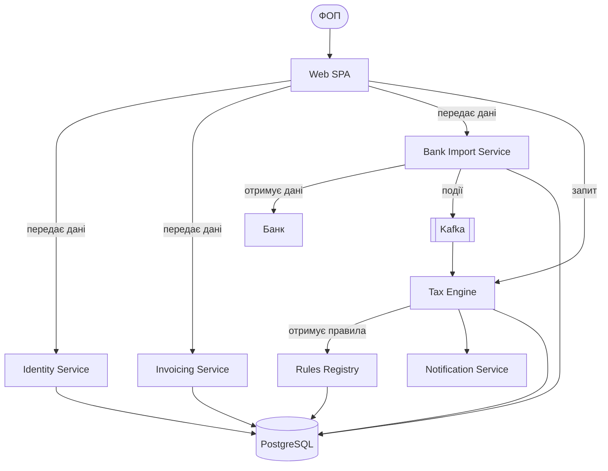
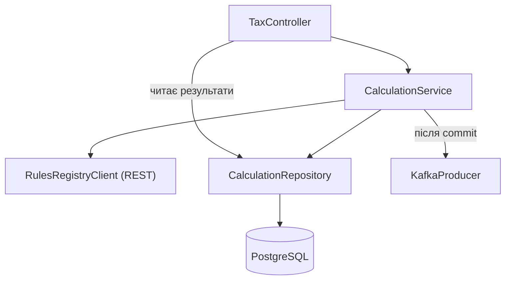
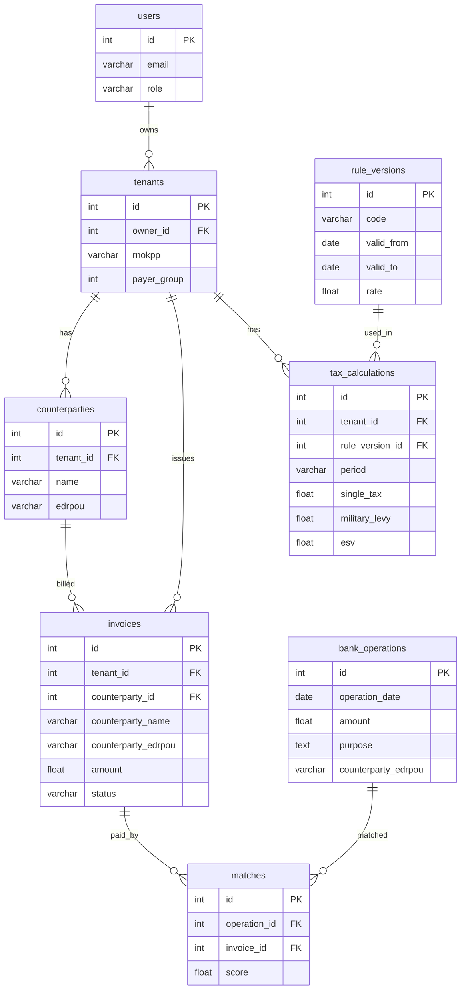

# AI Disclosure: протокол валідації теми

| Параметр | Значення |
|---|---|
| Модель | Claude Opus 5.5 (Anthropic) |
| Дата | 04.11.2026 |
| Мета | Перевірка відповідності теми рівню спеціальності F2, очищення стилю, формування фінального Thesis Proposal |
| Результат | [`proposal.md`](proposal.md), версія 1.0 |

## 1. Початковий текст

Первинний опис ідеї, сформульований студентом до AI-аудиту (зафіксований у коміті `docs(proposal): add initial thesis proposal draft`):

> **Назва:** Веб-платформа обліку фінансів, формування рахунків-фактур і розрахунку податків для ФОП та юридичних осіб.
>
> **Ключові функції:** профілі платників та ізоляція даних між користувачами; рахунки-фактури й акти; облік операцій та імпорт банківських виписок; автоматичне звіряння платежів; рушій податкових розрахунків із версіонованими правилами; календар зобов'язань і сповіщення; аналіз впливу змін законодавства.
>
> **Стек:** Python, FastAPI, PostgreSQL, React, Docker.

Альтернативний варіант, розглянутий і відхилений під час аудиту: «Платформа розрахунку заробітної плати та кадрового обліку для малого бізнесу».

## 2. Використаний промпт

Застосовано шаблон «під еталонні архітектурні рішення» з методичних вказівок до ЛР №1:

> **Роль:** Senior Software Engineer, Technical Writer та Голова Екзаменаційної Комісії зі спеціальності F2 Інженерія програмного забезпечення.
>
> **Контекст:** Я студент 4 курсу. Мені потрібно захистити кваліфікаційний проєкт бакалавра. Надано суворі вимоги до архітектурно-інфраструктурної складності майбутнього проєкту (проєкт повинен містити повний життєвий цикл: від System Design до DevSecOps, хмарного розгортання та Observability, на рівні з патернами Saga/CQRS, Kafka, SonarQube, k6, Trivy). Просто CRUD-сайти не приймаються.
>
> Ось мій первинний Thesis Proposal: *[текст із розділу 1]*
>
> **Завдання для ШІ:**
>
> 1. Проаналізуй мою ідею. Чи відповідає вона задекларованій інженерній глибині спеціальності F2?
> 2. Запропонуй конкретні архітектурні та інфраструктурні ускладнення (наприклад, додавання асинхронної взаємодії, патернів відмовостійкості, безпеки Application Security або автоматизації контролю технічного боргу), які піднімуть цінність моєї роботи до рівня Enterprise-орієнтованих архітектурних рішень.
> 3. Очисти текст від розмовного стилю та канцеляризмів. Зроби формулювання чіткими, інженерними та лаконічними.
> 4. Згенеруй фінальний відформатований варіант пропозиції українською та англійською мовами.

Додаткові уточнювальні запити в межах тієї самої сесії: порівняння двох варіантів теми; модель роботи системи зі змінами законодавства; оцінка складності розширення на юридичних осіб; вибір мови та фреймворку серверної частини (backend).

## 3. Аналітичні рекомендації ШІ

### 3.1. Оцінка відповідності рівню F2

- Ідея не є простим CRUD-застосунком: імпорт виписок, звіряння платежів і версіонований рушій правил потребують асинхронної обробки, ідемпотентності та аудиту.
- Варіант із заробітною платою відхилено: частина функцій (кадровий реєстр, табель, кабінет працівника) має CRUD-характер, а основна складність є предметною, а не інженерною.
- Ключова інженерна проблема проєкту — темпоральна коректність розрахунків в умовах змін законодавства.

### 3.2. Рекомендовані ускладнення архітектури

| Напрям | Рекомендація |
|---|---|
| Модель даних | Бітемпоральне версіонування правил (valid time та transaction time); незмінність опублікованих версій |
| Рушій правил | Розділення параметрів (дані з періодом дії) і формул (версіоновані стратегії); Rules as Code у Git із CI-гейтом на golden tests |
| Асинхронна взаємодія | Event-driven архітектура на Apache Kafka; Transactional Outbox; ідемпотентні консюмери; Dead Letter Queue |
| Звітність | CQRS: окрема модель читання для звітів і diff-звітів аналізу впливу |
| Мультитенантність | Row-Level Security у PostgreSQL; делегований доступ бухгалтера |
| Безпека | SonarQube, Bandit, Trivy у CI; шифрування фінансових даних; незмінний журнал аудиту |
| Якість | Property-based тести (Hypothesis), Testcontainers, k6 на масовому імпорті |
| Спостережуваність | OpenTelemetry, Prometheus, Grafana; наскрізне трасування від імпорту до сповіщення |
| Процес змін законодавства | Human-in-the-loop замість автоматичного розбору законів; тіньовий what-if перерахунок перед застосуванням |

### 3.3. Рекомендації щодо обсягу

- Звузити предметну область до ФОП 1–3 груп. Підтримка юридичних осіб потребує подвійного бухгалтерського запису, ПДВ і податку на прибуток, що збільшує обсяг предметної логіки в кілька разів без пропорційного зростання інженерної складності.
- Розширюваність на інші категорії платників продемонструвати архітектурно (тип платника як вимір правил, ADR), а не функціонально.
- Спростити назву теми; бітемпоральну модель розкрити в описі та ADR.

### 3.4. Стилістичні виправлення

- Вилучено розмовні конструкції («часто ведуть облік вручну», «важко вчасно все перераховувати»).
- Проблематику переформульовано як перелік вимірюваних інженерних вимог (темпоральна коректність, відтворюваність, керована еволюція правил, надійність).
- Стек структуровано за категоріями відповідно до вимог Завдання 2.

## 4. Рішення студента

Прийнято рекомендації 3.1–3.4. Фінальну назву обрано зі спрощених варіантів, запропонованих ШІ. Мову серверної частини (Python / FastAPI) обрано студентом з урахуванням власного досвіду. Остаточну відповідність теми підтверджує науковий керівник.

---

## ЛР №2. Науковий апарат і календарний план

| Параметр | Значення |
|---|---|
| Модель | Claude Opus 5.5 (Anthropic) |
| Дата | 05.11.2026 |
| Результат | [`0_intro.md`](0_intro.md), календарний план у [`README.md`](README.md) |

### Сесія 1. Науковий апарат («Вступ» за ДСТУ 3008:2015)

#### Промпт

Застосовано калібрувальний промпт із методичних вказівок до ЛР №2 (роль: Technical Writer, Senior Software Engineer та Голова Екзаменаційної Комісії ЧНУ зі спеціальності F2/121). У тіло промпту вставлено повний текст [`proposal.md`](proposal.md) версії 1.0. Завдання: згенерувати п'ять блоків — Актуальність, Об'єкт, Предмет, Мета, 6–7 завдань інженерного pipeline, кожне з інфінітива.

#### Початковий результат (ітерація 1)

- **Об'єкт:** процес податкового обліку фізичних осіб-підприємців.
- **Предмет:** мікросервісна архітектура, Apache Kafka, PostgreSQL та FastAPI для автоматизації податкового обліку.
- **Мета:** розробка платформи податкового обліку для ФОП з метою автоматизації розрахунку податків.
- **Завдання (6):** проаналізувати предметну область і аналоги; обґрунтувати стек; спроєктувати архітектуру системи; реалізувати серверну частину та інтерфейс; провести тестування; підготувати статтю.

#### Рев'ю та коригування

| № | Виявлена проблема | Вимога до виправлення |
|---|---|---|
| 1 | Об'єкт сформульовано надто широко, без зв'язку з основною проблемою теми | Уточнити об'єкт: розрахунок податкових зобов'язань в умовах змін законодавства |
| 2 | Предмет містить лише перелік технологій, без методів | Сформулювати предмет як методи та засоби: бітемпоральне версіонування, Transactional Outbox, ідемпотентні консюмери, CQRS, мультитенантна ізоляція |
| 3 | Мета не містить якісного покращення («автоматизація» не є інженерною характеристикою) | Додати вимірювані якості: темпоральна коректність, відтворюваність, відмовостійкість |
| 4 | Лише 6 завдань; відсутні окремі етапи алгоритмізації критичних вузлів і схеми розгортання; реалізацію змішано з проєктуванням інтерфейсу | Переписати як 7 завдань за pipeline методички; деталізувати алгоритми та інструментальний аудит |
| 5 | Актуальність описує проблему загально, без інженерного контексту | Додати асинхронність, пікові навантаження, ідемпотентність, узгодженість і ізоляцію даних |

#### Фінальний результат (ітерація 2)

Прийнято до [`0_intro.md`](0_intro.md) без змін після повторної перевірки: об'єкт є процесом, предмет є частиною об'єкта, мета містить якісне покращення, 7 завдань починаються з інфінітива та покривають аналіз, обґрунтування стеку, архітектуру C4/UML, алгоритми, інтерфейс і розгортання, інструментальний аудит, апробацію.

### Сесія 2. Календарний план

#### Промпт

Застосовано календарний промпт із методичних вказівок до ЛР №2 (роль: IT Project Manager та Нормоконтролер). Передано тему, мету та 7 завдань із сесії 1. Обмеження: 8–10 етапів; етапи 1–4 завершуються не пізніше лютого 2027 року; етапи 5–7 — не пізніше кінця квітня 2027 року; травень залишається вільним для нормоконтролю та передзахисту.

#### Результат і валідація

Сформовано 9 етапів: етап 1 (тема та науковий апарат) і етап 9 (оформлення пояснювальної записки) доповнюють 7 завдань наукового апарату, які відображено в етапах 2–8 у тому самому порядку.

| Перевірка | Результат |
|---|---|
| Етапи аналітики, стеку, архітектури, алгоритмів і базового коду (1–5) завершуються до 28.02.2027 | Виконано |
| Етапи інтерфейсу та інфраструктури, аудиту, апробації та оформлення (6–9) завершуються до 30.04.2027 | Виконано |
| Травень 2027 вільний | Виконано |
| Відсутні часові розриви між етапами | Виконано: етапи йдуть послідовно з частковим перекриттям |
| Архітектурі відведено достатньо часу | Виконано: 7 тижнів на проєктування, 8 тижнів на алгоритми та базову реалізацію |

---

## ЛР №3. Інженерний аналіз аналогів

| Параметр | Значення |
|---|---|
| Модель | Claude Opus 5.5 (Anthropic) з інструментом вебпошуку |
| Дата | 12.11.2026 |
| Результат | [`1_analysis.md`](1_analysis.md), підрозділ 1.2 |

### Сесія 1. Інженерний скаутинг аналогів

**Початкові дані:** тема, стек із [`proposal.md`](proposal.md). Вимога до вибору: лише українські системи різних архітектурних класів. Обрано M.E.Doc (десктопний клієнт-сервер), Таксер (хмарний SaaS для ФОП) та Електронний кабінет платника податків ДПС (державна платформа з API).

**Промпт:** калібрувальний аналітичний промпт із методичних вказівок до ЛР №3 (роль: Senior Software Architect, Technical Writer та Технічний Аудитор систем) зі структурою: архітектурний патерн, протоколи, стек даних і консистентність, технічні обмеження.

**Валідація та верифікація.** Кожне твердження про аналоги перевірено за публічними джерелами (перелік джерел наведено в кінці підрозділу 1.2). Коригування:

| № | Початкове твердження | Результат перевірки |
|---|---|---|
| 1 | M.E.Doc використовує СУБД Firebird | Уточнено: Firebird (Super Classic / Classic, до 100 ГБ), для більших баз — Oracle або PostgreSQL |
| 2 | Таксер зберігає ключі КЕП на сервері для підписання звітів | Спростовано: криптоперетворення виконуються в браузері, ключі зберігаються в зашифрованій базі й за замовчуванням не передаються на сервер |
| 3 | Таксер синхронізує виписки всіх українських банків | Уточнено: автоматична синхронізація — monobank, ПриватБанк, ПУМБ; для інших банків — імпорт CSV |
| 4 | API Електронного кабінету приймає звіти у форматі XML | Уточнено: JSON із вкладеним підписаним і зашифрованим XML у Base64 у форматі транспортного контейнера (наказ ДПА № 499 від 12.07.2010) |
| 5 | API відкритої частини Електронного кабінету доступний без обмежень | Уточнено: використання API відкритої частини припинено на період воєнного стану |
| 6 | Внутрішній стек даних Таксера та Електронного кабінету | Позначено як публічно не задокументований; аналіз обмежено рівнем інтерфейсів |

### Сесія 2. Порівняльна матриця та аналітичний висновок

**Промпт:** промпт архітектурного висновку з методичних вказівок до ЛР №3 (роль: Senior Software Architect та Team Lead). Передано дані матриці: стек проєкту та архітектуру, API, СУБД і обмеження трьох аналогів.

**Критерії матриці (6):** тип архітектури та розгортання; протоколи обміну; СУБД та консистентність; масштабування та відмовостійкість; безпека та ланцюг постачання; керування версіями податкових правил. Нетехнічні критерії (ціна, популярність) виключено.

**Результат:** висновок підрозділу 1.2 у трьох абзацах — порівняння трьох архітектурних підходів, запозичені рішення та способи усунення недоліків, архітектурний компроміс і перехід до розділу 2.

### Сесія 3. Стилістичний AI-лінтер

**Промпт:** промпт стилістичного лінтера з методичних вказівок до ЛР №3 (роль: Головний редактор наукових ІТ-видань, Technical Writer та Нормоконтролер). На вхід передано робочий текст картки «Інженерний опис аналогів» і висновок із PKM Workspace.

**Внесені зміни:**

- особові форми («обрали», «запозичимо», «наш реєстр») переведено в безособові («обрано», «запозичено», «проєктований реєстр»);
- оцінні формулювання замінено нейтральними; твердження постачальників позначено посиланням «за даними постачальника»;
- назву таблиці розміщено над таблицею з номером за розділом (Таблиця 1.1);
- англомовні терміни та назви технологій (Apache Kafka, PostgreSQL, REST API, CQRS, Transactional Outbox) збережено мовою оригіналу;
- додано посилання на джерела у квадратних дужках.

---

## ЛР №4. Аналіз предметної області, вимоги та консолідація Розділу 1

| Параметр | Значення |
|---|---|
| Модель | Claude Opus 5.5 (Anthropic) з інструментом вебпошуку |
| Дата | 12.11.2026 |
| Результат | [`1_analysis.md`](1_analysis.md) (підрозділи 1.1–1.5, висновки), документ F2_Diploma_Chapter1_Ishchuk |

### Лог №1. Аналіз предметної області (Завдання 1)

**Промпт:** промпт ШІ-аналітика доменів із методичних вказівок до ЛР №4 (роль: Senior Business Analyst, Product Owner та Технічний writer) з темою та стеком проєкту; структура: характеристика домену, актори та сутності, 2–3 процеси As-Is із bottlenecks, регуляторні обмеження.

| № | Проблема в результаті ШІ | Внесене коригування |
|---|---|---|
| 1 | Процеси описано загально («облік доходів є трудомістким») | Конкретизовано пайплайн: канали надходження даних, класифікація доходу, зіставлення з рахунками |
| 2 | Числові параметри домену подано без перевірки | Значення на 2026 рік (МЗП 8647 грн, ЄСВ 1902,34 грн, ВЗ 864,7 грн / 1 %, ліміт 3 групи 10 091 049 грн) звірено з фаховими виданнями та Законом № 4695-IX |
| 3 | Відкритий банкінг подано як уже доступний для ФОП | Уточнено: спершу API для рахунків фізичних осіб, для ФОП — пізніше; система підтримує кілька каналів |
| 4 | Вузькі місця не мали ідентифікаторів | Додано таблицю B1–B9 для трасування до вимог To-Be |
| 5 | Бракувало стандартів обміну з ДПС | Додано формат транспортного контейнера (наказ ДПА № 499) і Положення НБУ про відкритий банкінг |

### Лог №2. Модель To-Be, Core Features і NFRs (Завдання 2)

**Промпт:** промпт ШІ-інженера вимог із методичних вказівок до ЛР №4 (роль: Senior Systems Analyst, Lead Software Architect та Нормоконтролер) з текстом підрозділу 1.4 як контекстом.

| № | Початкове формулювання | Фінальне формулювання та обґрунтування |
|---|---|---|
| 1 | «Система має забезпечувати високу продуктивність» | NFR-01/02: p95 ≤ 200 мс при 200 RPS (читання), p95 ≤ 300 мс при 50 RPS (запис); 200 RPS замість 500 RPS із прикладу методички відповідає ресурсам демонстраційного кластера |
| 2 | «Висока доступність і відмовостійкість» | NFR-07–NFR-10: SLO 99,5 %, 0 дублікатів при повторній доставці, збереження подій при недоступності брокера до 15 хв, RPO ≤ 15 хв, RTO ≤ 1 год |
| 3 | «Захищена автентифікація користувачів» | NFR-12: OAuth 2.0 / OIDC (Keycloak), JWT RS256, TTL 15 хв / 8 год; Keycloak додано до стеку |
| 4 | «Відповідність стандартам безпеки» | NFR-15: OWASP ASVS 4.0 L2 і числові пороги SonarQube, Bandit, Trivy |
| 5 | Відсутня вимога до відтворюваності | Додано NFR-11: 100 % відтворюваних розрахунків, CI-гейт на golden tests |
| 6 | 10 функцій, зокрема мобільний застосунок і подання декларації з КЕП | Скорочено до 8: обидві функції виходять за межі проєкту з Thesis Proposal |

### Лог №3. Висновки до розділу 1 (Завдання 3)

**Промпт:** промпт ШІ-редактора висновків із методичних вказівок до ЛР №4 (роль: Senior Technical Writer, Голова Екзаменаційної Комісії) з темою, стеком і змістом підрозділів 1.1–1.5.

**Коригування:** вилучено оцінні прикметники; у другий абзац додано обґрунтування вибору Python (FastAPI) і роль відкритого банкінгу; третій абзац переписано як явний місток до розділу 2 (архітектура, модель даних, схема розгортання) і розділу 3 (реалізація, верифікація NFRs, аудит коду); кількість вузьких місць і вимог звірено з таблицями 1.3 і 1.5.

---

## ЛР №5. SRS, C4 Model та ADR

| Параметр | Значення |
|---|---|
| Модель | Claude Opus 5.5 (Anthropic) |
| Дата | 12.11.2026 |
| Результат | [`srs.md`](srs.md), [`2_design.md`](2_design.md), [`adr/0001-choice-of-technology.md`](adr/0001-choice-of-technology.md) |

### Лог №1. Аудит SRS за ISO/IEC/IEEE 29148 (Завдання 1)

**Початкова чернетка (імпорт із ЛР №4):** 8 функціональних вимог FR-1 – FR-8, згрупованих за сервісами, без модальних дієслів; 19 нефункціональних вимог NFR-01 – NFR-19; критерії верифікації — стовпець «Метод перевірки» з однослівними значеннями («k6», «Інтеграційні тести»); глосарій відсутній.

**Промпт:** промпт ШІ-аудитора вимог із методичних вказівок до ЛР №5 (роль: Principal Systems Analyst, Lead Requirements Engineer, технічний аудитор ISO/IEEE) зі стеком проєкту та чернеткою SRS.

**Звіт ШІ-аудитора:**

1. *Атомарність.* FR-1 містить чотири системні дії (створення тенанта, призначення ролей, делегування, RLS); FR-2 — три (створення документа, генерація PDF, статус); FR-4 — три; FR-5 — чотири (розрахунок, збереження версії, відтворення, експорт XML); FR-7 — чотири. Рекомендація: одна вимога — одна дія, модальне дієслово «повинна». Суб'єктивний поріг «нечіткий збіг» не визначено числом.
2. *Вимірюваність NFRs.* NFR-01 – NFR-05 вимірювані. Для NFR-01 відсутній критерій допустимої частки помилок під навантаженням, без якого p95 можна виконати за рахунок відхилених запитів. NFR-07 (99,5 %) не має вікна вимірювання. Вимога до грошової точності відсутня, хоча предметна область фінансова.
3. *Критерії верифікації.* Однослівні методи не є критеріями проходження. Рекомендовано вказати інструмент і поріг: k6 thresholds, Testcontainers для PostgreSQL/Kafka/Keycloak, Postman/Newman для API, валідацію XSD, Prometheus для доступності, gitleaks для секретів.
4. *Gap Analysis.* Відсутні: rate limiting на рівні шлюзу; обробка недоступності банківських API (Circuit Breaker); health checks; версіонування API; комплаєнс обробки персональних даних і строки видалення; керування секретами; формат логів для кореляції; mTLS між сервісами (service mesh); реплікація PostgreSQL і SLA 99,9 % з multi-AZ; відповідність GDPR.

**Опрацювання зауважень:**

| № | Зауваження | Рішення |
|---|---|---|
| 1 | Неатомарні FR | Прийнято: 8 вимог розбито на 25 атомарних SRS-FUN-01 – SRS-FUN-25 із дієсловом «повинна»; поріг нечіткого збігу задано як 0,85 |
| 2 | Немає критерію помилок під навантаженням | Прийнято: SRS-NFR-PERF-03 (5xx ≤ 0,5 %) |
| 3 | Немає вимоги до грошової точності | Прийнято: SRS-NFR-COR-02 (`Decimal`, ROUND_HALF_UP, заборона `float`) |
| 4 | Однослівні критерії верифікації | Прийнято: розділ 5 з інструментами та порогами для кожної групи вимог |
| 5 | Rate limiting, Circuit Breaker, health checks, версіонування API, секрети, логи | Прийнято: SRS-NFR-SEC-05, SRS-NFR-REL-05, SRS-NFR-REL-06, SRS-NFR-MNT-02, SRS-NFR-SEC-07, SRS-NFR-OBS-02 |
| 6 | Комплаєнс персональних даних | Прийнято з уточненням: замість GDPR — Закон України «Про захист персональних даних» (SRS-NFR-CMP-01), оскільки система обробляє дані резидентів України |
| 7 | Реплікація PostgreSQL і SLA 99,9 % з multi-AZ | Відхилено: демонстраційне розгортання виконується в одному кластері з обмеженими ресурсами; ризик компенсується PITR з RPO ≤ 15 хв (SRS-NFR-REL-04) |
| 8 | mTLS через service mesh | Відхилено: накладні ресурси Istio/Linkerd несумісні з демонстраційним кластером; внутрішній трафік обмежується Kubernetes NetworkPolicy, зовнішній — TLS 1.3 на шлюзі |

### Лог №2. Рев'ю діаграм C4 Context і Container (Завдання 2)

**Перша версія Container Diagram (v1):**

**Промпт:** промпт ШІ-рев'юера архітектури C4 із методичних вказівок до ЛР №5 (роль: Chief Software Architect, експерт C4 Model) з текстом SRS і кодом діаграм.

**Звіт ШІ-рев'юера:**

1. *Трасування SRS.* Відсутні актори «Бухгалтер» і «Адміністратор правил» (SRS-FUN-03, SRS-FUN-19); відсутні Keycloak (SRS-NFR-SEC-01), канали сповіщень (SRS-FUN-24), об'єктне сховище PDF (SRS-FUN-06), CI репозиторію правил (SRS-NFR-COR-01).
2. *Логіка контейнерів.* SPA звертається до сервісів напряму без точки входу — неможливо виконати SRS-NFR-SEC-05 (rate limiting) і централізовану перевірку JWT. Синхронний виклик Tax Engine → Rules Registry створює залежність розрахунку від доступності іншого сервісу. Зв'язок Tax Engine → Notification дублює подієвий канал.
3. *Протоколи.* Підписи «передає дані», «запит», «отримує дані», «події» та стрілки без підписів не специфікують протокол.
4. *Інфраструктура.* Бракує API Gateway, Identity Provider, кешу/сховища лічильників для rate limiting, колектора телеметрії (SRS-NFR-OBS-01); не позначено ізоляцію схем PostgreSQL між сервісами.

**Виправлення у фінальній версії:** додано акторів і зовнішні системи на рівні Context; додано API Gateway (Kong Gateway OSS) з Redis для лічильників, Keycloak, MinIO, OpenTelemetry Collector; синхронний виклик Tax Engine → Rules Registry замінено подією `RuleSetPublished` і локальною проєкцією правил; прямий зв'язок Tax Engine → Notification замінено подіями `TaxRecalculated`, `LimitThresholdReached`; кожен зв'язок підписано протоколом і портом; позначено «схема на сервіс, RLS». Експериментальний синтаксис `C4Container` у Mermaid дав накладання підписів для 15+ елементів, тому діаграми побудовано синтаксисом `flowchart` із нотацією C4 (стереотипи та кольори C4).

### Лог №3. Аудит C4 Component для Tax Engine Service (Завдання 3)

**Перша версія Component Diagram (v1):**

**Промпт:** промпт ШІ-аудитора компонентного рівня із методичних вказівок до ЛР №5 (роль: Principal Software Architect, експерт GoF, Clean Architecture, DDD) з назвою сервісу (Tax Engine Service, Python 3.12, FastAPI, SQLAlchemy 2.0, aiokafka) і кодом діаграми.

**Звіт ШІ-аудитора:**

1. *Порушення шарів.* TaxController звертається до CalculationRepository напряму в обхід прикладного шару.
2. *SOLID і зв'язність.* CalculationService залежить від конкретних класів RulesRegistryClient, CalculationRepository, KafkaProducer — порушено Dependency Inversion; публікація події «після commit» є подвійним записом без атомарності (втрата події при збої між commit і send). Розрахунок, вибір версії правил, контроль ліміту та хешування зосереджено в одному сервісі — порушено Single Responsibility. Відсутній вхід із Kafka, хоча сервіс споживає `PaymentReconciled` і `RuleSetPublished`.
3. *Повнота конвеєра.* Відсутні глобальний обробник помилок, валідація DTO, correlation ID і телеметрія, захист від повторної обробки подій.
4. *Безпека.* Відсутні перевірка JWT і RBAC, встановлення контексту тенанта для RLS.

**Виправлення у фінальній версії:** введено шари Inbound / Core / Outbound і порти `typing.Protocol`; контролер викликає лише use case; додано EventConsumer та IdempotencyGuard; CalculationService розділено на CalculationUseCase, ShadowRecalculationUseCase, RuleResolver, TaxCalculators (Strategy), LimitMonitor, InputHasher; KafkaProducer замінено на SqlAlchemyUnitOfWork (результат і outbox в одній транзакції) та OutboxRelay; синхронний RulesRegistryClient замінено на RuleSnapshotRepository з проєкцією подій; додано Middleware Pipeline (correlation ID, OpenTelemetry, обробник помилок RFC 9457), AuthGuard і TenantContext.

### Лог №4. Аудит ADR-001 (Завдання 4)

**Початкова чернетка:** «Обрано Apache Kafka, оскільки це галузевий стандарт для мікросервісів, він швидкий і масштабується. RabbitMQ застарілий і повільніший. Наслідки: висока продуктивність і надійність системи».

**Промпт:** промпт ШІ-аудитора рішень (ADR Reviewer) із методичних вказівок до ЛР №5 (роль: CTO, Principal Enterprise Architect) з текстом SRS і чернеткою ADR.

**Звіт ШІ-судді:**

1. *Аргументація.* «Галузевий стандарт», «швидкий», «масштабується» не є інженерними аргументами без прив'язки до вимог. Рішення слід обґрунтувати вимогами, що відрізняють альтернативи: replay історії (SRS-FUN-21), порядок подій тенанта при паралельній обробці (SRS-NFR-SCAL-02), збереження подій (SRS-NFR-REL-03).
2. *Альтернативи.* Твердження «RabbitMQ застарілий» некоректне: RabbitMQ має вбудовані DLX, TTL, quorum-черги і RabbitMQ Streams із семантикою журналу. Не розглянуто Redis Streams, хоча Redis уже є у стеку.
3. *Наслідки.* Відсутні негативні наслідки: операційна складність і ресурси Kafka, відсутність вбудованих DLQ і відкладених повторних спроб, відсутність exactly-once end-to-end із PostgreSQL, паузи під час ребалансування груп, ускладнення CI через контейнер Kafka у тестах, вартість керованих сервісів (FinOps) і ризик vendor lock-in; один брокер у демонстраційному кластері не забезпечує відмовостійкості самого брокера.

**Підсумок:** прийнято всі зауваження. Рішення на користь Kafka збережено, але обґрунтування переведено на вимоги replay і впорядкованої паралельної обробки; для RabbitMQ і Redis Streams описано реальні переваги; додано сім негативних наслідків і умови перегляду рішення. Розуміння вибору змінилося: Kafka обрано не через продуктивність, а через модель журналу, яку інші альтернативи забезпечують лише з додатковими компонентами.

---

## ЛР №6. Моделі даних, API-контракти та алгоритми критичних вузлів

| Параметр | Значення |
|---|---|
| Модель | Claude Opus 5.5 (Anthropic) |
| Дата | 19.11.2026 |
| Результат | [`2_design.md`](2_design.md) (підрозділи 2.4–2.7), [`api/openapi.yaml`](api/openapi.yaml) |
| Інструменти перевірки | `mmdc` (Mermaid CLI), `openapi-spec-validator`, `redocly lint` |

### Лог №1. Аудит схеми даних (Завдання 1)

**Перша версія схеми (v1):**

**Промпт:** промпт ШІ-аудитора моделей даних із методичних вказівок до ЛР №6 (роль: Principal Database Architect, Lead Data Engineer) із СУБД PostgreSQL 16 і кодом схеми v1.

**Звіт ШІ-аудитора (скорочено):**

1. *Нормалізація (3NF).* INVOICES дублює `counterparty_name` і `counterparty_edrpou` з COUNTERPARTIES — транзитивна залежність, аномалія оновлення. TAX_CALCULATIONS містить один `rule_version_id` на весь період, хоча період може охоплювати кілька версій правил; `period` у вигляді рядка `2026-Q1` неатомарний.
2. *Цілісність.* BANK_OPERATIONS і MATCHES не мають `tenant_id` — політики RLS неможливі. MATCHES посилається FK на INVOICES іншого сервісу — порушення меж схеми на сервіс. Роль користувача зберігається в USERS, хоча роль залежить від тенанта (зв'язок M:N через членство). Відсутній зв'язок операції з пакетом імпорту.
3. *Типи та індекси.* `int` як PK — перебір ідентифікаторів і конфлікти між сервісами, рекомендовано UUID. `float` для грошових сум — помилки округлення, потрібен `numeric(14,2)`. Статуси як `varchar` без обмежень. Відсутні унікальний ключ ідемпотентності операції, GIN (pg_trgm) для призначення платежу, GiST для періодів дії правил, частковий індекс для outbox.
4. *Прогалини.* Немає transaction time у RULE_VERSIONS (бітемпоральна модель неповна), немає `created_at`, `updated_at`, `deleted_at`, `version`, шифрування РНОКПП та IBAN, журналу аудиту, таблиць OUTBOX і PROCESSED_EVENTS, тіньових розрахунків і diff-звітів, подій ліміту.

**Перебудова шару даних:** схему розділено за сервісами (5 схем, дві діаграми); PK переведено на UUIDv7, суми — на `numeric(14,2)`; додано `tenant_id` + RLS у всі таблиці платника; роль винесено в MEMBERSHIPS; посилання між схемами замінено логічними й проєкцією OPEN_INVOICES; RULE_VERSIONS отримала `valid_period daterange` + `recorded_at` / `superseded_at` та EXCLUDE GiST; розрахунок розділено на TAX_CALCULATIONS і CALCULATION_LINES з версією правил на рядок; додано SHADOW_RUNS, CALCULATION_DIFFS, LIMIT_EVENTS, AUDIT_LOG, OUTBOX, PROCESSED_EVENTS; складено план індексування (таблиця 2.7).

### Лог №2. Аудит API-контракту (Завдання 2)

**Початковий каркас (v1):** OpenAPI 3.0.3 з трьома шляхами `POST /api/v1/upload_statement`, `POST /api/v1/get_calculation`, `POST /api/v1/shadow`; кожен має лише відповідь `200`; суми — `type: number`; `batch_id` — `integer`; період — рядок `2026-Q1`; статус імпорту — `done`; блок `security` відсутній.

**Промпт:** промпт ШІ-аудитора API-контрактів із методичних вказівок до ЛР №6 (роль: Principal API Architect, Lead Integration Engineer) з інструментом OpenAPI v3 (YAML) і кодом каркаса.

**Звіт ШІ-аудитора (скорочено):**

1. *Синтаксис.* Документ валідний, але `requestBody` без `required: true`, відсутні `operationId`, `tags`, `servers`; схеми вбудовані замість `components`, що ускладнює генерацію SDK.
2. *RESTful.* Дієслова в шляхах (`upload_statement`, `get_calculation`); отримання розрахунку через POST замість GET; асинхронні операції повертають 200 замість 202 з `Location`; немає ресурсу для стану імпорту й тіньового перерахунку; немає пагінації списків.
3. *Помилки.* Не описано 400, 401, 403, 404, 409 (повторний файл, розрахунок уже виконується), 413, 415, 422, 429 з `Retry-After`, 500, 503; немає єдиного формату помилок — рекомендовано RFC 9457.
4. *Безпека та схеми.* Немає `securitySchemes` для JWT Bearer, контексту тенанта, ключа ідемпотентності для POST; `number` для грошових сум втрачає точність; ідентифікатори мають бути UUID; відсутні обмеження `pattern`, `minimum`, `maximum`, `maxLength`, `enum`.

**Покращення контракту:** ресурси перейменовано на іменники у множині (`/bank-statements`, `/tax-calculations`, `/shadow-runs`), додано GET-ресурси і курсорну пагінацію; асинхронні операції повертають 202 з `Location`; додано `bearerAuth` (JWT), заголовки `X-Tenant-ID` і `Idempotency-Key`; усі помилки описано через спільні `responses` у форматі Problem Details з `trace_id` і масивом `errors`; суми переведено на рядок з шаблоном `^-?\d{1,12}\.\d{2}$`; статуси й види податків — `enum`; додано рядки розрахунку з `rule_version_id` і `input_sha256`. Фінальний файл пройшов `openapi-spec-validator` і `redocly lint` (після виправлення 4 помилок `nullable` без `type` та попередження про відсутній `license`).

### Лог №3. Нормоконтроль алгоритмів (Завдання 3)

**Початковий опис (v1):**

> *Алгоритм 1. Вибір правила.* 1. Отримати дату операції. 2. Знайти правило, у якого дата початку <= дата і дата кінця >= дата. 3. Якщо правило знайдено — повернути його.
>
> *Алгоритм 2. Розрахунок податку.* 1. income = сума всіх операцій за період. 2. Знайти правило на дату кінця періоду. 3. tax = income * rate. 4. Якщо є помилка — повторити. 5. Зберегти результат.
>
> *Алгоритм 3. Звіряння.* 1. Для кожного рахунку: якщо сума співпадає і в призначенні є номер рахунку — рахунок оплачено. 2. Якщо не знайдено — шукати схожий рахунок і якщо схожий, то позначити оплаченим.

**Промпт:** промпт ШІ-нормоконтролера алгоритмів із методичних вказівок до ЛР №6 (роль: нормоконтролер навчальних документів, Senior Software Engineer, математичний лінтер) з трьома описами v1.

**Звіт ШІ-нормоконтролера (скорочено):**

1. *Нормоконтроль.* Присвоювання записано через `=` (`income = …`, `tax = …`); умови сформульовано розмовно («якщо сума співпадає і в призначенні є номер»), без AND / OR / NOT; колекції не індексовано (`Inv[i]`, `Ops[j]` відсутні); не визначено вхідні та вихідні дані, не виділено блоки введення / виведення.
2. *Логіка та edge cases.* Алгоритм 1 ігнорує transaction time і включає верхню межу періоду (дві версії на дату зміни), не обробляє відсутність або конфлікт версій. Алгоритм 2 застосовує одну версію правил до всього періоду, не враховує фіксовані щомісячні суми (ЄСВ, ЄП 1–2 груп), має нескінченний повтор при помилці, не фіксує хеш вхідних даних і не захищений від повторного розрахунку; не описано поведінку при порожньому періоді й відсутньому профілі. Алгоритм 3 автоматично підтверджує нечіткий збіг без порогу (суперечить SRS-FUN-12), не враховує часткову оплату, валюту, переплату, паралельну оплату одного рахунку, порожні призначення та відсутній ЄДРПОУ.
3. *Структура блок-схем.* Для кожного алгоритму надано послідовність блоків: Термінатор → Введення → Рішення (перевірка входу) → Процес (`:=`) → цикл із Рішенням (`i ≤ n`) → Виведення → Термінатор.

**Внесені виправлення:** усі присвоювання переведено на `:=`, умови — на AND / OR / NOT, колекції проіндексовано (`S[i]`, `Ops[j]`, `Months[k]`, `Kinds[t]`, `Inv[i]`); алгоритм 1 перевіряє обидві осі часу з напіввідкритими межами й повертає `RULE_NOT_FOUND` / `RULE_CONFLICT`; алгоритм 2 вибирає версію правил помісячно, підтримує `ratio` і `fixed_monthly`, фіксує `input_sha256`, повертає наявний розрахунок при збігу хешу, обмежує повтори (`attempt < 3`) і передає подію в retry-топік / DLQ; алгоритм 3 застосовує поріг 0,85 з ручною чергою, умовний UPDATE проти паралельної оплати, фільтр валюти й обмеження вибірки 500 записами. Блок-схеми побудовано в Mermaid (`flowchart TD`) за ДСТУ ISO 5807; додано таблицю 2.9 обробки виняткових ситуацій.

### Лог №4. Інтеграційний аудит (Завдання 4)

**Промпт:** промпт ШІ-аудитора інтеграційної цілісності із методичних вказівок до ЛР №6 (роль: Principal Systems Architect, Lead Data Engineer) з фінальними артефактами завдань 1–3: код двох ERD, `openapi.yaml`, текстові описи алгоритмів 2.6.1–2.6.3.

**Звіт ШІ-валідатора:** виявлено 7 розбіжностей (таблиця 2.10 у [`2_design.md`](2_design.md)): 4 типу Logic-to-Data (алгоритм розрахунку читає дані іншої схеми; немає групи платника в схемі Tax Engine; спосіб розрахунку не зберігається в числовому полі; немає валюти в проєкції рахунків), 2 типу API-to-Database (`RULE_CONFLICT` відсутній у БД; поля періоду в diff-звіті) та 1 типу API-to-Architecture (шлях TaxController на C4 Component). Розбіжностей типів UUID / INT, рядкових дат / TIMESTAMP і грошових сум не виявлено (таблиця 2.11).

**Дії з усунення:** додано проєкції INCOME_ENTRIES і TENANT_PROFILE_SNAPSHOTS та події `IncomeOperationRecorded`, `TaxProfileChanged` (оновлено потоки подій у 2.1.2 і вхід EventConsumer у 2.2.1); додано `calc_mode` і CHECK початку періоду дії в RULE_VERSIONS / RULE_SNAPSHOTS; додано `currency` в OPEN_INVOICES; `failure_code` переведено на ENUM; оновлено шляхи TaxController; для полів періоду diff-звіту задокументовано JOIN. Повторна перевірка розбіжностей не виявила; Production Readiness Report наведено в підрозділі 2.7.

## ЛР №7. Консолідація архітектурного контуру Розділу 2

| Параметр | Значення |
|---|---|
| Модель | Claude Opus 5.5 (Anthropic) |
| Дата | 25.11.2026 |
| Результат | [`2_design.md`](2_design.md) (консолідований Розділ 2), [`api/openapi.yaml`](api/openapi.yaml), [`models/F2_UseCase_Ishchuk.mdj`](models/F2_UseCase_Ishchuk.mdj), конфігурація Docs Quality Gate |
| Інструменти перевірки | StarUML (модель прецедентів), `mmdc`, `openapi-spec-validator`, `redocly lint`, `markdownlint-cli2`, Vale, `actionlint` |

### Лог №1. Краш-тест архітектурного обґрунтування (Завдання 1)

**Первинний текст студента:**

> Для системи обрано мікросервісну архітектуру, оскільки вона сучасна, добре масштабується й дозволяє легко розвивати систему. Сервіси спілкуються між собою через REST і Kafka. Використано патерни Repository, Singleton, CQRS і Saga, які роблять код чистим і гнучким. Kafka забезпечує надійність, а PostgreSQL — швидкодію. Система витримає будь-яке навантаження завдяки Kubernetes.

**Промпт:** промпт ШІ-краш-тесту архітектурного обґрунтування з методичних вказівок до ЛР №7 (роль: Chief Enterprise Architect, CTO, безкомпромісний Technical Lead) зі стеком, кодом C4 Container і Component з ЛР №5 та текстом вище.

**Звіт ШІ-техліда (Architectural Review Log, скорочено):**

1. *«Вода» та протиріччя з C4.* «Сучасна», «легко розвивати», «будь-яке навантаження» не є інженерними аргументами. Текст стверджує взаємодію сервісів через REST, а на діаграмі C4 Container синхронних викликів між сервісами немає — або текст, або діаграма хибні. Не названо жодної вимоги SRS, яку забезпечує обраний стиль.
2. *Атака на патерни.* Saga заявлено, але на діаграмах немає ні оркестратора, ні компенсувальних подій — яку розподілену транзакцію вона координує? Повний CQRS з окремим сховищем читання надлишковий для шести сервісів одного розробника. Singleton для сесії БД у FastAPI призведе до спільної транзакції між запитами й витоку `tenant_id` у пулі з'єднань.
3. *Requirements Gaps.* Не згадано eventual consistency і як її бачить користувач; один брокер Kafka і один вузол PostgreSQL — єдині точки відмови; не описано бюджет затримки для p95 ≤ 5 с у конвеєрі подій; не оцінено вартість ресурсів мікросервісної топології для одного вузла Kubernetes; немає умов, за яких рішення варто переглянути.

**Як студент переписав текст:** у 2.1.1 стиль обґрунтовано трьома вимогами SRS (різні профілі навантаження, ізоляція збоїв банків, незалежна публікація правил) з числами з NFR; явно зазначено, що синхронні виклики є лише на межі системи, а між сервісами — локальні проєкції подій (узгоджено з C4); описано бюджет затримки конвеєра по етапах; Saga виключено з обґрунтуванням (немає мультисервісних транзакцій) і замінено компенсувальною подією `PaymentUnreconciled`; додано абзаци про SPOF з компенсацією (outbox, PITR) і цільову продуктивну конфігурацію, оцінку ресурсів (≈ 8 vCPU, 13 ГіБ) та умови перегляду стилю. У 2.1.2 повний CQRS замінено на CQRS-lite з поясненням, Singleton обмежено незмінними об'єктами рівня процесу, для кожного патерна вказано конкретну проблему зв'язності. Повторна перевірка: зауваження №1–3 закрито.

### Лог №2. Краш-тест специфікацій прецедентів (Завдання 2)

**Первинна таблиця студента (фрагмент UC-01):**

> Передумови: користувач увійшов у систему.
>
> | Крок | Дія актора | Реакція системи |
> |---|---|---|
> | 1 | Завантажує файл виписки | Система зберігає файл |
> | 2 | — | Система імпортує операції |
> | 3 | Бачить результат | Система оновлює екран |
>
> Альтернативний потік: файл уже завантажено — система показує помилку. Виключення: сервер недоступний — система показує повідомлення про помилку.

**Промпт:** промпт ШІ-краш-тесту Use Case специфікацій з методичних вказівок до ЛР №7 (роль: Senior Systems Analyst, Lead Product Owner, Technical Lead) зі стеком, переліком акторів і прецедентів діаграми StarUML та первинними таблицями UC-01, UC-02, UC-03.

**Звіт ШІ-рев'юера (Use Case Review Log, скорочено):**

1. *Preconditions.* Не розділено продуктові й інфраструктурні передумови; не вказано роль, членство в тенанті, обмеження файлу, доступність MinIO і PostgreSQL, відставання проєкцій.
2. *System Responses.* «Система зберігає файл», «оновлює екран» — абстракції: який endpoint, де перевіряється JWT, який SQL-запит гарантує відсутність дубліката, коли фіксується транзакція і як клієнт дізнається про завершення асинхронної обробки?
3. *Alternative Flows.* Немає посилань «Старт із кроку №X» і «Повернення на крок №Y». Не описано невідповідність шаблону банку й некоректні рядки. Прихована логічна помилка: якщо унікальний ключ `(tenant_id, file_sha256)` діє і для невдалих пакетів, користувач не зможе повторно завантажити той самий файл з правильним шаблоном.
4. *Exception Flows.* «Показує повідомлення» — система «вилітає» без відкату: що відбувається з частково записаним файлом у MinIO, з частково вставленими операціями при відмові БД, з подіями при недоступності Kafka, з пакетом, що завис у стані `processing`?

**Як студент переписав специфікації:** передумови розділено на П1–П3 і І1–І3 для кожного прецедента; права частина Happy Path містить конкретні endpoint, перевірки шлюзу й AuthGuard, SQL `INSERT … ON CONFLICT DO NOTHING`, межі транзакцій і запис outbox; кожен альтернативний потік має старт і повернення; додано AF-01B (невідповідність шаблону) і AF-01C (некоректні рядки), а унікальний індекс змінено на частковий `WHERE status <> 'failed'` (оновлено ERD у 2.7); для кожного прецедента описано 2–3 Exception Flows з ROLLBACK, multipart abort, повторами з експоненційною затримкою, DLQ і фоновим наглядачем. На діаграмі StarUML додано зв'язки «extend» «Відхилити повторний файл виписки» і «Обробити недоступність API банку».

### Лог №3. Краш-тест топології API та потоків даних (Завдання 3)

**Первинна чернетка матриці (фрагмент):**

> | Метод | URI | Параметри | Сервіс |
> |---|---|---|---|
> | GET | `/api/v1/calculations?tenant_id={id}&page=1` | tenant_id, page | Tax Engine |
> | POST | `/api/v1/calculations/{id}/recalculate` | — | Tax Engine |
> | GET | `/api/v1/shadow-runs/{id}/diffs` | — | Tax Engine |
> | POST | `/api/v1/rules` | JSON правила | Rules Registry |
>
> Потік імпорту: клієнт надсилає файл на сервер, сервер зберігає операції в БД.

**Промпт:** промпт ШІ-краш-тесту мережевої взаємодії з методичних вказівок до ЛР №7 (роль: Principal Integration Architect, Network Security Engineer) з контрактом `openapi.yaml` з ЛР №6 і чернеткою вище.

**Звіт ШІ-архітектора інтеграцій (API Integration Review Log, скорочено):**

1. *Розбіжності з контрактом.* Шляхи `/calculations` і `/recalculate` відсутні в `openapi.yaml` (там `/tax-calculations`, повторний розрахунок — той самий POST); дієслово в URI порушує REST-іменування; маршрут `POST /api/v1/rules`, який викликає CI, у контракті взагалі не описано; пропущено `GET /api/v1/bank-statements/{batchId}`.
2. *Безпека передачі даних.* `tenant_id` у query-параметрі потрапляє в журнали шлюзу й дозволяє IDOR простою заміною значення; не вказано, що мутуючі маршрути й GET вимагають Bearer-токена; не визначено, хто може викликати публікацію правил.
3. *Мережеві інваріанти.* Не задано Max Body Size для multipart, CORS-політику для SPA на окремому домені, ліміти частоти, пагінацію для diff-звіту (до 1000 тенантів), тайм-аути шлюзу; ключ ідемпотентності заявлено в контракті, але не визначено, де він зберігається; курсор пагінації можна підробити.

**Як студент переписав топологію:** матрицю приведено до 9 операцій контракту з ID API-REQ-01 – API-REQ-09; до `openapi.yaml` додано `POST /api/v1/rule-versions` з роллю сервісного облікового запису `rules_publisher` і схемою `PublishRuleVersionRequest`; `tenant_id` перенесено в заголовок `X-Tenant-ID`; додано таблицю мережевих інваріантів (TLS 1.3, CORS allowlist, 10 МБ / 64 КіБ, 100 запитів/хв, курсорна пагінація з HMAC, тайм-аути); визначено сховище ідемпотентності (Redis `SET NX`, TTL 24 год); описано три наскрізні потоки DF-01 – DF-03 з поетапною мережевою логікою й передачею `traceparent` через Kafka. Повторна валідація контракту — без помилок.

### Лог №4. Краш-тест серверного ядра та контуру AppSec (Завдання 4)

**Первинна чернетка студента:**

> Сервер захищено сучасними методами. Користувачі входять через Keycloak, після чого отримують JWT. Дані перевіряються Pydantic. Паролі зберігаються надійно. Кожен тенант бачить лише свої дані завдяки RLS, а членство перевіряється за таблицею MEMBERSHIPS. Враховано OWASP Top 10.

**Промпт:** промпт ШІ-краш-тесту контуру безпеки з методичних вказівок до ЛР №7 (роль: Principal Application Security Engineer, DevSecOps Architect, White Hat Hacker) з кодом C4 Component з ЛР №5 і чернеткою вище.

**Звіт ШІ-аудитора безпеки (AppSec Vulnerability Log, скорочено):**

1. *Security theater.* «Сучасні методи», «надійно», «враховано OWASP» без алгоритмів, параметрів і зіставлення з категоріями.
2. *OWASP / архітектура коду.* Таблиця MEMBERSHIPS знаходиться в схемі `identity`, а Tax Engine і Bank Ingestion за правилами розділу 2.7 не мають доступу до чужих схем — отже, перевірка членства фактично не реалізовна, а це пряма BOLA. Не сказано, як `app.tenant_id` скидається в пулі з'єднань. `rnokpp_hash` як простий SHA-256 від 10-значного коду перебирається за хвилини. Не описано заборону зайвих полів DTO (Mass Assignment), захист від SQL-ін'єкцій у запитах `similarity()`, CSV-ін'єкцію в експорті та SSRF через адреси банків. На діаграмі компонентів немає адаптера для читання INCOME_ENTRIES, хоча алгоритм розрахунку його потребує.
3. *Прогалини середовища.* Немає захисту від перебору паролів, політики зберігання токенів у SPA, сервісного облікового запису для CI, rate limiting для ресурсомістких операцій, журналу аудиту й правил виявлення аномалій, керування секретами та сканування залежностей.

**Як студент посилив контур:** створено підрозділ 2.4 з шістьма блоками й таблицею відповідності OWASP Top 10:2021 / API Security Top 10:2023; додано конкретику: Argon2id (m = 7 МіБ, t = 5, p = 1), Brute Force Detection, TOTP для `rules_admin`, PKCE, токени лише в пам'яті й CSP, ротація refresh token, роль `rules_publisher`; перевірку членства переведено на локальну проєкцію MEMBERSHIP_SNAPSHOTS з подією `MembershipChanged` (оновлено ERD, контракт і C4 Component); описано `SET LOCAL` і `FORCE ROW LEVEL SECURITY`; `rnokpp_hash` замінено на HMAC-SHA-256; додано DTO з `extra="forbid"`, правила Ruff S608 / Bandit B608, екранування CSV, allowlist адрес банків, журнал аудиту з правилами Alertmanager, Kubernetes Secrets і gitleaks, Trivy і pip-audit. У 2.3.2 описано проходження даних Inbound → Core → Outbound, інваріанти ядра й таблицю портів; на C4 Component додано IncomePort та IncomeEntryRepository.

### Лог №5. Налаштування лінтера документації (Завдання 5)

**Початковий стан.** Перший запуск `markdownlint-cli2` з типовими правилами на документах ЛР №1–6 дав 1053 зауваження: MD013 (довжина рядка) — 674, MD060 (стиль таблиць) — 272, MD033 (inline HTML) — 62, MD034 (URL без розмітки) — 26, MD036, MD025, MD022 та інші — 19.

**Рішення щодо правил** (файл `.markdownlint-cli2.jsonc`): MD013 і MD060 вимкнено, оскільки україномовна проза й широкі таблиці не форматуються під 80 символів, і ці правила не впливають на якість змісту; MD033 обмежено єдиним дозволеним елементом `<a>` для якорів перехресних посилань; закріплено стиль заголовків ATX, маркерів `-`, курсиву й жирного шрифту зірочками, обов'язкову мову для блоків коду.

**Виправлення розмітки:** 26 джерел у `1_analysis.md` оформлено як автопосилання `<…>`; назви сервісів у Core Features переведено з жирного тексту в заголовки четвертого рівня; підписи рисунків переведено в звичайний текст за ДСТУ; додано порожні рядки між якорями й заголовками; нумеровані передумови Use Cases замінено позначеними пунктами П1–П3 / І1–І3; у `ai-disclosure.md` усунуто кілька заголовків першого рівня (розділи лабораторних перенесено на другий рівень). Результат: 0 зауважень.

**Vale.** Створено стиль `Diploma` з трьох правил типу `existence` (транслітерація англомовних термінів, маркетингові формулювання, розмовні конструкції) з параметром `nonword: true`, оскільки межі слів `\b` у регулярних виразах Go не працюють з кирилицею. Перший запуск знайшов 2 помилки в `ai-disclosure.md` (кирилична транслітерація англомовного терміна замість «серверна частина») — текст виправлено. Контрольний файл із чотирма навмисними порушеннями (три транслітерації назв технологій і одне маркетингове формулювання) дав 4 помилки, отже правила спрацьовують.

**Конвеєр.** Workflow `.github/workflows/docs-linter.yml` запускається на кожен Pull Request у `main` і вручну (`workflow_dispatch`), має два незалежні завдання (markdownlint через `DavidAnson/markdownlint-cli2-action@v25` і Vale 3.13.0), мінімальні права `contents: read`; синтаксис перевірено `actionlint`.
